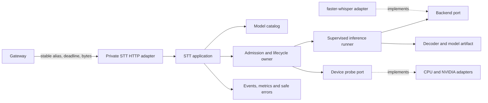
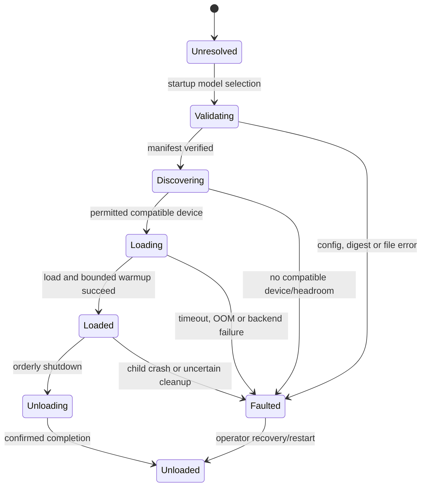
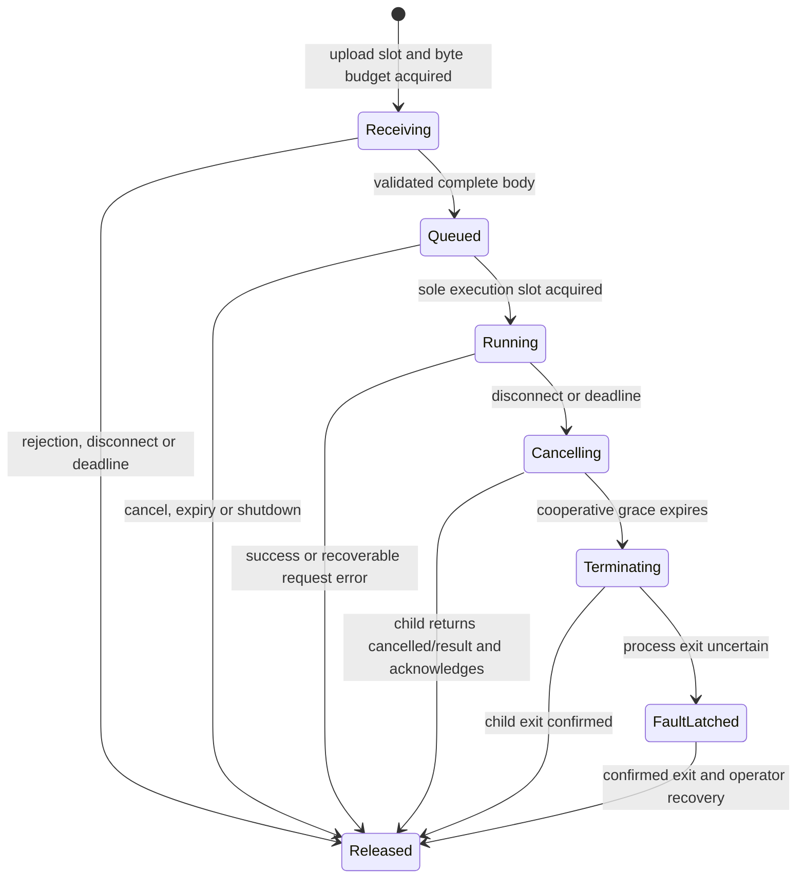

# M02 STT architecture design

Status: accepted architecture baseline. M02-A, M02-B, bounded M02-C.2b, C.3 and C.4 scopes, and M02-C.5's deterministic offline fault-handling and operator-procedure scope are PASS. M01 remains PASS and overall M02 is INCOMPLETE. C.6 deployment design is proposed; implementation and runtime validation have not started. See [M02 plan](../milestones/M02/plan.md) and ADRs [0006](../adr/0006-stt-alias-ownership.md), [0007](../adr/0007-stt-execution-lifecycle.md), [0008](../adr/0008-stt-artifacts-devices-configuration.md) and accepted [0009](../adr/0009-worker-network-reachability.md).

## Evidence and assumptions

**OBSERVED:** M01 separates Gateway, STT and TTS processes; the public API names stable platform aliases; the internal STT contract includes deadlines and cancellation intent; the initial Compose design has no public worker ports. M01 is PASS at `734e223a249988a93df668a857831db7c2a43852`. The M00 result is a user-reported observation, not an independently reproduced benchmark.

**INTERPRETATION:** M02 can prove model and backend replaceability with one real backend plus a fake. The same faster-whisper adapter can accept CPU or CUDA device selections without changing the application layer. Limiting a worker instance to one model and active job keeps resource ownership clear on a shared GPU; it does not make these permanent architecture limits.

**OBSERVED (M02-C.4, bounded scope):** the approved large-v3-turbo artifact completed one and then three sequential requests through the production STT HTTP application using CUDA device 0 and float16, without CPU fallback. See the M02 verification record for provenance, timings and sampled resource observations.

**NOT ESTABLISHED:** concurrency capacity, sustained performance, exact peak VRAM, child-specific GPU/RSS attribution, cancellation/driver release latency during CUDA inference, active GPU workload coexistence with Ollama/Dify, and persistent deployment. The bounded C.4 runs do not establish an operating envelope or production performance guarantee.

## Boundaries and data flow



Dependencies point inward to portable STT types. The composition root injects the selected adapter, device probe, catalog and runner. No application code imports backend, CUDA, NVML, filesystem deployment paths or HTTP types. TTS and STT share no inference or model dependencies.

| Boundary | Responsibility | Must not own |
|---|---|---|
| HTTP adapter | Bounded multipart parsing, internal request validation, deadline and disconnect handling, serialization | Model selection or native calls |
| Application | Resolve alias, validate effective capabilities, orchestrate job, map typed failures | Backend identifiers, filesystem layout or device enumeration |
| Catalog | Map stable aliases to immutable model identity and manifest reference | Host paths and runtime GPU state |
| Admission controller | Upload slots, byte budget, FIFO queue, expiry and one active job | Native backend queueing or other workers' resources |
| Worker lifecycle | HTTP/control process health, start, drain and stop | Model-loaded state alone |
| Model lifecycle | Validate, discover, load, ready, unload or fault one resident model | Worker process liveness |
| Device adapters | Discover CPU/GPU facts and backend compatibility | Choosing fallback policy |
| Backend adapter | Decode supported inputs, invoke engine, report effective capabilities and normalize errors | Public contract changes |
| Supervised runner | Own one child, IPC, cancellation escalation and confirmed reap | Automatic replacement after uncertain GPU cleanup |
| Observability | Safe lifecycle events, timings, capacity and resource samples | Audio, transcripts, filenames or raw native errors |

M02 has one resident model and one active inference job per worker instance. Queue depth, retained audio and upload concurrency are independently bounded. These are configurable instance policy and capacity constraints, not types or interfaces that prohibit future multiple-model scheduling.

## Portable types and ports

The following Python sketch defines proposed domain and port types; it is not production code. Model alias, logical model identity, converted artifact and device are separate values. The STT application does not receive backend options. The composition root validates the selected backend's strict option schema, constructs it with its own typed settings, and injects it. `VerifiedArtifact.root` is a filesystem handle used only at the infrastructure boundary; it is not model metadata or public contract data.

```python
from dataclasses import dataclass
from enum import StrEnum
from pathlib import Path
from typing import Protocol


@dataclass(frozen=True)
class AudioInput:
    content: bytes
    media_type: str


@dataclass(frozen=True)
class PCM:
    samples: memoryview          # read-only, interleaved float32
    sample_rate_hz: int
    channels: int


@dataclass(frozen=True)
class TranscriptionRequest:
    audio: AudioInput
    model_alias: str | None      # None selects configured default
    language: str | None         # None means automatic detection
    timestamps: bool             # segment timestamps only in M02


@dataclass(frozen=True)
class Segment:
    start_seconds: float
    end_seconds: float
    text: str


@dataclass(frozen=True)
class TranscriptionResult:
    text: str
    language: str
    segments: tuple[Segment, ...] | None


@dataclass(frozen=True)
class ModelIdentity:
    family: str
    upstream_revision: str


@dataclass(frozen=True)
class ModelSelection:
    alias: str
    identity: ModelIdentity
    artifact_ref: str


@dataclass(frozen=True)
class ArtifactIdentity:
    manifest_digest: str
    format: str


@dataclass(frozen=True)
class VerifiedArtifact:
    model_identity: ModelIdentity
    identity: ArtifactIdentity
    root: Path                  # Infrastructure handle, not model metadata.


@dataclass(frozen=True)
class ModelMetadata:
    identity: ModelIdentity
    languages: frozenset[str]
    segment_timestamps: bool
    word_timestamps: bool


@dataclass(frozen=True)
class BackendCapabilities:
    device_kinds: frozenset[str]
    automatic_language_detection: bool
    segment_timestamps: bool
    streaming: bool


@dataclass(frozen=True)
class DeviceCapabilities:
    kind: str                    # cpu, cuda, or a later registered kind
    handle: str                  # opaque internal selector
    features: frozenset[str]
    total_memory_bytes: int | None
    free_memory_bytes: int | None


@dataclass(frozen=True)
class DeviceRequirements:
    allowed_kinds: frozenset[str]
    required_features: frozenset[str]
    estimated_peak_memory_bytes: int | None


class OperationContext(Protocol):
    deadline_monotonic: float
    def cancelled(self) -> bool: ...
    def check(self) -> None: ...  # raises typed cancellation/deadline failure


class LoadedModel(Protocol):
    metadata: ModelMetadata
    def transcribe(
        self, audio: PCM, request: TranscriptionRequest, ctx: OperationContext
    ) -> TranscriptionResult: ...
    def unload(self, ctx: OperationContext) -> None: ...


class Backend(Protocol):
    def capabilities(self) -> BackendCapabilities: ...
    def requirements(self, model: ModelIdentity) -> DeviceRequirements: ...
    def load(
        self, model: ModelIdentity, artifact: VerifiedArtifact,
        device: DeviceCapabilities, ctx: OperationContext
    ) -> LoadedModel: ...


class DeviceProbe(Protocol):
    def discover(self, ctx: OperationContext) -> tuple[DeviceCapabilities, ...]: ...


class ModelCatalog(Protocol):
    def resolve(self, alias: str | None) -> ModelSelection: ...


class ArtifactStore(Protocol):
    def verify(
        self, reference: str, expected_model: ModelIdentity, ctx: OperationContext
    ) -> VerifiedArtifact: ...


@dataclass(frozen=True)
class FasterWhisperOptions:
    # Concrete settings live only in the faster-whisper adapter package.
    compute_type_by_device: dict[str, str]
    beam_size: int
    temperature: float


class FailureCode(StrEnum):
    INVALID_INPUT = "invalid_input"
    UNSUPPORTED_OPTION = "unsupported_option"
    UNKNOWN_MODEL = "unknown_model"
    INPUT_LIMIT = "input_limit"
    DECODE_FAILED = "decode_failed"
    LANGUAGE_UNDETECTED = "language_undetected"
    OVERLOADED = "overloaded"
    NOT_READY = "not_ready"
    CANCELLED = "cancelled"
    DEADLINE_EXCEEDED = "deadline_exceeded"
    DEVICE_UNAVAILABLE = "device_unavailable"
    RESOURCE_EXHAUSTED = "resource_exhausted"
    MODEL_LOAD_FAILED = "model_load_failed"
    BACKEND_FAILED = "backend_failed"
```

At composition time, the selected device and model are compared with backend requirements. Effective capabilities are the intersection of the loaded model, adapter, device and configured policy. Requests for unsupported detection or timestamps fail before inference. Streaming remains false. No public or internal OpenAPI schema includes engine names, device names, precision values, artifact paths or backend tuning fields.

## Configuration and artifacts

Portable application configuration maps aliases and declares inference policy. Deployment configuration selects local paths, container resources and visible devices. Filesystem locations are supplied only to the composition/deployment layer; artifact manifests contain normalized relative paths. Strict loaders reject missing, duplicate, unknown, incompatible and unimplemented settings. The existing M01 health-only configuration remains accepted and keeps readiness false; it does not load models. Inference configuration uses an explicit new schema version and is not silently inferred from legacy fields.

Example application config (the placeholders are intentionally incomplete and fail validation until provisioned):

```yaml
schema_version: 2
default_model: general-multilingual
backend:
  type: faster-whisper
  options:
    compute_type_by_device:
      cpu: int8
      cuda: float16
    beam_size: 1
    temperature: 0
models:
  - alias: general-multilingual
    family: whisper
    upstream_model: large-v3-turbo
    immutable_revision: "<immutable upstream revision>"
    artifacts:
      faster-whisper: primary
device_policy:
  mode: auto
  preference: [cuda, cpu]
loading:
  policy: startup
  timeout_seconds: 120
admission:
  max_active: 1
  max_queued: 2
  max_queued_audio_bytes: 52428800
  max_uploads: 2
  queue_wait_timeout_seconds: 10
limits:
  max_request_bytes: 26214400
  max_audio_duration_seconds: 120
  max_decoded_audio_bytes: 67108864
  max_result_bytes: 1048576
  max_request_timeout_seconds: 60
cancellation:
  cooperative_grace_seconds: 0.2
  process_exit_timeout_seconds: 2
recovery:
  policy: manual
shutdown:
  drain_timeout_seconds: 10
```

Example deployment config (illustrative only; values require host validation):

```yaml
schema_version: 1
http:
  listen_host: 0.0.0.0
  listen_port: 8081
artifacts:
  primary:
    directory: /models/primary
    manifest: /models/primary/manifest.json
device_access:
  cuda_device_selector: first_visible
  minimum_free_gpu_bytes_before_load: 8589934592
execution:
  cpu_threads: 4
```

Portable policy for initial `llm` is explicit CUDA with no CPU fallback. A separate CPU-only profile selects CPU, omits all NVIDIA libraries/device access, and uses CPU-compatible precision and thread settings. `auto` is for portable applications and tests; it follows a validated ordered preference and never changes device mid-request. Missing CUDA, unsupported precision or inadequate headroom makes an explicit CUDA model unready. No silent downgrade.

The memory threshold is a preflight heuristic and can race with Ollama or Dify allocations. If a backend declares a mandatory peak-memory estimate, a CUDA device with unknown free memory fails selection; insufficient reported free memory also fails. A sufficient observation is advisory only: it is neither a reservation nor a hard VRAM limit. Never evict, unload or signal another service's model. Cgroups bound CPU, host memory and processes; they do not provide a GPU allocation limit.

### Artifact manifest

The sidecar manifest is independent of the artifact mount path. Its versioned schema should require:

```yaml
manifest_version: 1
model:
  family: whisper
  repository: "<provisioned source repository>"
  revision: "<immutable source revision>"
artifact:
  format: ctranslate2-whisper
  tool: "<converter name>"
  tool_version: "<exact version>"
files:
  - path: model.bin
    size_bytes: 1
    sha256: "<64 hexadecimal characters>"
  - path: config.json
    size_bytes: 1
    sha256: "<64 hexadecimal characters>"
```

The example is schematic, not a valid provisioned manifest. Real sizes, revisions, digests and converter versions must come from provisioning; no model digest or hardware guarantee is invented here. The manifest's canonical digest is pinned in application config and resolves to an `ArtifactIdentity`. `ModelIdentity` is the logical family and source revision, independent of converted artifact format, backend and device. An alias may have distinct verified artifacts for different adapters while retaining the same logical model identity. Validate schema/version, model family, immutable revision, canonical digest, each listed size and SHA-256, duplicate entries, normalized relative paths, regular files only, and exact manifest/file-set agreement. Reject absolute paths, `..`, symlinks and path escapes. Fail before loading if any check fails. Record source provenance and conversion reproducibly. Model download/conversion is a provisioning activity; inference containers have no runtime network requirement.

The `large-v3-turbo` value identifies the intended model family only. It is not by itself an immutable model revision or artifact identity. The exact source revision, backend-converted files, conversion tool and manifest digest are unresolved until provisioned and verified.

### Dependencies and pinning

Use a checked-in resolved lock with exact versions and hashes for the worker's complete Python dependency graph. Pin the base image by an approved tag plus image digest in deployment review. Keep CUDA userspace, cuBLAS, cuDNN and CTranslate2 compatibility together in the CUDA image/profile. The CPU profile must not import NVIDIA packages. Pin and test the model conversion/provisioning tool separately from the serving image.

The historical M00 benchmark reports faster-whisper 1.2.1 and CUDA 12.8, but does not identify the exact CTranslate2 build, cuDNN library, base image digest or model artifact digest. It is historical provenance, not a reproduced environment. The separately approved M02-B CUDA dependency policy pins faster-whisper 1.2.1, CTranslate2 4.8.3, cuBLAS 12.9.2.10 and cuDNN 9.27.0.42 in the CUDA lock; CUDA NVRTC 12.9.86 is resolved transitively. The CPU lock remains independent and unchanged.

For CTranslate2 4.8.3 Python wheels, use cuDNN 9: its versioned changelog says Python wheel support for cuDNN 9 began in 4.5.0 and that cuDNN 8 is no longer supported. faster-whisper 1.2.1 likewise documents CUDA 12 and cuDNN 9 for current CTranslate2 releases. The cuDNN 8 statement in the versioned CTranslate2 4.8.3 `CONTRIBUTING.md` conflicts with that release history and is treated as stale. CTranslate2's wheel notes describe CUDA Runtime as statically linked; therefore absence of a separately loadable `libcudart.so.12` is not itself a dependency failure. These sources establish the policy, not successful STT inference on the target GPU. [CTranslate2 4.8.3 changelog](https://github.com/OpenNMT/CTranslate2/blob/v4.8.3/CHANGELOG.md), [faster-whisper 1.2.1 CUDA requirements](https://github.com/SYSTRAN/faster-whisper/blob/v1.2.1/README.md), [conflicting CTranslate2 4.8.3 wheel note](https://github.com/OpenNMT/CTranslate2/blob/v4.8.3/CONTRIBUTING.md#cuda-support-in-python-wheels).

The M02-B worker dependency graph is hash-locked separately for CPU and CUDA. It includes faster-whisper, CTranslate2, PyAV and the isolated aiohttp transport; CUDA additionally includes the pinned NVIDIA user-space packages and `nvidia-ml-py`. The CPU lock has no NVIDIA packages. aiohttp disconnect notification is not a substitute for explicit cancellation and child reaping. The NVIDIA driver remains a host/container runtime prerequisite.

Pin every direct and transitive package with hashes in a checked-in lock and validate the exact Python, CUDA, cuBLAS, cuDNN, CTranslate2, base-image and driver combination on the authorized target. Do not infer runtime compatibility from M00's incomplete provenance or library discovery alone. Pin and test the artifact converter separately from the serving image.

## Worker, model and request lifecycles

Worker control-process lifecycle is independent of model lifecycle:

```mermaid
stateDiagram-v2
    [*] --> Starting
    Starting --> Serving: HTTP/control plane started
    Starting --> Failed: invalid runtime config
    Serving --> Draining: shutdown signal
    Serving --> Serving: model fault latched; liveness remains 200
    Draining --> Stopped: child reaped and cleanup finished
    Failed --> Stopped
    Stopped --> [*]
```





`/healthz` means the worker control process can respond. `/readyz` means a model is loaded, no lifecycle fault is latched, and admission is enabled. Loading, draining, load failure, missing explicit CUDA or uncertain runner cleanup return 503. Temporary full queues return 429 and do not toggle readiness. Readiness does not prove model accuracy or future device capacity.

Job ownership and release are explicit:



The HTTP adapter limits upload bytes while streaming and does not trust multipart lengths. Acquire an upload slot before reading; enforce request size, audio duration, channels and decoded-byte limits before queueing. Queue FIFO with bounded item count, cumulative audio bytes and per-request expiry. Do not rely on a hidden CTranslate2 queue.

On client disconnect or deadline, immediately remove a queued item and release its audio and queue accounting. For active work, signal cancellation to the inference child. The adapter checks cancellation between decoder/inference checkpoints. faster-whisper's segment iterator must be consumed inside the inference operation because iteration performs work; a return from `transcribe()` alone is not completion. [faster-whisper iterator behavior](https://github.com/SYSTRAN/faster-whisper/blob/master/README.md).

Keep active-job slot, process ownership and audio accounting until the child returns a terminal response or its exit is confirmed. After cooperative grace, terminate then kill only after the configured process-exit interval. Do not start a replacement while the old PID may still own GPU allocations. If exit is uncertain, latch a worker fault, reject queued work with 503 and require manual operator recovery. The client may already have received no response after disconnect; for a live connection, return 504 only after bounded cleanup is initiated. A deadline does not promise immediate native-kernel or driver cleanup.

Shutdown disables new admission, removes queued jobs and releases their buffers, then drains the active job until the configured deadline. After that it uses the same cancel/terminate/reap sequence. Compose must not restart repeatedly after an OOM/uncertain cleanup; recovery is manual. Liveness remains separate from model readiness so the health system does not create a restart loop.

On OOM or unexpected child exit, fail the active request safely, release queued jobs, mark model faulted and stop admission. Do not retry that request, reload at a smaller precision, evict the model, flush another process's GPU state, or call Ollama/Dify. A clean, ordinary request-level decode error need not fault the loaded model. Distinguish such errors through adapter exception types, not string matching. Error responses contain stable code/message only; logs omit raw exception text when it may reveal paths or payloads.

## Contracts and error semantics

Public `/v1` remains engine/device independent. Public model aliases and fields do not change for faster-whisper. Internal STT keeps its versioned private path; it accepts the stable alias and remaining timeout budget. The STT worker resolves the alias. Gateway starts the total deadline at request receipt and subtracts time spent uploading/forwarding before sending the remaining milliseconds. The worker uses its own monotonic deadline beginning on receipt. The internal connection closing/cancelling is a cancellation request, not a guarantee that native work has stopped at that instant.

For M02 the internal behavior is: 200 result; 400 invalid or unsupported option; 404 unknown alias; 413 request or decoded-resource limit; 415 unsupported media type; 422 corrupt audio or unsupported automatic language result; 429 bounded admission rejected; 500 unexpected request-isolated failure; 503 model/device unavailable, draining or fault-latched; 504 deadline expired while connection remains usable. Client disconnect has no response requirement. Keep the existing error JSON (`code`, `message`) and avoid backend type or text in it. Use `Retry-After` only where a measured/configured retry estimate is valid.

Capabilities are per loaded model/device and can differ by adapter. M02 implements complete-file transcription and segment timestamps only if the adapter supports them; no word alignment, streaming, diarization, translation or batching. The internal `/readyz` response describes model readiness. Do not add a public route; Gateway inference routing and authentication remain M04.

## Device portability and resources

The same faster-whisper adapter accepts a `DeviceCapabilities` value and validated device-specific options. CPU mode discovers process-visible CPU facts and uses configured thread limits, without importing CUDA/NVML. CUDA mode checks visible devices, driver/runtime access, backend compute type and current free VRAM before model load. Hardware-specific queries stay behind adapters; policy decides whether discovered candidates are permitted.

For `llm`, deployment policy explicitly requests CUDA and fails closed if the device/runtime/precision/artifact is incompatible or free memory is below configured headroom. A separate CPU-only profile selects CPU and does not include NVIDIA access. A portable `auto` policy follows a configured deterministic order; it may fall back only during startup discovery, never after an OOM or mid-request. No auto policy is used in the initial `llm` deployment profile.

Start with one resident model and one active job. Queue count and bytes must account for copies during HTTP upload, queue retention, IPC and decoding. Container host-memory limit must be validated against model CPU/RSS, worst-case retained audio, decoder expansion, response buffers and process overhead. Refuse a config whose declared queue byte maximum obviously exceeds its deployment memory budget. Do not claim this calculation accurately predicts RSS; measure it.

Free VRAM checks are sampled facts, not locks. Ollama/Dify can allocate memory between sample and model load or while STT is active. One active STT job limits local concurrency only. On low headroom fail before load; on runtime OOM fault-latch and stop admission. Never control or evict Ollama/Dify. Record NVML or equivalent samples during authorized tests but do not publish device UUID as a metric label.

**OBSERVED (historical, user-reported):** M00 reports median transcription 0.666 s and RTF 0.0314 over ten warm runs for a 21.205 s Russian recording, with faster-whisper 1.2.1 and `large-v3-turbo`. Scripts/config were not recovered; no reproduction claim exists.

**NOT ESTABLISHED:** concurrency, other audio, transcript accuracy, exact peak RSS/VRAM, behavior alongside active Ollama load or production latency. M02-C.4 now provides bounded cold-readiness, sequential request and sampled-resource observations for one approved model/audio combination. These measurements do not establish capacity or guarantees.

## Failure-mode summary

| Failure | External result | State and resource action |
|---|---|---|
| Unknown alias | 404 | No load; release request bytes |
| Unsupported option/language | 400 | Fail before inference |
| Upload/decoded input exceeds configured limit | 413 | Stop reading/decoding; release buffers |
| Unsupported media type | 415 | Fail before decoder |
| Decode failure or auto language undetected | 422 | Release job; keep model loaded if adapter is healthy |
| Queue full / queue bytes exhausted | 429 | Reject promptly; no hidden wait or retry |
| Model loading or incompatible device | 503 readiness | Control process remains live; no admission |
| Deadline | 504 where writable | Cancel; retain capacity until child completion/exit |
| Client disconnect | No response | Remove queued item or cancel active child; release only on confirmed completion/exit |
| Inference OOM / uncertain child state | 503 for affected/new work | Fault-latch; no retry, eviction or auto reload; manual recovery |
| Worker shutdown | Existing requests drain, then cancel | Reject new work; reap child before claiming cleanup |

## Adapter additions later

Adding whisper.cpp requires a new backend adapter and artifact conversion/manifest support; the application, alias registry, admission, lifecycle protocol and public API stay unchanged. Capability differences are reported from the loaded model and tested against the same adapter contract suite.

A remote adapter requires an explicit network trust, credentials, egress, timeout, cancellation and data-retention decision. It may not provide local load/unload controls and cannot guarantee cancellation at the remote GPU. It must still accept portable requests/results and stable model aliases. No remote adapter or unrestricted runtime egress is part of M02.

## Tests and acceptance

GPU-free CI covers application behavior with fake backends, strict configuration and legacy compatibility, manifest validation, lifecycle transitions, bounded queues, cancellation races and child reaping. Adapter contract tests run on CPU. A small licensed, immutable model artifact can be provisioned for an offline CPU smoke test; if not available, record that check NOT ESTABLISHED rather than as passed.

GPU validation requires an explicitly authorized target-host run. Verify the exact image/library/model combination, actual CUDA inference, timestamps, free/used VRAM before/after load/request/unload, RSS, load time, latency/RTF and child termination/release after cancellation. Capture active Ollama/Dify context without changing those services. Separate memory estimates from measurements. M00 timings are not acceptance thresholds.
