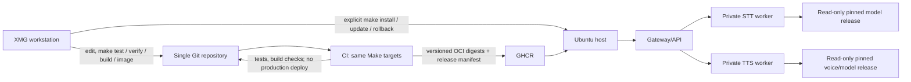

# VoiceService platform architecture and migration plan

Status: historical deployment roadmap, superseded for normal operation by [ADR 0018](../adr/0018-git-compose-product-operations.md). M01C–M01E and M01F-A/B1/B2 retain their recorded outcomes. M01F-B3.1 implementation and evidence remain preserved as optional lifecycle tooling; G0 adoption and snapshot capture are not installation prerequisites. M02-D STT v1 is PASS/complete; M03 TTS is in planning for operator review and is not implementation-authorized. The repository remains `speech-platform`; Speech Platform is the product name.

## Current operating decision

One tracked production configuration in a supported Git release and Docker Compose define normal install, operation and recovery. A clean checkout must not depend on `private/deployment/`. The host configures its model-store root, GPU, bind address and port through validated local settings. Model files remain external and read-only. Process crashes use Compose restart policies; configuration or model failures are diagnosed and repaired by checking out a known-good release and reinstalling it. Generations, snapshots, deployment histories, automatic rollback, external backup and NAS remain optional. This decision supersedes older requirements that made B1/B2/B3 lifecycle workflows mandatory for ordinary deployment; historical test/evidence records are unchanged.

The accepted M01E deployment path and legacy deployment tools remain available for their recorded scopes. They are not the new product installation interface. Do not infer that prior M01E private-config deployment is equivalent to the clean-checkout product path.

The M01C–M01G plan below is retained as historical planning and acceptance evidence. Its sequencing and requirements for private host configuration, generations, snapshots, mandatory rollback and M04-gated public routing are superseded for normal operation by ADR 0018. Do not use those old milestones as STT v1 installation prerequisites. The accepted product path includes M02-D; M03 TTS planning is tracked in [PLANS.md](../../PLANS.md) and [the M03 plan](../milestones/M03/plan.md). Optional STT lifecycle work and future text transformation remain separate.

## Executive recommendation

Keep the one-repository, one-host, Docker Compose architecture. The root `compose.yaml`, validated `.env`, and pinned Git source commit define the product deployment. Keep the working CUDA STT baseline protected, mount the verified persistent model store read-only, and use restart policies for process crashes. Build service images locally from the checked-out source and immutable base/dependency inputs; registry publication is a separate operator decision. Do not introduce an orchestrator, remote deployment controller, or separate service repositories.

Treat the currently working STT deployment as a protected reference, not as proof that the tracked Compose stack is already a reproducible installation. The successful deployment used a private standalone Compose file. `releases/stt-cuda-baseline-001.yaml` records its runtime identity and checksums; its private config and audio are ignored by Git. Preserve the running container and those private inputs until a separately approved migration has a tested rollback.

The intended shape is:



The diagram is the historical M01 target. The root `compose.yaml` is now the canonical product deployment and includes a Gateway-to-STT route, worker-backed readiness and optional bearer authentication when a non-loopback bind is configured. The TTS entry point remains health-only. The earlier direct STT smoke baseline remains protected and is not replaced by product installation.

## Repository findings

The table is a historical M01 baseline inventory. It records what existed before the M02-D STT product path and does not override ADR 0018 or claim current remote host state.

| Area | Current evidence | Design consequence |
|---|---|---|
| Source/repository | One Go/Python repository. GitHub is the approved primary host; `memphis` remains a secondary remote. The existing verification workflow has passed on GitHub Actions (M01B evidence below). | Keep GitHub canonical; do not split or rewrite history. Confirm GHCR package write access before the first approved publication. |
| Make | `test`, `verify`, `build`, `lint`, `config`, `compose-check`, governance, CUDA diagnostics and `image` exist in the accepted M01B baseline. `plan`, `install`, `update`, `status`, `logs`, `rollback` and `publish` are not part of that baseline. `build` checks Go build and Python syntax, not OCI images. | Extend one Makefile. Keep recipes short; reuse checks and Compose. |
| CI/CD | M01B runs read-only verification and local image builds for pushes/PRs. No GHCR release has been published and no deployment job is part of CI. | Preserve read-only PR verification. Add tag-triggered publication with narrowly scoped `packages: write`; do not deploy automatically from Git push. |
| Services | `cmd/gateway` and `internal/gateway` are health/readiness/metrics foundation; public API is not routed. `services/stt` is a production aiohttp application with admission, a supervised inference child, faster-whisper adapter, strict configs and tests. `services/tts/main.py` delegates to the health-only shared worker server. | Preserve STT boundaries and worker lifecycle. Implement TTS under M03 and public authenticated routing under M04; do not pretend either is available now. |
| Container definitions | Generic Compose has Gateway/STT/TTS services, internal STT/TTS networks, non-root users, read-only roots, caps dropped and limits. Its base STT is CPU/foundation-oriented with a 256 MiB default. CUDA overlay has explicit device selection and profile validation. A separate ignored private Compose file produced the successful runtime. | Do not use generic Compose defaults as the production CUDA profile. Consolidate only after the tracked deployment can reproduce the accepted baseline. Keep the worker private and do not attach STT to Ollama/Dify networks. |
| Images/dependencies | Separate CPU/CUDA locks and Dockerfiles exist. The CUDA image definition requires explicit immutable base/source/lock inputs. The existing operational STT image is local to the target and has no GHCR digest. | Publish distinct, correctly selected service/runtime images by digest. Keep the operational image and baseline available for recovery until replacement is accepted. |
| Configuration/artifacts | Strict YAML validation exists for STT app/deployment settings, artifact manifests and CUDA deployment identity. Config is split into worker, application and deployment concerns. Models are outside images and read-only. | Reuse existing schemas. A small host-level platform selection file may name release/enabled services, but service settings remain owned by existing per-service schemas. No second values source or implicit example fallback. |
| Release/evidence | `releases/stt-cuda-baseline-001.yaml` records image, model, private configuration digests, host/runtime details, successful audio results and limitations. `releases/README.md` explains its use. It is an experiment baseline, not yet a platform release manifest or installable release. | Preserve it verbatim as historical evidence. Introduce any future release descriptor separately and link it to, rather than overwrite, the baseline. |
| Operational tooling | Several validators, diagnostic launchers, resource sampling and the one-time containerd evidence collector support prior C.4/C.6 evidence. | Retain validators used by deployment and failure reporting. Keep experiment-only launchers and the `ctr` collector out of normal install/update paths; retire only after references and evidence are archived. |

### Gaps recorded in the historical M01 baseline

1. The operational success is not yet reproducible from tracked deployment inputs: the effective Compose/config files are private and only checksummed by the baseline.
2. `README.md` still contains M01-era claims that inference is unavailable and shows generic Compose `up` as if it were the current runtime procedure. That is stale relative to the recorded STT smoke test.
3. Make has no image/release lifecycle interface, while CI calls Compose directly. The canonical checks are reusable, but build/deployment commands are not unified.
4. The accepted local image identity path and target-specific containerd evidence solve a real store-identity issue, but add operator work that a repository-qualified OCI manifest digest can avoid. Do not delete them before registry-based replacement and rollback are proven.
5. `compose.yaml` combines three services for foundation use, while the CUDA overlay and private smoke Compose serve different purposes. These are not interchangeable configurations.
6. Model artifact integrity is strong, but automated fresh install/update, configuration activation, installed-state recording, and service-scoped rollback are not yet a single tested workflow.
7. The OpenAPI public contract reserves auth and STT/TTS routes, but those routes do not match current Gateway behavior. API implementation/version compatibility must precede declaring an integrated platform release.

## Target service and configuration model

Use one deployable container per independently scaled/lifecycle-managed service: Gateway, STT, and later TTS. Keep domain/backend code modular inside each service; do not split STT into another network service or add a model-serving daemon. The current supervised child remains an implementation detail inside STT because it isolates native inference faults and owns model lifecycle. It is not an extra Compose service.

Compose remains the host-local service registry and network topology. Each service has a stable name, image digest, health/readiness contract, resource policy, config mounts, artifact mounts and dependencies. Do not add a second service registry that repeats Compose. An eventual release manifest records image/model versions and compatibility; a small private host selection file may select the release, enabled services and environment-specific resource/path references. It must not duplicate backend options already in application config or resource values already in deployment config.

Configuration ownership:

- **Service application config:** portable model aliases, backend policy, admission, request bounds and lifecycle deadlines; validated by the service's existing strict schema.
- **Service deployment config:** listen address, mounted artifact roots, visible device index and host-dependent GPU admission settings; validated by its existing deployment schema.
- **Platform release descriptor:** immutable source revision and per-service image references/digests, model manifest identities, config schema compatibility, and dependencies. It contains no secrets or host paths.
- **Private host selection/config:** selected release, enabled services, host mount references, GPU UUID approval, resource review and secret-file references. Restrictive permissions; never commit values. Its canonical digest identifies exactly the configuration set used by an install.

Avoid environment-variable overrides for the same setting in multiple files. Make should resolve one explicitly selected private config and pass it consistently to validation and Compose. Public examples remain incomplete and cannot be used as fallback deployment authority.

Networking retains separate private STT and TTS networks with Gateway attached to each required network. Only Gateway may publish a host port, loopback by default. Workers publish no ports, have no Docker socket, and do not share a network with Ollama or Dify. The operator-managed STT smoke port may remain an explicitly private diagnostic exception until migration; it is not the target public topology.

GPU allocation is per worker profile and explicit. Initially only the validated STT worker uses GPU 0. The GPU is shared with Ollama/Dify at host level; a free-VRAM probe is not a reservation. Do not schedule STT and a future GPU TTS model concurrently by default. Require measured resource review and explicit policy before enabling another GPU consumer.

Health remains split: `/healthz` is process liveness; `/readyz` is service readiness based on actual usable model/provider and no fault-latched or `cleanup_unconfirmed` state. Compose health is not by itself permission to route inference. Gateway readiness must reflect configured routes and required worker readiness after M04 implements that behavior.

## Make interface proposal

One root Makefile remains the human/CI/server interface. `SERVICE` is optional: absent means all services enabled in the selected private platform configuration; present must be a known service (`gateway`, `stt`, `tts`) and limits changes to that service plus declared dependencies. Unknown values fail before Docker changes. Service selection should not be inferred from image tags or whichever containers happen to exist.

| Target | Proposed responsibility |
|---|---|
| `make test` | Unit/contract/fake tests, no containers or GPU. |
| `make verify` | Canonical formatting/lint, strict config checks, static Compose checks, tests, build checks, governance and lock integrity. It must not start persistent services. |
| `make build` | Build language artifacts from source (Go binary and Python/package validation as applicable); no Docker image publication. |
| `make image [SERVICE=…]` | Build selected local image(s) with the same Dockerfiles/arguments as CI; no push. Require source commit and locked dependency/base identities. |
| `make plan [SERVICE=…]` | Read-only resolve/validate release, config, image/model identities, and render the exact service-scoped Compose diff; no resource changes. |
| `make install [SERVICE=…]` | Stage verified immutable artifacts/config, then create/start only selected services and required dependencies. Repeated install converges without replacing already-correct instances. |
| `make update [SERVICE=…]` | Stage and verify first; replace only affected services; retain previous release state for rollback. |
| `make status [SERVICE=…]`, `make logs SERVICE=…` | Query exact VoiceService Compose project/service. Missing `SERVICE` shows all enabled services. Logs are bounded and must avoid audio/transcript data. |
| `make rollback [SERVICE=…]` | Reapply the recorded previous immutable image/model/config release for the selected scope; fail if any required prior artifact is missing. |

Planned operational forms are:

```sh
make plan
make plan SERVICE=stt
make install
make install SERVICE=stt
make install SERVICE=tts
make update
make update SERVICE=stt
make rollback
make rollback SERVICE=stt
```

Recipes remain thin wrappers around `docker compose` plus the existing validators. If installed-state journaling and atomic release selection cannot be expressed clearly with Compose/Make alone, introduce one narrowly scoped host script with tests, not a daemon or general controller. Keep that as a design decision at the install milestone. Never use whole-host `docker compose down`, broad prune, GPU reset, or `restart` of unrelated projects.

For service-specific operations, use the same validated project and configuration file set but target only named Compose services (and explicit dependencies); do not recreate or restart unrelated services. `SERVICE=stt` must never restart Gateway, TTS, Ollama or Dify unless a future, reviewed dependency contract explicitly requires it.

## Release and artifact identity

Keep the identifiers distinct:

1. Git source revision: exact application/Dockerfile source commit.
2. OCI image reference: repository-qualified immutable manifest digest, with supported platform/architecture recorded per image. A tag is a human alias only.
3. Runtime variant: explicit service variant, such as STT CPU or STT CUDA; CUDA must never resolve to the CPU image. Gateway and TTS roles must also be identified truthfully, including health-only TTS until M03 inference exists.
4. Model identity: upstream repository and pinned revision plus canonical artifact-manifest digest and per-file SHA-256 values. Keep model files outside images and Git.
5. Configuration identity: schema compatibility/version and canonical digest of the deployment-relevant config set; private secret contents and host paths are referenced privately, not copied into image/labels/logs or public release metadata.
6. Platform release identity: one versioned YAML descriptor binds per-service images, variants, models, config compatibility, dependencies and supported architectures. Reuse Compose for service definitions and existing artifact/config validators; do not duplicate a service registry. Keep `stt-cuda-baseline-001.yaml` as separate historical evidence.
7. Installed state: private host record of release descriptor digest, exact image/model/config identities, enabled services, project/service/container IDs and previous known-good release. Do not include secret values.

Publish versioned discovery tags, but install and update only by the recorded OCI manifest digest. Record CPU/CUDA variant and architecture independently of the tag. Preserve the original target-local image, archive SHA and `stt-cuda-baseline-001` until the managed STT installation passes the agreed acceptance and rollback checks. Tags can move; they never authorize deployment. Do not treat a Docker image ID, OCI config digest, manifest digest or archive checksum as interchangeable.

For models, keep content-addressed/versioned host directories, read-only mounts and manifest verification. A fresh install may fetch only files from an immutable upstream revision or a separately approved private artifact store, into a new staging directory; verify every digest before promotion. Never download at worker startup. Reuse unchanged manifest-addressed artifacts on update. Model distribution location and license/source policy remain open decisions; a local model already present does not prove future-target provisioning.

Reproducible build means the same reviewed source, base digest, dependency lock, platform and build arguments. Bit-for-bit identical image bytes require independent evidence and are not assumed. Keeping a previously built exact image digest is stronger for rollback than relying on rebuilding it identically.

## Fresh install, update and rollback

### Fresh installation

1. `make plan` validates host prerequisites, Docker/Compose support, free disk/RAM/GPU observations, selected release, exact configuration, model hashes, image availability/pull-by-digest, networks/ports and service collisions. These checks are observational and do not reserve resources.
2. Fetch the OCI image by immutable digest and required model files by pinned manifest into new versioned staging locations. Verify platform, image provenance policy, every model file hash and config-set digest before activation. A failed stage leaves the running system untouched.
3. Prepare least-privilege model-reader access and private config/secret-file permissions. Do not chmod/chown a shared or prior release broadly.
4. Render and validate Compose. Confirm project identity, service selection, GPU UUID/index relationship, non-root identity, read-only mounts, no public worker port, resource/timeouts and restart policy.
5. Start only requested services, wait separately for liveness and readiness, then run a bounded non-sensitive smoke test for the selected service. Record installed state only after success.
6. On first STT installation, report that GPU headroom is an observed gate and another process can allocate VRAM between check and load. Do not claim an admission probe reserves resources.

Fresh installation starts from no VoiceService installed-state record: validate the complete enabled service set, prepare only VoiceService-owned paths and networks, stage the selected release/config/models, then record state after acceptance. Adding a service to an existing host reads and validates the current installed state, computes the requested service's declared dependency closure, and applies only that closure. It must not reset the project, replace compatible services, or disturb unrelated Compose projects. Repeating either operation with unchanged identities is a no-op for already-correct services.

With no `SERVICE`, plan/install/update/rollback select the services enabled in the private host configuration. With `SERVICE`, select that known service plus manifest dependencies. Unknown or disabled/unavailable service names fail before downloads, directory changes, image pulls, or container actions. A Gateway or TTS installation may currently provide only its health foundation; it must not be reported as public routing or TTS inference.

### Update

1. Resolve an explicit release version or digest; no “latest” implicit deployment.
2. Download/pull and verify new image/model/config artifacts before touching the current service. Reuse a model only when its manifest identity matches exactly.
3. Compute affected services from image/config/model digests and dependency declarations. Do not touch unchanged services.
4. With one 16 GB GPU, plan an in-place STT replacement: stop old STT, verify process/container shutdown as observable, then start new STT. Do not assume old/new model coexistence or zero downtime. The API may be unavailable during model loading and health checks.
5. Require readiness plus a bounded inference smoke before marking the new release active. If unsuccessful, keep candidate evidence and invoke explicit rollback; no retry loop or automatic GPU reset.

For a selective update, compare image, runtime variant, model manifest and config compatibility identities for the requested service and its dependency closure; leave unchanged services running. Persist both the previous and candidate release identities before activation. Preserve private config and compatible model data in place; model directories are content-addressed and reused only after checksum verification.

### Rollback and failure handling

Rollback reselects the previous complete image, runtime variant, model and configuration identities for the selected service and dependency closure. The old image/model/config remain retained until the candidate is accepted. If an update fails after only some services switched, restore changed services in reverse dependency order from the recorded previous release; do not roll back untouched services. If a required prior artifact is missing or restoration fails, stop, retain the candidate and failure state, and report exact operator recovery steps rather than claiming success. Rollback has service downtime and model reload latency; with one shared GPU, stop the old STT process and establish cleanup before starting its replacement. If GPU cleanup is unconfirmed, do not start another worker. Only exact VoiceService project/service/container identities are targeted. Ollama/Dify are not dependencies and remain untouched. Persist sanitized operation reports and installed-state history outside Git; never log audio/transcripts/secrets.

## CI/CD proposal

### Existing system

The repository has a single `.github/workflows/verify.yaml` for push and pull request. It installs Go/Python dependencies, runs `make verify`, and invokes the existing Make image target. M01B records a successful hosted run. The project owner has selected GitHub and GHCR; package write permission remains to be confirmed before the first approved release.

### Minimal pipeline

- **Pull request:** checkout; install pinned toolchains; run `make verify`; run image build validation using `make image` with no push. Use CPU-only build/test on hosted runners; tests use fakes and never require GPU/model artifacts.
- **Main branch:** same checks; optional uniquely tagged development images, not production deployment. No credentials beyond read-only checkout unless publishing is explicitly enabled.
- **Versioned release tag:** after all verification and image-build jobs pass, publish Gateway, STT CPU, STT CUDA and health-only TTS image variants to GHCR from the exact tagged source. Reuse the Make image/build definitions; CUDA STT publication must explicitly select the CUDA Dockerfile, immutable base, `linux/amd64` platform and approved lock/source arguments. Capture each actual registry manifest digest, platform, source revision and workflow identity. Grant `packages: write` only to the release publication job through scoped `GITHUB_TOKEN`; PR jobs remain read-only. Pin third-party Actions by full commit SHA.
- **GPU validation:** a separate manually approved workflow/job on an explicitly managed GPU runner or the target under a separately authorized operation. It runs the bounded CUDA HTTP integration, not a production deployment. Standard hosted build runners do not imply CUDA hardware or CUDA inference capability.
- **Production host:** no CI SSH deployment in the initial design. An operator runs `make plan`, reviews it, then explicit `make install`/`update`; this avoids giving CI control of Ollama/Dify or the host Docker daemon.

Standard GitHub-hosted Linux runners can perform CPU-side Docker builds of a Linux/amd64 CUDA image: assembling a filesystem and installing pinned CUDA user-space wheels does not itself require an NVIDIA GPU. They cannot establish that CUDA kernels or the driver/runtime work. Validate image build duration and disk use because runner storage is finite. GitHub's current runner reference lists standard x64 Linux runners and describes GPU-powered managed runner options separately; the latter are not the standard runner assumption. See [runner reference](https://docs.github.com/en/actions/reference/runners/github-hosted-runners) and [publishing Docker images](https://docs.github.com/en/actions/tutorials/publish-packages/publish-docker-images). GHCR publication requires package write permission; scope that permission to the release job. See [workflow permission syntax](https://docs.github.com/en/actions/reference/workflows-and-actions/workflow-syntax).

Use build cache only as a performance optimization; cache contents never replace digest/hash verification. Avoid mutable base tags. Do not claim bit-for-bit rebuild determinism unless demonstrated. Publish immutable OCI digests and retain release metadata. A tag-triggered workflow publishes artifacts only; no Git push triggers production deployment and no CI job connects to the Ubuntu host.

## Migration sequence

The implementation order is M01C → M01D → M01E → M01F → M01G. These are proposed work packages, not started or completed milestones. M02, M03 and M04 retain their existing IDs and acceptance scopes. The canonical objectives, dependencies and evidence are listed once below.

## M01A and M01B: completed Git hosting and CI work

M01A is repository migration only; M01B is Make/CI verification and local image builds only. Their acceptance records below are historical and remain unchanged. No deployment or GHCR publication was included in either completed scope.

### M01A — Establish GitHub as the primary repository

**Status: PASS for migration of the reviewed local `main` branch only.** This does not claim that unknown Memphis-only refs were inventoried or migrated.

**Verified execution:** the local `main` was clean at `3ac06b729189209b6349ac53dbd30b53aff21e8a`. Gitleaks v8.30.1 was downloaded as a standalone binary; the official Linux x64 release archive SHA-256 was verified as `551f6fc83ea457d62a0d98237cbad105af8d557003051f41f3e7ca7b3f2470eb`. Its full-history scan of commits reachable from `main` reported one `generic-api-key` candidate at `releases/stt-cuda-baseline-001.yaml:26`; inspection confirmed the value is the `api_source_revision` Git commit identifier, not a credential. No other findings were reported. Secret values were not retained in the user-facing report.

Only `main` was pushed to GitHub, without force. The resulting remote tip is `3ac06b729189209b6349ac53dbd30b53aff21e8a`. A fresh bare clone independently resolved `main` to that exact commit, retained `master` at `ad1dd96a867628e368eb8ab15ef3df2234195213`, and passed `git fsck --full`. GitHub repository metadata confirmed private visibility, administrator permission for `azargarov`, and `main` as the default branch; `git ls-remote --symref origin HEAD` also points to `main`. Local `main` tracks `origin/main`; `origin` is GitHub and `memphis` remains the secondary remote.

**Unresolved scope limitation:** an explicit branch/tag fetch from Memphis failed because credentials were unavailable. Per the approved narrowed scope, Memphis-only refs were not migrated and this does not block M01A. The secondary remote remains configured. No GitHub `master` ref was changed, and no application, CI, container, model or server state was changed.

**Acceptance:** local `main` is published and matches GitHub `main`; full reachable history passed the Gitleaks scan apart from the verified commit-SHA false positive; independent clone integrity passed; upstream tracking and default branch are `main`; the existing GitHub `master` is preserved; Memphis remains configured. This completes M01A for the approved local-`main` migration scope. It does not start M01B or claim migration of other source-host refs.

### M01B — Make-driven verification and local image builds

**Status: PASS for this bounded scope (2026-10-18).**

**Objective:** use the same Make targets for local development and CI, and provide local image builds. Image publication and deployment are deferred. No CI job deploys to the production host.

**Scope:** preserve `make bootstrap`, `test`, `verify`, and `build`; add `make image` for all current Compose images and `make image SERVICE=...` for one image; use those same Make targets in the existing GitHub Actions workflow. The workflow runs for pushes to and pull requests targeting `main`, has `contents: read`, builds but does not publish, and pins actions by full commit SHA. `make image` reuses the Compose Dockerfiles and does not push. STT uses the CPU image definition for ordinary builds; TTS remains health-only. CUDA inference remains a separate manually approved GPU path; a successful image build is not CUDA runtime verification.

**Dependencies:** M01A accepted; canonical Git host and Make target contract reviewed. Go 1.27.2, Python 3.13.9, the existing dependency files and Ubuntu 24.04 hosted runner are selected. Standard hosted runners can assemble CPU-side Linux images without a GPU, subject to the actual workflow build result and runner disk/time limits.

**Acceptance:** local `make verify`, selected and default `make image` builds succeed; unknown image service selection fails before Docker is invoked; the workflow invokes `make bootstrap`, `make verify` and `make image` for the required `main` events with read-only permissions; the actual GitHub Actions run succeeds. This scope does not publish images or change any running STT/Ollama/Dify service.

**Observed verification:** `make verify PYTHON=.venv/bin/python`, `make image SERVICE=stt`, and `make image` passed on the workstation. The unknown-service check exited during Makefile parsing with a clear error. Workflow YAML and the required branch/permission settings were inspected. The pushed commit `5489c637d80ef1ba24cd64168cdfc2886dfc2f94` passed the hosted `foundation` job, including `make bootstrap`, `make verify`, and `make image`: [GitHub Actions run 39156033629](https://github.com/azargarov/speech-platform/actions/runs/39156033629). A bare `make verify` using the host system Python initially failed because that interpreter lacked Ruff; the repository virtualenv invocation passed. No environment dependency was installed to resolve that local interpreter difference.

## M01C-M01G: CI/CD and deployment lifecycle

M01C is **PASS; closed 2026-10-18** after controlled `v0.1.2` publication and user-reported independent XMG inspection of all three GHCR manifests. Earlier release failures remain recorded in [M01C verification](../milestones/M01C/verification.md): v0.1.0 stopped at the deprecated upload-artifact pin; v0.1.1 built images but failed to resolve them without Compose containers. Those tags remain unchanged. M01D implementation is in progress and awaits user validation; M01E–M01G remain planned only. This work does not advance M02/M03/M04 or permit automatic deployment. Model-source policy must be resolved before the dependent installation work.

### M01C — GHCR image publication

- **Objective:** publish reviewed, versioned service images after successful GitHub Actions verification and image builds.
- **Scope and deliverables:** retain CPU as the default for `make image` and `make image SERVICE=stt`; select CUDA with `VARIANT=cuda`. `make publish` defaults STT to CUDA; `VARIANT=cpu` explicitly selects CPU. Use the existing CPU/CUDA Dockerfiles and locks through tracked Compose definitions, with separate `voiceservice-stt-cpu` and `voiceservice-stt-cuda` repositories. Resolve deterministic local image names from rendered Compose configuration and inspect them directly; validate the full selection before any registry write. Ordinary read-only verification builds both CPU and CUDA variants; the tag-triggered release workflow explicitly builds and publishes CUDA STT. Record actual registry manifest digest, source commit, release version, service/runtime variant, dependency-lock SHA-256, architecture and workflow identity; inspect each pushed image by digest. Keep PR permissions read-only and scope `packages: write` to publication only. Do not deploy from CI.
- **Dependencies:** M01B; GHCR package write access; implemented CUDA build and publisher variant checks. The first release has been published under the explicitly approved `v0.1.2` tag.
- **Acceptance and verification:** make publication rejects missing/invalid version and unknown service/variant before side effects; local publication requires explicit invocation and GHCR auth; tag workflow passes syntax/permission review and publishes only after verify/build; registry digests were inspected from XMG and matched release metadata for Gateway, CUDA STT and health-only TTS, with `linux/amd64` platform and image identity recorded in the closeout evidence.
- **Exclusions:** host deployment, model transfer, Gateway inference routing, TTS inference, tag creation before explicit user approval.

### M01D — Release manifest and model artifact management

- **Objective:** define one immutable platform release contract that binds deployable images, model artifacts and compatibility without duplicating Compose service definitions.
- **Scope and deliverables:** `releases/voiceservice-v0.1.2.yaml` binds the release/source revision, immutable per-service image digests, `linux/amd64`, runtime variants, truthful capabilities, dependencies, required model manifest references and configuration compatibility. `make release-check` validates the strict versioned descriptor and referenced artifact manifest, using Compose as the service-name source. The descriptor references the existing-format manifest at `releases/artifacts/stt-large-v3-turbo.yaml`; it does not repeat the file inventory. `make model-check` verifies the local content-addressed cache; explicit `make model-fetch` downloads pinned files into staging, verifies the existing artifact contract, then atomically activates `<store>/<manifest-sha256>/{manifest.yaml,artifact/}`. Previous versions are retained. Default local storage is ignored `private/model-store/`. Model files remain outside images and Git; host permissions, private configuration and Compose lifecycle remain M01E concerns.
- **Dependencies:** M01C digests; approved Hugging Face Hub model identity and previously verified artifact manifest; existing STT artifact/config validators. The approved model revision and checksums are retained as metadata, with no model download during M01D verification.
- **Acceptance and verification:** strict validation rejects missing/mutable OCI digests, unknown Compose services/variants, mismatched model revision/manifest and unsupported config/platform declarations. Synthetic tests cover cache reuse, missing/corrupt files, size/hash mismatch, interrupted transfer and no activation or change to existing artifacts on failure. `make verify` includes release checking and these deterministic tests; model checks never run during service startup. User validation and CI are required before M01D closeout.
- **Exclusions:** image build definitions or service registry duplication, runtime model downloads at startup, replacing `stt-cuda-baseline-001.yaml`.

### M01E — Installation and deployment planning

- **Objective:** provide read-only planning and idempotent, service-scoped installation through Make and the existing Compose project.
- **Scope and deliverables:** implement `make plan [SERVICE=…]` and `make install [SERVICE=…]`. The private host config is the authority for enabled services; no `SERVICE` selects all enabled services, while a provided service selects it plus declared dependencies. Unknown or disabled services fail before side effects. Planning validates host/Engine/Compose prerequisites, release and configuration, image architecture, GPU availability/headroom as an observation, model hashes, mounts, networks, ports, resources and the exact Compose change set. Install resolves/pulls immutable digests, downloads models into staging, verifies checksums, reuses verified models, validates config, and changes only selected services and required dependencies. Document fresh installation separately from adding a service to an existing installation.
- **Dependencies:** M01D; reviewed private host configuration and filesystem/GPU policy; current Compose constraints; preserve the original CUDA STT deployment until accepted cutover.
- **Acceptance and verification:** plan is read-only; install is repeatable and leaves unchanged services untouched; unknown selection has no filesystem/network/container side effects; fresh install and selective add are rehearsed in an isolated VoiceService project; health and readiness are distinct. TTS and Gateway are reported as health-only/foundation services until M03/M04 deliver their behavior.
- **Exclusions:** updating/removing existing services, CI-to-host access, changing Ollama/Dify, replacing the live baseline before acceptance.

### M01F — Update and rollback

- **Objective:** update only affected services and restore a known prior immutable release after failure.
- **Scope and deliverables:** implement `make update [SERVICE=…]` and `make rollback [SERVICE=…]`; stage and verify release, image, model and config before stopping services; calculate changes across the selected dependency closure; retain current/previous release identity and compatible private config/data; reuse unchanged artifacts. Record operation state before activation. On partial failure, restore only changed services in reverse dependency order; if restoration fails, retain evidence and stop for explicit operator recovery. Include bounded readiness/inference checks and diagnostics. For shared GPU STT, enforce stop/cleanup before candidate start when concurrent model memory is unproven.
- **Dependencies:** M01E accepted; M01D immutable release contract; validated prior release and recovery procedure.
- **Acceptance and verification:** inject staging and post-activation failures; show no live change on staging failure; selective update leaves unrelated services untouched; rollback restores previous image/model/config identity and applicable functionality; report downtime and cleanup uncertainty; preserve original CUDA baseline recovery until migration acceptance.
- **Exclusions:** zero-downtime claims, automatic retry/rollback loops, shared GPU concurrency assumptions, model/config garbage collection before retention policy.
- **Architecture and slices:** M01F remains one canonical milestone. M01F-A finalized architecture only; M01F-B/C/D are implementation slices beneath it, not replacements for these canonical requirements. The accepted details are in [M01F-A](../milestones/M01F-A/design.md) and [ADRs 0014–0016](../adr/0014-host-local-deployment-state.md). Implementation remains separately gated. M01F-B is next: durable state, planner, approval and adoption foundation. M01F-C covers selected update and failure recording; M01F-D covers separately approved rollback and recovery rehearsal. No slice advances M01F automatically.

### M01G — End-to-end deployment validation

- **Objective:** establish the complete artifact-to-host lifecycle on the real Ubuntu target without interfering with other host services.
- **Scope and deliverables:** with separate target-operation authorization, validate fresh installation, repeated idempotent install, selective add, whole-platform and selective update, failure recovery and rollback; verify service/network isolation, resource limits, health/readiness and currently implemented inference. Exercise CUDA STT inference and model cleanup. Compare Ollama/Dify state before and after. Deliver concise operator instructions for install, update, status/diagnostics, recovery and preserved-baseline restoration. Reuse qualifying M02 evidence rather than repeat target work unnecessarily.
- **Dependencies:** M01E and M01F accepted; an immutable M01D release; target host identity, approved maintenance window and recovery plan; M02 STT runtime behavior needed for CUDA inference checks. M03/M04 are not prerequisites.
- **Acceptance and verification:** evidence covers all lifecycle cases, exact selected project/service changes, hashes/digests, dependency order, health/readiness, CUDA inference, resource bounds, rollback identity and Ollama/Dify non-interference. TTS and Gateway are judged only against capabilities implemented at validation time; do not require future inference/routing for deployment-infrastructure acceptance.
- **Exclusions:** public TTS inference, authenticated Gateway routing, broad host changes, automated deployment on Git push, claims of zero downtime or multi-host support.

### Relationship to functional milestones

M02 remains incomplete and owns STT inference behavior and its accepted bounded runtime evidence. M01E/F may use the implemented STT configuration, artifact verifier and worker without waiting for unrelated M02 closeout. M01G's CUDA inference check must reuse or coordinate with the M02 target-validation scope so the shared host is not operated twice for duplicate evidence. The existing smoke baseline alone does not prove managed installation/update/rollback. M03 owns TTS inference; M04 owns authenticated Gateway routing. Neither is a prerequisite for M01C–M01G, and publishing/installing their current health foundations must not be described as those functional milestones being delivered.

## Preserve, simplify, defer, retire

- **Preserve:** production STT app/adapter/supervisor/admission, strict configs and artifact verifier; separate CPU/CUDA lockfiles; non-root/read-only security; ADRs; M02 evidence; `releases/stt-cuda-baseline-001.yaml`; current container and its private config/audio; Ollama and Dify untouched.
- **Simplify after replacement is proven:** reduce local image-ID + evidence handoff for normal deployment in favor of registry digest; have CI call Make rather than duplicate build commands; converge deployment docs on one canonical Make workflow; keep only one current install/runbook path.
- **Keep but scope narrowly:** profile/config validators remain preflight for immutable identities and Compose; diagnostic smoke/resource tools remain explicit test paths; one-time `ctr` collector remains diagnostic only. Their complexity is justified by the local image-store discrepancy and C.4 evidence, but not in every operator install.
- **Defer:** M03 TTS inference, M04 auth/public routing, remote orchestration, multi-host scheduling, multi-model GPU service, streaming, autoscaling, zero-downtime deployment and automatic rollback.
- **Retire only with evidence:** old generic Compose/health-only configuration examples, prior private smoke deployment files, local identity tooling, and duplicate runbook sections can be archived or removed only after the new digest-based release can install, update, and rollback successfully and no accepted milestone references them.

## Open decisions

1. Confirm GHCR package ownership/write access and package retention before the first approved image publication.
2. Where are pinned model artifacts fetched on a fresh host: an upstream pinned repository revision or a private artifact store? Confirm license, availability, credentials mechanism and retention.
3. Which services and runtime variants are enabled in the private host configuration? Keep Gateway/TTS health-only unless M04/M03 functionality is implemented and accepted.
4. What least-privilege host boundary permits image pulls, restricted directory preparation, model-reader access and exact Compose lifecycle while leaving Ollama/Dify untouched?
5. What measured host headroom and maintenance window is acceptable for STT updates, given model reload downtime and shared GPU contention?
6. At M01E design review, determine whether Compose/Make can safely represent installed-state transitions or one narrow tested host script is required; do not add a controller framework.

## References

- [Working STT baseline](../../releases/stt-cuda-baseline-001.yaml) and [baseline README](../../releases/README.md)
- [Repository milestone ledger](../../PLANS.md)
- [Current architecture overview](overview.md)
- [M02 STT design and limitations](m02-stt-design.md)
- [STT deployment runbook](../operations/stt-cuda-deployment.md)
- [Public and internal API contracts](../../api/openapi/public-v1.yaml)
