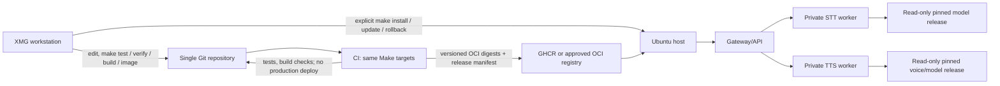

# VoiceService platform architecture and migration plan

Status: planning proposal only. No deployment, release, or repository architecture has changed as a result of this document. The repository remains `speech-platform`; VoiceService is the intended product name.

## Executive recommendation

Keep the current one-repository, one-host, Docker Compose architecture. Preserve the working CUDA STT baseline and the current non-root, read-only model, resource-limit, private-network and no-runtime-download properties. Simplify by making one Make interface call the existing checks and Compose definitions, and by replacing the experimental local-only image path with immutable OCI image digests when registry publication is approved. Do not introduce an orchestrator, remote deployment controller, or separate service repositories.

Treat the currently working STT deployment as a protected reference, not as proof that the tracked Compose stack is already a reproducible installation. The successful deployment used a private standalone Compose file. `releases/stt-cuda-baseline-001.yaml` records its runtime identity and checksums; its private config and audio are ignored by Git. Preserve the running container and those private inputs until a separately approved migration has a tested rollback.

The intended shape is:



The diagram describes the target, not current API readiness: the Go Gateway currently exposes health, readiness, metrics and a not-found fallback; public STT/TTS routing and authentication are still M04 work. The TTS entry point is a health-only process, not an inference provider. The working smoke baseline currently exposes STT directly on loopback and is not the future public Gateway path.

## Repository findings

Findings below come from the checked-out source and the baseline record. They do not establish the current remote server state beyond the recorded successful smoke test.

| Area | Current evidence | Design consequence |
|---|---|---|
| Source/repository | One Go/Python repository. The current local `origin` is `git@github.com:azargarov/speech-platform.git`; `memphis` retains `https://memphis.myftp.org/andrei/speech-platform.git`. `.github/workflows/verify.yaml` exists. The operator identifies GitHub as the approved private primary host; repository settings and workflow execution were not independently verified here. | Keep GitHub as canonical. Confirm repository access/settings and workflow execution before depending on hosted CI or package publication; do not split or rewrite history. |
| Make | `test`, `verify`, `build`, `lint`, `config`, `compose-check`, governance and CUDA diagnostic targets exist. `verify` composes checks. `image`, `install`, `update`, `status`, `logs`, `rollback` and `plan` do not exist. `build` checks Go build and Python syntax, not OCI images. | Extend one Makefile. Keep recipes short; reuse existing checks and Compose. |
| CI | One workflow runs on push and PR, bootstraps dependencies, runs `make verify`, then builds the generic Compose images. No release publication, image digest output, SBOM/provenance policy, or deployment job is present. | Keep PR checks read-only; add separately permissioned versioned publication only after registry approval. No CI-to-host deployment. |
| Services | `cmd/gateway` and `internal/gateway` are health/readiness/metrics foundation; public API is not routed. `services/stt` is a production aiohttp application with admission, a supervised inference child, faster-whisper adapter, strict configs and tests. `services/tts/main.py` delegates to the health-only shared worker server. | Preserve STT boundaries and worker lifecycle. Implement TTS under M03 and public authenticated routing under M04; do not pretend either is available now. |
| Container definitions | Generic Compose has Gateway/STT/TTS services, internal STT/TTS networks, non-root users, read-only roots, caps dropped and limits. Its base STT is CPU/foundation-oriented with a 256 MiB default. CUDA overlay has explicit device selection and profile validation. A separate ignored private Compose file produced the successful runtime. | Do not use generic Compose defaults as the production CUDA profile. Consolidate only after the tracked deployment can reproduce the accepted baseline. Keep the worker private and do not attach STT to Ollama/Dify networks. |
| Images/dependencies | Separate CPU/CUDA locks and Dockerfiles exist. CUDA image uses pinned base digest, hash-locked dependencies, source/lock labels and UID 65532; current successful target image is local and has no registry digest. | Publish a new versioned image by digest. Keep the old local image and baseline as rollback until new digest deployment is accepted. |
| Configuration/artifacts | Strict YAML validation exists for STT app/deployment settings, artifact manifests and CUDA deployment identity. Config is split into worker, application and deployment concerns. Models are outside images and read-only. | Reuse existing schemas. A small host-level platform selection file may name release/enabled services, but service settings remain owned by existing per-service schemas. No second values source or implicit example fallback. |
| Release/evidence | `releases/stt-cuda-baseline-001.yaml` records image, model, private configuration digests, host/runtime details, successful audio results and limitations. `releases/README.md` explains its use. It is an experiment baseline, not yet a platform release manifest or installable release. | Preserve it verbatim as historical evidence. Introduce any future release descriptor separately and link it to, rather than overwrite, the baseline. |
| Operational tooling | Several validators, diagnostic launchers, resource sampling and the one-time containerd evidence collector support prior C.4/C.6 evidence. | Retain validators used by deployment and failure reporting. Keep experiment-only launchers and the `ctr` collector out of normal install/update paths; retire only after references and evidence are archived. |

### Current gaps and avoidable complexity

1. The operational success is not yet reproducible from tracked deployment inputs: the effective Compose/config files are private and only checksummed by the baseline.
2. `README.md` still contains M01-era claims that inference is unavailable and shows generic Compose `up` as if it were the current runtime procedure. That is stale relative to the recorded STT smoke test.
3. Make has no image/release lifecycle interface, while CI calls Compose directly. The canonical checks are reusable, but build/deployment commands are not unified.
4. The accepted local image identity path and target-specific containerd evidence solve a real store-identity issue, but add operator work that a repository-qualified OCI manifest digest can avoid. Do not delete them before registry-based replacement and rollback are proven.
5. `compose.yaml` combines three services for foundation use, while the CUDA overlay and private smoke Compose serve different purposes. These are not interchangeable configurations.
6. Model artifact integrity is strong, but automated fresh install/update, configuration activation, installed-state recording, and service-scoped rollback are not yet a single tested workflow.
7. The OpenAPI public contract reserves auth and STT/TTS routes, but those routes do not match current Gateway behavior. API implementation/version compatibility must precede declaring an integrated platform release.

## Target service and configuration model

Use one deployable container per independently scaled/lifecycle-managed service: Gateway, STT, and later TTS. Keep domain/backend code modular inside each service; do not split STT into another network service or add a model-serving daemon. The current supervised child remains an implementation detail inside STT because it isolates native inference faults and owns model lifecycle. It is not an extra Compose service.

Compose remains the host-local service registry and network topology. Each service has a stable name, image digest, health/readiness contract, resource policy, config mounts, artifact mounts and dependencies. Do not add a second service registry that repeats Compose. An eventual release manifest records image/model versions and compatibility; a small private host selection file may select the release, enabled services and environment-specific resource/path references. It must not duplicate backend options already in application config or resource values already in deployment config.

Configuration ownership:

- **Service application config:** portable model aliases, backend policy, admission, request bounds and lifecycle deadlines; validated by the service's existing strict schema.
- **Service deployment config:** listen address, mounted artifact roots, visible device index and host-dependent GPU admission settings; validated by its existing deployment schema.
- **Platform release descriptor:** immutable source revision and per-service image references/digests, model manifest identities, config schema compatibility, and dependencies. It contains no secrets or host paths.
- **Private host selection/config:** selected release, enabled services, host mount references, GPU UUID approval, resource review and secret-file references. Restrictive permissions; never commit values. Its canonical digest identifies exactly the configuration set used by an install.

Avoid environment-variable overrides for the same setting in multiple files. Make should resolve one explicitly selected private config and pass it consistently to validation and Compose. Public examples remain incomplete and cannot be used as fallback deployment authority.

Networking retains separate private STT and TTS networks with Gateway attached to each required network. Only Gateway may publish a host port, loopback by default. Workers publish no ports, have no Docker socket, and do not share a network with Ollama or Dify. The operator-managed STT smoke port may remain an explicitly private diagnostic exception until migration; it is not the target public topology.

GPU allocation is per worker profile and explicit. Initially only the validated STT worker uses GPU 0. The GPU is shared with Ollama/Dify at host level; a free-VRAM probe is not a reservation. Do not schedule STT and a future GPU TTS model concurrently by default. Require measured resource review and explicit policy before enabling another GPU consumer.

Health remains split: `/healthz` is process liveness; `/readyz` is service readiness based on actual usable model/provider and no fault-latched or `cleanup_unconfirmed` state. Compose health is not by itself permission to route inference. Gateway readiness must reflect configured routes and required worker readiness after M04 implements that behavior.

## Make interface proposal

One root Makefile remains the human/CI/server interface. `SERVICE` is optional: absent means all services enabled in the selected private platform configuration; present must be a known service (`gateway`, `stt`, `tts`) and limits changes to that service plus declared dependencies. Unknown values fail before Docker changes. Service selection should not be inferred from image tags or whichever containers happen to exist.

| Target | Proposed responsibility |
|---|---|
| `make test` | Unit/contract/fake tests, no containers or GPU. |
| `make verify` | Canonical formatting/lint, strict config checks, static Compose checks, tests, build checks, governance and lock integrity. It must not start persistent services. |
| `make build` | Build language artifacts from source (Go binary and Python/package validation as applicable); no Docker image publication. |
| `make image [SERVICE=…]` | Build selected local image(s) with the same Dockerfiles/arguments as CI; no push. Require source commit and locked dependency/base identities. |
| `make plan [SERVICE=…]` | Read-only resolve/validate release, config, image/model identities, and render the exact service-scoped Compose diff; no resource changes. |
| `make install [SERVICE=…]` | Stage verified immutable artifacts/config, then create/start only selected services and required dependencies. Repeated install converges without replacing already-correct instances. |
| `make update [SERVICE=…]` | Stage and verify first; replace only affected services; retain previous release state for rollback. |
| `make status [SERVICE=…]`, `make logs SERVICE=…` | Query exact VoiceService Compose project/service. Missing `SERVICE` shows all enabled services. Logs are bounded and must avoid audio/transcript data. |
| `make rollback [SERVICE=…]` | Reapply the recorded previous immutable image/model/config release for the selected scope; fail if any required prior artifact is missing. |

Recipes remain thin wrappers around `docker compose` plus the existing validators. If installed-state journaling and atomic release selection cannot be expressed clearly with Compose/Make alone, introduce one narrowly scoped host script with tests, not a daemon or general controller. Keep that as a design decision at the install milestone. Never use whole-host `docker compose down`, broad prune, GPU reset, or `restart` of unrelated projects.

For service-specific operations, use the same validated project and configuration file set but target only named Compose services (and explicit dependencies); do not recreate or restart unrelated services. `SERVICE=stt` must never restart Gateway, TTS, Ollama or Dify unless a future, reviewed dependency contract explicitly requires it.

## Release and artifact identity

Keep the identifiers distinct:

1. Git source revision: exact application/Dockerfile source commit.
2. OCI image reference: repository-qualified immutable manifest digest, with platform-specific manifest recorded for `linux/amd64`. A tag is a human alias only.
3. Model identity: upstream repository/revision plus canonical artifact-manifest digest and per-file SHA-256 values.
4. Configuration identity: config schema versions and canonical digest of the deployment-relevant config set; private secret contents are mounted separately and not copied into image/labels/logs.
5. Platform release identity: a versioned YAML descriptor binds the above per service and declares service dependencies and compatibility. The current STT baseline remains a separate experiment record and is not rewritten into this format.
6. Installed state: private host record of release descriptor digest, exact image manifest digest, model release identity, active config-set digest, project/service/container IDs and previous known-good release. Do not include secrets.

Registry images should be published under immutable release tags for discovery, then deployed by digest. Preserve the original target-local image, archive SHA and `stt-cuda-baseline-001` until the first registry image is running, healthy, ready and transcribes the approved smoke fixture. Tags can move; they never authorize deployment. Do not treat an image ID, OCI config digest, manifest digest or archive checksum as interchangeable.

For models, keep content-addressed/versioned host directories, read-only mounts and manifest verification. A fresh install may fetch only files from an immutable upstream revision or a separately approved private artifact store, into a new staging directory; verify every digest before promotion. Never download at worker startup. Reuse unchanged manifest-addressed artifacts on update. Model distribution location and license/source policy remain open decisions; a local model already present does not prove future-target provisioning.

Reproducible build means the same reviewed source, base digest, dependency lock, platform and build arguments. Bit-for-bit identical image bytes require independent evidence and are not assumed. Keeping a previously built exact image digest is stronger for rollback than relying on rebuilding it identically.

## Fresh install, update and rollback

### Fresh installation

1. `make plan` validates host prerequisites, Docker/Compose support, free disk/RAM/GPU observations, selected release, exact configuration, model hashes, image availability/pull-by-digest, networks/ports and service collisions. These checks are observational and do not reserve resources.
2. Fetch the OCI image by immutable digest and required model files by pinned manifest into new versioned staging locations. Verify platform, image provenance policy, every model file hash and config-set digest before activation. A failed stage leaves the running system untouched.
3. Prepare least-privilege model-reader access and private config/secret-file permissions. Do not chmod/chown a shared or prior release broadly.
4. Render and validate Compose. Confirm project identity, service selection, GPU UUID/index relationship, non-root identity, read-only mounts, no public worker port, resource/timeouts and restart policy.
5. Start only requested services, wait separately for liveness and readiness, then run a bounded non-sensitive smoke test for the selected service. Record installed state only after success.
6. On first STT installation, report that GPU headroom is an observed gate and another process can allocate VRAM between check and load. Do not claim an admission probe reserves resources.

### Update

1. Resolve an explicit release version or digest; no “latest” implicit deployment.
2. Download/pull and verify new image/model/config artifacts before touching the current service. Reuse a model only when its manifest identity matches exactly.
3. Compute affected services from image/config/model digests and dependency declarations. Do not touch unchanged services.
4. With one 16 GB GPU, plan an in-place STT replacement: stop old STT, verify process/container shutdown as observable, then start new STT. Do not assume old/new model coexistence or zero downtime. The API may be unavailable during model loading and health checks.
5. Require readiness plus a bounded inference smoke before marking the new release active. If unsuccessful, keep candidate evidence and invoke explicit rollback; no retry loop or automatic GPU reset.

### Rollback and failure handling

Rollback reselects the previous complete image, model and configuration identities. The old image/model/config remain retained until the candidate is accepted. Rollback has service downtime and model reload latency; if GPU cleanup is unconfirmed, do not start another worker. Stop and escalate rather than claiming recovery. Only exact VoiceService project/service/container identities are targeted. Ollama/Dify are not dependencies and remain untouched. Persist sanitized operation reports and installed-state history outside Git; never log audio/transcripts/secrets.

## CI/CD proposal

### Existing system

The repository has a single `.github/workflows/verify.yaml` for push and pull request. It installs Go/Python dependencies, runs `make verify`, and invokes Docker Compose build. The current `origin` is GitHub, but a successful hosted workflow run and repository/package permissions have not been established by this review.

### Minimal pipeline

- **Pull request:** checkout; install pinned toolchains; run `make verify`; run image build validation using `make image` with no push. Use CPU-only build/test on hosted runners; tests use fakes and never require GPU/model artifacts.
- **Main branch:** same checks; optional uniquely tagged development images, not production deployment. No credentials beyond read-only checkout unless publishing is explicitly enabled.
- **Versioned release tag:** build one image per service from the tagged clean source; hash-locked dependencies and digest-pinned bases; publish to GHCR or the approved OCI registry. Capture per-platform manifest digest and source/base/lock provenance in the platform release descriptor. Use least-privilege token permissions (`contents: read`, `packages: write` only in the publish job); pin third-party Actions by full commit SHA and do not expose publish credentials to untrusted PR jobs.
- **GPU validation:** a separate manually approved workflow/job on an explicitly managed GPU runner or the target under a separately authorized operation. It runs the bounded CUDA HTTP integration, not a production deployment. Standard hosted build runners do not imply CUDA hardware or CUDA inference capability.
- **Production host:** no CI SSH deployment in the initial design. An operator runs `make plan`, reviews it, then explicit `make install`/`update`; this avoids giving CI control of Ollama/Dify or the host Docker daemon.

Standard GitHub-hosted Linux runners can perform CPU-side Docker builds of a Linux/amd64 CUDA image: assembling a filesystem and installing pinned CUDA user-space wheels does not itself require an NVIDIA GPU. They cannot establish that CUDA kernels or the driver/runtime work. Validate image build duration and disk use because runner storage is finite. GitHub's current runner reference lists standard x64 Linux runners and describes GPU-powered managed runner options separately; the latter are not the standard runner assumption. See [runner reference](https://docs.github.com/en/actions/reference/runners/github-hosted-runners) and [publishing Docker images](https://docs.github.com/en/actions/tutorials/publish-packages/publish-docker-images). GHCR publication requires package write permission; scope that permission to the release job. See [workflow permission syntax](https://docs.github.com/en/actions/reference/workflows-and-actions/workflow-syntax).

Use build cache only as a performance optimization; cache contents never replace digest/hash verification. Avoid mutable base tags. Do not claim bit-for-bit rebuild determinism unless demonstrated. Publish immutable OCI digests and retain release metadata. GHCR remains a candidate; package ownership and write permissions still require confirmation.

## Migration sequence

These are proposed work packages, not started milestones. Keep the existing `M03` TTS and `M04` public gateway/authentication boundaries; do not renumber or mark them complete. No new milestone ID is assigned here.

| Order | Objective and deliverables | Dependencies | Acceptance and verification | Recovery / exclusions |
|---|---|---|---|---|
| 1. Canonical developer interface | Align `make test`, `verify`, `build`, and new `image` behavior; document local prerequisites; ensure CI calls the same targets. Keep current verification commands as compatibility aliases during transition. | Agree on canonical tool versions and whether existing `bootstrap` remains developer-only. | Clean workstation and CI produce the same test/check outcomes; `make verify` never starts services; `make image SERVICE=stt` builds the selected image only; unknown service fails. | No deployment changes or image publication. Existing working container unaffected. |
| 2. CI and registry decision | Confirm canonical Git host; consolidate workflow; PR verification/build checks; tag-only GHCR/OCI publication; immutable digest output and release metadata. | Order 1; GitHub org/repository/registry permissions decision. | Pull-request job cannot publish or deploy; release image digest/platform/source/lock evidence is captured; no secrets exposed to PRs. Build on standard runner succeeds within disk/time envelope. | Keep current local image and baseline. No target login or production deploy. |
| 3. Minimal release/artifact contract | Define one platform release YAML and private host selection input; bind per-service image digests, model manifest identities, config schema versions, enabled services and compatibility. Define approved model source/distribution and retention. | Registry choice and service config ownership. | Strict validation; digest changes when a bound artifact/config changes; missing or ambiguous identities fail; no private values in release metadata. | Do not replace `stt-cuda-baseline-001`; no artifact download at runtime. |
| 4. STT fresh-install and status path | Add Make install/status/logs/plan for STT using existing Compose and validators; verify/reuse model and apply permanent least privilege; no direct public worker port in target Compose. | 1–3; target model access, Engine/image compatibility and reviewed resource limits. | Rehearsal on an isolated project; exact image/model/config identity; liveness + readiness + one approved inference; other project/container IDs unchanged. | Schedule an in-place cutover because GPU model overlap is unproven. Preserve baseline rollback. |
| 5. STT update and rollback | Stage candidate first; record active/previous release; update only STT; bounded health/readiness/smoke; explicit rollback to immutable prior tuple. | 4 accepted and host state recording decision. | Inject failures before replacement and during readiness; verify unchanged artifacts reused, failed candidate retained for evidence, rollback restores prior model/API. Record downtime; no zero-downtime claim. | No auto restart/rollback loops; `cleanup_unconfirmed` requires operator escalation. |
| 6. Gateway API/auth and TTS | Implement public authenticated Gateway routing (M04) and TTS inference provider/service (M03); version service contracts, release dependencies and resource ownership. | API contract/ADR review, M03/M04 approval, provider/model decisions. | Contract tests, fake-backed service tests, service-scoped container tests; later targeted TTS hardware validation. Gateway only is externally reachable; workers remain private. | Keep STT independently operable. Do not combine TTS or gateway migration with the first STT installation. |

## M01A and M01B: Git hosting and CI roadmap

These names are proposed roadmap work packages under the M01 foundation umbrella. They are not implementation status changes. M01A is repository migration only; M01B is CI/Make integration only. No application or deployment changes are part of M01A.

### M01A — Establish GitHub as the primary repository

**Objective:** make the approved private GitHub repository the primary remote without rewriting commits, dropping refs, or disturbing the working STT baseline.

**Observed state in this execution:** local branch `main` and GitHub `origin/main` both point to `bd0fa17c71bbaf79d6fbaeecedb0f2d1fb19c856`; local `origin` is `git@github.com:azargarov/speech-platform.git`, and `memphis` is the prior HTTPS remote. GitHub also advertises `master` at `ad1dd96a867628e368eb8ab15ef3df2234195213`, with `HEAD` pointing to `master`; that separate branch was fetched for inspection and not modified. Its tip is an initial commit containing `LICENSE`. Local source inventory contains one branch and no tags. GitHub read access succeeded. The operator states that the repository is private, but this session did not independently inspect repository visibility or write permissions. A Memphis fetch of branch and tag refs failed because credentials were unavailable, so its complete live ref inventory is unknown. No dedicated history-sensitive scanner (`gitleaks`, `trufflehog`, or `detect-secrets`) is installed. A bounded custom pattern sweep of 502 unique blobs reachable from locally available refs found no candidates; it does not satisfy the required dedicated scan and cannot cover Memphis-only refs. Therefore source-history/security acceptance is incomplete and M01A is not PASS.

The four files in this change set are planning/status documentation only: `PLANS.md`, `README.md`, `docs/architecture/overview.md`, and this document. They are not included in the GitHub `main` commit observed at the start of this execution. They may be recorded in a separate local documentation commit, but that commit must remain unpublished until the history and secret-scan gates are cleared. This execution does not push refs or change remote names; the remotes were already configured as requested when inspected.

**Remaining checks:** obtain an authorized read-only Memphis branch/tag inventory; run an approved history-sensitive scan over the exact refs intended for migration, covering the proposed source refs and reviewing the retained GitHub history; independently confirm GitHub visibility and the authenticated account's required write/admin permissions. The GitHub `HEAD` symref currently points to `master`; an authorized repository administrator must change the default branch to `main` after confirming `main` is ready. Review and preserve `master`. Do not delete or force-update either remote ref. Confirm that the source `main` history includes the accepted STT baseline record.

**Required GitHub settings:** private visibility; repository name `speech-platform`; set default branch to `main` after review; restrict write/admin access to intended collaborators; disable force pushes and branch deletion for the protected default branch; require pull requests and, once M01B publishes a stable check name, require that CI status check before merging. Require an approval only if an independent reviewer is available. Keep Actions token permissions read-only by default and allow only reviewed workflows/actions. Do not add deployment secrets in M01A. Secret scanning and push protection are useful where the repository plan supports them, but do not replace history inspection. GitHub notes private-repository branch-protection availability depends on plan; verify entitlements before treating rules as enforced ([protected branches](https://docs.github.com/en/repositories/configuring-branches-and-merges-in-your-repository/managing-protected-branches)). Rulesets can also block force pushes and deletions ([available rules](https://docs.github.com/en/repositories/configuring-branches-and-merges-in-your-repository/managing-rulesets/available-rules-for-rulesets)).

**Non-force publication and independent verification, only after blockers are cleared and separately approved:**

```sh
# Verify the reviewed, clean source checkout and intended refs.
git status --short
git branch --all --verbose --verbose
git tag --list
git ls-remote --heads --tags memphis
git ls-remote --heads --tags origin

# GitHub main already matches the reviewed baseline as of this execution.
# If later reviewed source refs need publication, push only those named refs,
# without force, after checking for conflicts. Do not push all refs blindly.
git push origin main

# Compare every intended local branch and tag object ID with GitHub.
git for-each-ref --format='%(refname) %(objectname)' refs/heads refs/tags | sort > /tmp/speech-platform-local-refs.txt
git ls-remote --heads --tags origin | awk '$2 !~ /\\^\\{\\}$/ {print $2, $1}' | sort > /tmp/speech-platform-github-refs.txt
while read -r ref oid; do
  remote_oid=$(awk -v ref="$ref" '$1 == ref {print $2}' /tmp/speech-platform-github-refs.txt)
  test "$remote_oid" = "$oid"
done < /tmp/speech-platform-local-refs.txt
comm -13 /tmp/speech-platform-local-refs.txt /tmp/speech-platform-github-refs.txt > /tmp/speech-platform-github-only-refs.txt
cat /tmp/speech-platform-github-only-refs.txt

# In a disposable verification directory, clone the migrated repository,
# fetch all intended refs and verify the accepted baseline commit is present.
VERIFY_DIR=$(mktemp -d)
git clone --bare git@github.com:azargarov/speech-platform.git "$VERIFY_DIR/repo.git"
git -C "$VERIFY_DIR/repo.git" cat-file -e 'bd0fa17c71bbaf79d6fbaeecedb0f2d1fb19c856^{commit}'
git -C "$VERIFY_DIR/repo.git" fsck --full
```

Do not execute publication while source inventory or scan results are incomplete. Stop on any ref conflict or mismatch. Review destination-only refs, especially `master`, without deleting them. The Memphis remote remains configured as secondary. Use unique temporary paths for ref inventories and a fresh clone; remove only those exact temporary paths after verification.

The requested remote names and upstream are already configured. Confirm them with `git remote -v` and `git branch -vv`; no local rename is required. If they are changed later, restore only the local remote names and upstream without changing remote refs.

If a future push is interrupted, compare remote refs with a recorded object-ID inventory and repeat only the same non-force push for missing, conflict-free named refs. Do not force-push, delete remote branches/tags, rebase, squash, or initialize GitHub with another README. Keep `memphis` configured as the secondary remote.

**Acceptance:** dedicated history-sensitive scanning is clean for the reviewed migration refs; complete source and destination ref inventories have been reviewed; GitHub visibility and permissions are confirmed; the intended branch/tag object IDs and history are independently verified in a fresh clone; GitHub `master` remains preserved; authorized repository settings show `main` as default; local `origin` tracks GitHub `main` and `memphis` remains secondary; no force push/history rewrite occurred; existing STT target and private configuration were untouched. At the current observed state, M01A is **not accepted** because these checks are incomplete. M01A does not include CI changes or image publication.

### M01B — Consolidate Make-driven CI and image publication

**Objective:** have local development and CI use the same Make targets, then publish versioned images only from an explicitly approved release workflow. No CI job deploys to the production host.

**Scope:** first establish `make test`, `make verify`, `make build`, and `make image` semantics; make existing GitHub workflow call those targets rather than duplicate Compose build commands; separate PR verification/build jobs from release publication. PR jobs receive read-only repository permission and no registry-publish credentials. Release-tag publication uses immutable bases and hash-locked dependencies, records source/platform/image digest and build provenance, and grants package-write permission only to the publication job. Pin third-party workflow actions to reviewed full commit SHAs. CUDA inference remains a separate manually approved GPU path; a successful image build is not CUDA runtime verification.

**Dependencies:** M01A accepted; canonical Git host and package owner chosen; Make target contract reviewed; immutable image/model release identity contract approved. Standard hosted runners are sufficient for CPU-side `linux/amd64` image assembly if disk/time are adequate, but do not provide the GPU evidence needed for CUDA inference. GitHub currently documents standard runner specifications separately from GPU-powered managed runner options; verify current availability and plan entitlement before selecting any GPU runner.

**Acceptance:** PR workflow invokes canonical Make checks and does not publish/deploy; release workflow publishes only after verification and produces repository-qualified immutable image digests plus release metadata; workflow token permissions are least-privilege; build cache does not replace digest/hash checks; the produced image can be pulled by digest in a non-production verification environment. No changes to running STT/Ollama/Dify are made by CI.

**Recovery:** failures before publication leave deployment untouched. A partial registry publication is retained under its immutable digest for diagnosis and is not selected by deployment; reruns use the same reviewed source/dependencies and do not overwrite a release digest. Host deployment remains a later explicit operator action.

Milestones 4 and 5 are operationally separate: prove fresh STT install first, then prove update and rollback. Do not use the currently running smoke container as a test sandbox. Until cutover is separately approved, it remains the working reference.

## Preserve, simplify, defer, retire

- **Preserve:** production STT app/adapter/supervisor/admission, strict configs and artifact verifier; separate CPU/CUDA lockfiles; non-root/read-only security; ADRs; M02 evidence; `releases/stt-cuda-baseline-001.yaml`; current container and its private config/audio; Ollama and Dify untouched.
- **Simplify after replacement is proven:** reduce local image-ID + evidence handoff for normal deployment in favor of registry digest; have CI call Make rather than duplicate build commands; converge deployment docs on one canonical Make workflow; keep only one current install/runbook path.
- **Keep but scope narrowly:** profile/config validators remain preflight for immutable identities and Compose; diagnostic smoke/resource tools remain explicit test paths; one-time `ctr` collector remains diagnostic only. Their complexity is justified by the local image-store discrepancy and C.4 evidence, but not in every operator install.
- **Defer:** M03 TTS inference, M04 auth/public routing, remote orchestration, multi-host scheduling, multi-model GPU service, streaming, autoscaling, zero-downtime deployment and automatic rollback.
- **Retire only with evidence:** old generic Compose/health-only configuration examples, prior private smoke deployment files, local identity tooling, and duplicate runbook sections can be archived or removed only after the new digest-based release can install, update, and rollback successfully and no accepted milestone references them.

## Open decisions

1. Confirm GitHub repository visibility, default branch and write/admin permissions through an authenticated settings view. GHCR still requires package ownership and permissions.
2. Which registry is approved (GHCR or another OCI registry), who owns package access, and what image retention/cleanup policy applies?
3. Where are pinned model artifacts fetched from on a fresh host: upstream pinned repository revision or a private object/artifact store? Confirm license, availability and access policy.
4. Which services are enabled by default? Until TTS and public Gateway are implemented, the practical initial platform remains STT-only.
5. Should the current direct loopback STT API remain a temporary diagnostic interface, or be replaced only after M04 Gateway routing is ready?
6. What system privilege boundary permits image pulls, restricted directory preparation, supplementary model-reader groups and exact Compose lifecycle while leaving Ollama/Dify untouched?
7. What measured host headroom and maintenance window is acceptable for STT updates, given model reload downtime and shared GPU contention?
8. Is installed-state journaling worth one narrowly scoped script, or can the first implementation use operator-selected immutable release files plus Compose and a protected state file?

## References

- [Working STT baseline](../../releases/stt-cuda-baseline-001.yaml) and [baseline README](../../releases/README.md)
- [Repository milestone ledger](../../PLANS.md)
- [Current architecture overview](overview.md)
- [M02 STT design and limitations](m02-stt-design.md)
- [STT deployment runbook](../operations/stt-cuda-deployment.md)
- [Public and internal API contracts](../../api/openapi/public-v1.yaml)
