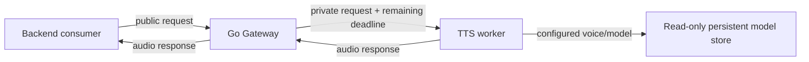

# M03 — self-hosted Text-to-Speech

Status: **M03A PASS. M03B PASS and COMPLETE (2026-10-22) for the agreed implementation and technical-validation scope after operator acceptance of all four supported mode configurations: `fast` (8 steps), `quality` (10 steps, default), `high_quality` (16 steps), and `auto` (maps to quality). Production licensing, sustained concurrent load, and significant cold-model loading latency remain open limitations; see the result.**

## Current operator direction — 2026-10-21

Private technical evaluation and candidate selection are independent from
production acceptance. The operator reports good VoxCPM2 results for English,
Russian, Swedish and mixed-language input, and selects VoxCPM2 for initial M03B
integration only. MOSS-TTS-Nano pure English is acceptable, while its Russian,
Swedish and mixed-language speech is unsatisfactory; MOSS is not selected for
initial integration. These are operator listening observations, not
independently reproduced measurements or production approval. See
[verification.md](verification.md) for measured performance, limitations,
licensing observations and evidence provenance.

## Goal and product boundary

Deliver a reliable, self-hosted TTS capability for English (`en`), Russian
(`ru`) and Swedish (`sv`) through the existing Speech Platform Gateway and
private TTS worker. Keep Speech Platform backend-only. Client applications,
consumer business logic, orchestration frameworks, model training and a new
inference service are out of scope.

M03 is separated into two gated phases:

1. **M03A — bounded model benchmark and selection.** First run a screening
   round of three representative prompts per mandatory language and one
   generation per prompt. Only candidates that pass the quality/pronunciation
   screen proceed to the detailed benchmark, which uses the comprehensive
   criteria below. Publish reproducible evidence and obtain operator review of
   one integration candidate before M03B; production acceptance remains a
   separate M03B/operator decision.
2. **M03B — service implementation.** Implement the selected provider behind
   the existing public and private API contracts, and integrate it with the
   existing Gateway, TTS Compose service and persistent model store.

The operator decisions listed here accept the M03A/M03B separation, candidate
set, mandatory languages, quality-first evaluation order, independent asset
license review, and isolation/preservation boundaries. M03A screening is
authorized under the approved procedure and the operator's revised GPU
preflight below. M03A does not authorize M03B, deployment or changes to running
services.

### M03A focused follow-up — performance and automatic language behavior

This operator-authorized follow-up reuses only the pinned VoxCPM2 and
MOSS-TTS-Nano source, dependencies, and staged weights already recorded for
M03A. It does not change production code, contracts, deployment, or running
services. Private attempt outputs stay under `private/m03a/` and are excluded
from Git.

- **VoxCPM2 performance:** compare the existing `optimize=False` baseline with
  the pinned wrapper's documented `optimize=True` (`torch.compile`) option.
  Keep the same neutral voice description, fixed text, seed, BF16 checkpoint
  precision, generation parameters, and device. Record cold model load,
  compile/warm-up time, excluded warm-up, measured warm generations, RTF, audio
  duration/format, peak GPU allocation/use, process peak RSS and cgroup peak.
  Do not alter generation limits or audio speed/pitch. Keep at most these two
  configurations.
- **Language behavior:** inspect pinned interfaces, then send normal, short
  ambiguous, and foreign-name/borrowed-word text for English, Russian, and
  Swedish to each model without a language field or language-revealing
  instruction. Use MOSS text-only `continuation`. Add only a small number of
  mixed-language diagnostic inputs. Record native detected codes only if an
  API actually returns them; human listening remains pending and no automatic
  quality score is allowed.
- **Isolation and stop conditions:** use a disposable network-disabled
  container, existing artifact mounts, private temporary output, and the
  existing GPU monitor. Abort only the candidate on STT activity, canonical
  service health/restart change, unexpected GPU process, monitoring failure,
  or less than 1 GiB free VRAM. Never stop/reconfigure a canonical service.

Acceptance for this follow-up is reproducible observed measurements and samples
plus a per-input language evidence table. Faster performance is not an
improvement claim until the operator listens for pronunciation, words, and
naturalness. The later operator decision selected VoxCPM2 for initial M03B
integration; this is not production acceptance.

## Current state and affected boundaries

- `services/tts/main.py` delegates to the shared health-only worker server;
  there is no synthesis handler, model provider or voice catalogue.
- `api/openapi/public-v1.yaml` reserves `POST /v1/tts/speech` and
  `GET /v1/tts/voices`. Speech requests require text and a stable voice ID,
  accept a language tag or `auto`, and reserve WAV, MP3 and Ogg/Opus complete
  audio responses. `stream` is currently fixed to false. These routes are not
  implemented by the Gateway today.
- `api/openapi/internal-tts-v1.yaml` reserves the private worker speech route,
  health/readiness, timeout propagation, and cancellation on connection close.
  It explicitly forbids runtime model downloads.
- `deployments/compose/compose.yaml` already defines Gateway, STT and TTS as
  separate services. The Gateway is attached to `tts_private`; TTS is attached
  only to `tts_private`, has no host port, and runs non-root with read-only root
  filesystem and dropped capabilities. Current TTS defaults (256 MiB and 1
  CPU) are health-only values and cannot be treated as inference limits.
- `configs/tts.yaml` currently configures only listener and polling behavior.
  The service deployment example has small health-only TTS resource limits.
  Neither is a model/runtime profile.
- The Go Gateway already owns request validation, auth middleware, forwarding
  for STT and health/readiness foundations. Reuse those patterns where
  appropriate; keep TTS-specific model lifecycle and synthesis in TTS.

## Responsibilities and proposed data flow

- **Gateway:** public authentication using existing configured policy;
  strict JSON/request validation; request and text limits; stable public voice
  IDs; deadlines and disconnect propagation; private-worker forwarding;
  consistent errors; response media types; readiness dependency reporting.
- **TTS worker:** voice/language capability validation; provider-neutral
  synthesis boundary; model loading/readiness, bounded admission and inference;
  generated-audio format conversion; cancellation/deadline handling; safe
  diagnostics and model lifecycle. It never calls STT.
- **Compose/deployment config:** separate TTS resource/device limits, explicit
  selected GPU or CPU profile, private networking, read-only pinned model
  artifacts and runtime identity. STT and TTS remain separate workers.
- **Model store:** provision immutable, digest-verified assets before runtime;
  mount read-only. Runtime has no outbound model-fetch path. Generated audio
  and request text are transient and are not logged or retained by default.

### Failure and resource policy

Provider load failure leaves process liveness distinct from model readiness.
Invalid voice/language/format returns a stable client error; queue saturation
returns overload; deadline and disconnect stop waiting and request worker
cancellation; provider errors become fixed safe errors. Admission remains held
until synthesis has finished or the worker has safely recovered. Bound input
text, generated audio bytes/duration, active requests, queue depth and temporary
storage before implementation. Do not claim immediate native-kernel/GPU
cleanup from HTTP cancellation alone.

The Quadro RTX 5000 has 16 GB VRAM and is shared with the existing STT CUDA
worker and other host GPU workloads. A memory probe is only an observation,
not a reservation. Initial GPU and CPU experiments use an isolated,
attempt-specific environment and must not attach to, restart, stop, or reconfigure
the running STT deployment. M03A GPU evaluation used a fresh process/device
preflight and stop-on-contention rule. M03B now includes the operator-requested
bounded STT/TTS coexistence test; that test does not establish general capacity
or throughput. Do not change the canonical deployment during M03A; the current
M03B task separately authorizes implementation and its scoped live validation.

## Candidate comparison (research snapshot: 2026-10-21)

Quality and target-host speed remain **NOT ESTABLISHED** until M03A. Public
model claims below are vendor/model-card data, not independent results.

| Candidate | Language coverage and quality fit | License and asset footprint | Inference / RTX 5000 fit | Benchmark role and caveats |
|---|---|---|---|---|
| [VoxCPM2](https://github.com/OpenBMB/VoxCPM/) | Officially lists all three target languages; voice design, controllable voice cloning, expressive 48 kHz output. Vendor describes it as natural/high-quality. | Apache-2.0 for code and weights; 2B parameters. | Official project lists Python 3.10–<3.13, PyTorch >=2.5, CUDA >=12; reports ~8 GB VRAM and RTF ~0.3 on RTX 4090. It may fit alone in 16 GB, but sharing with STT makes concurrent use unsafe until measured. The current shared worker image uses Python 3.13, so validate a dedicated TTS image/runtime. | **Quality leader candidate.** Benchmark one fixed voice-design profile per language. Standard Python inference is simpler than adopting vLLM; do not add the separate serving framework. Treat 4090 timing/VRAM as claims only. |
| [MOSS-TTS-Nano](https://github.com/OpenMOSS/MOSS-TTS-Nano) and [official weights](https://huggingface.co/OpenMOSS-Team/MOSS-TTS-Nano-100M) | Official list includes English, Russian and Swedish among 20 languages; supports short-reference voice cloning and 48 kHz stereo. Claimed quality is “good enough” for real-time products; independent quality is unknown. | Official weights declare Apache-2.0; about 100M parameters and 238 MB model repository. Verify separate audio-tokenizer weights, code/assets and notices before adoption. | Claims CPU real-time generation on a 4-core CPU; ONNX CPU path and optional CUDA path. This is attractive for avoiding GPU contention. Python dependency and voice-reference requirements need validation. | **Small multilingual candidate.** Benchmark CPU first. Use the same consented fixed reference recordings for all languages if the M03 voice policy accepts reference-conditioned voices; otherwise assess a fixed non-cloning flow. Do not expose arbitrary voice cloning without a separate privacy/safety decision. |
| [Piper](https://github.com/OHF-Voice/piper1-gpl) with per-language voices from [piper-voices](https://huggingface.co/rhasspy/piper-voices) | English, Russian and Swedish have separate listed voice models, mostly marked “medium” quality, rather than one shared multilingual voice. Voice selection is broad; expected naturalness may trail newer generative models. | Current Piper engine uses GPL-3.0. Voice licenses vary by exact voice/dataset; review each model card. Individual ONNX voices are small relative to generative LLM-based candidates; pin exact revisions and checksums. | ONNX Runtime CPU, designed for local/fast inference; GPU is unnecessary and it does not compete for VRAM. Target CPU latency still needs measurement. | **Low-complexity CPU baseline/fallback.** Benchmark one permissively licensed, reviewed voice per language. The older `rhasspy/piper` repository is archived; use the maintained successor only after code/runtime and license review. |

### Screened alternatives

- **Coqui XTTS-v2:** 17 languages include English and Russian but not Swedish;
  repository weights are about 2.08 GB and use the Coqui Public Model License,
  which is non-commercial. It does not meet all-language coverage and has a
  restrictive model license for general product use. Do not include in the
  primary benchmark.
- **Meta MMS-TTS:** per-language VITS checkpoints exist for English, Russian
  and Swedish (about 36.3M parameters / 145 MB safetensors per checkpoint),
  but the model license is CC BY-NC 4.0. It can be reconsidered only if the
  operator confirms non-commercial evaluation/use is acceptable; it is not a
  production recommendation under this plan.
- **MOSS-TTS flagship:** 8B parameters, versus the Nano variant at 0.1B. The
  larger model adds unjustified GPU pressure for this shared 16 GB host and is
  not shortlisted.

Repository/software licenses, model-weight licenses, and per-voice/dataset
licenses and rights are separate reviews. M03A must independently capture the
exact code and weight revisions, license texts, voice/dataset cards, dependency
license inventory, hashes and usage/redistribution review. A repository
license does not establish the model weights or voice rights.
No candidate is cleared for operational use by this comparison alone. Review
weight serialization and executable model code before loading. In particular,
MOSS-Nano's documented Transformers load path enables remote code; pin and
review that exact code revision or reject that path. The benchmark runtime must
be offline after explicitly authorized provisioning, with no secrets or
untrusted writable paths mounted.

### Independent candidate gates (operator decision, 2026-10-21)

Each candidate has independent **licensing**, **provisioning**, and
**execution** gates. Record each gate separately in the attempt evidence as
`APPROVED`, `BLOCKED`, or `FAILED`, with evidence and timestamp. A candidate
with an unresolved gate is `BLOCKED`, not rejected; candidates whose gates are
approved may proceed without waiting for blocked candidates. Do not propagate
one candidate's block to another candidate.

The license review covers source code, direct and transitive runtime
dependencies, model weights, voice checkpoints, reference audio, and any
applicable training-dataset or redistribution terms. Identify exact upstream
revisions and link the upstream license, notice, model card, dataset terms, or
maintainer statement supporting each conclusion. Record absent, ambiguous,
and conflicting evidence as such. Neither repository-level metadata nor a
model-card label overrides an individual checkpoint, dataset, dependency, or
asset term. Uncertain or conflicting terms are not permission. Do not
provision or execute a candidate until its own gates clear. A candidate-specific
legal or safety blocker does not stop other independently approved candidates.

## M03A — benchmark proposal

### Scope and reproducibility

1. Before any download, the operator approves the candidate set, maintenance
   window, corpus/voice rights, target deployment isolation and storage path.
   Keep benchmark assets and recordings under root `private/`; never commit
   audio or transcripts that identify people.
2. Record workstation/target identity, OS/kernel, NVIDIA driver, GPU model and
   UUID, CUDA/runtime versions, Python/dependency lock, CPU/RAM, GPU processes,
   Compose/project identity, candidate source revisions, weight revisions and
   SHA-256 manifests. Fetch artifacts only through a separately authorized,
   checksum-verified provisioning step. Disable runtime network access.
3. **Screening round:** prepare three fixed, representative prompts for each
   mandatory language (English, Russian and Swedish), covering a short phrase,
   a normal sentence with punctuation/numbers or a name, and a longer sentence.
   Freeze the nine texts and normalization notes before synthesis. Generate each
   prompt once per candidate: nine outputs per candidate and 27 outputs total
   if all three candidates are screened. No warm-up generation or repeats are
   part of screening.
4. Pin one candidate voice configuration per language before screening. For
   reference-voice
   candidates, use identical consented references and disclose that those
   models receive reference audio; voice cloning is not automatically part of
   the product contract.
5. Review the randomized candidate outputs for intelligibility, correct
   language, pronunciation, omissions and basic naturalness before recording
   screening judgments and descriptive timing/resource observations. Record
   model-load duration, generation wall duration, output duration, RTF where
   measurable, CPU/RAM/GPU use, and failures. These one-shot measurements do
   not establish latency percentiles or capacity. Screening pass/fail is
   recorded for each language;
   any missing/incorrect language, unintelligible output, or recurring severe
   pronunciation/omission issue fails the candidate. A candidate must pass all
   three languages to advance. Keep all audio and reference recordings under
   root `private/`.
6. Only passing candidates proceed to the **detailed benchmark**. Use the
   existing comprehensive evaluation criteria below: 12 prompts per language,
   one excluded warm-up, three measured generations per prompt where supported,
   cold-load and warm-latency separation, resource/reliability measures and
   proposed per-language quality/performance gates. Do not optimize performance
   before quality and pronunciation are evaluated.
7. Run CPU candidates without requesting CUDA. Run any CUDA candidate only in
   the isolated experiment and separately approved maintenance window after
   GPU process/device preflight confirms no STT or other protected inference.
   If that condition cannot be met, record CUDA results as NOT ESTABLISHED and
   continue only an independently isolated CPU evaluation. CPU-only candidates
   may proceed without waiting for a GPU candidate.

### Measures and provisional gates

- Human evaluation: randomized, blinded audio; at least three native/near-
  native listeners per language; 1–5 ratings for naturalness and intelligibility,
  plus a pronunciation-error checklist. Proposed gate: median >=4/5 in each
  language, no recurring severe pronunciation/omission issue in the fixed
  prompts. Report per-language distributions and rater counts, not one pooled
  score.
- Runtime: cold process-to-ready time; warm synthesis p50/p95 and real-time
  factor (wall time / output duration); output duration and first-audio time
  only if the candidate streams. Proposed performance gate: warm p95 RTF <=1.0
  for each language on the chosen deployment profile. This is a review target,
  not a prior performance claim.
- Resource use: process/container peak RSS, cgroup memory, CPU, GPU allocated
  and observed peak memory, GPU utilization, generated output bytes, and all
  other running GPU processes before/after. Record sampling intervals and
  attribution limits. No VRAM threshold may be inferred from free-memory
  snapshots alone.
- Reliability: all 36 cases produce decodable, finite, non-empty audio with
  the declared sample rate/format; fixed-seed repeat checks are reported;
  provider startup, malformed input, maximum text, cancellation/deadline,
  overload and shutdown cases are exercised in an isolated benchmark harness.
- Licensing/operations: all languages use reviewed assets; cold start and
  artifact sizes fit the reviewed storage/startup budget; offline startup
  succeeds; exact model/provider identity is reproducible from recorded
  revisions and hashes.

If no candidate clears both per-language quality and operational/resource
gates, report no selection and propose a follow-up research scope. M03A must
not make a production selection by averaging away a weak language.

## M03B — implementation boundaries and acceptance proposal

**Authorization:** The operator's 2026-10-21 instruction authorizes M03A
closeout and M03B implementation using VoxCPM2 as the selected initial
integration candidate. This supersedes earlier M03A-era statements that M03B
was unauthorized. It does not authorize a production-readiness claim, commit,
push, release tag, or milestone closeout. The operator separately requires
live RTX 5000 validation and will validate M03B before completion.

### M03B minimal implementation plan

1. Preserve the existing Go Gateway, Python TTS worker, canonical Compose
   service and model-store mount convention. Add the public speech route to
   Gateway and the private route to the existing worker.
2. Make the public request `{text, language?, mode?}` with strict size and
   enum validation. Default `language=auto`, `mode=quality`; return complete
   WAV PCM16. Explicit language values are instruction hints, never detected
   codes. `auto` passes multilingual text through without language metadata.
3. Keep `quality` as the 10-step default. Enable `fast` at 8 steps after
   operator acceptance. `auto` continues to select quality.
4. Add a small worker-owned lazy model lifecycle: explicit warm-up; loaded state;
   one serialized GPU inference; configurable idle unload; active inference
   prevents unload. A disconnected client does not kill native inference.
5. Pin runtime dependencies and immutable model identity, require a read-only
   local artifact mount and offline runtime. Keep strict config, private worker
   network, non-root execution, health probes, bounded shutdown and safe
   resource-exhaustion errors. Do not change STT's service or deployment.
6. Add focused API, mode, language hint, lifecycle, cancellation, recovery and
   Gateway/worker tests; run the repository verification targets.
7. Perform the requested live GPU/deployment checks only after artifacts are
   reviewable. Record unavailable or blocked checks; stop before milestone
   completion until operator validation and explicit closeout.

Material design: reuse the existing service boundary and Compose service;
worker owns model lifecycle, Gateway owns authentication/validation/routing.
No new scheduler is introduced. Resource-free-memory checks are advisory and
cannot guarantee shared-GPU coexistence. See [ADR 0020](../../adr/0020-voxcpm2-tts-integration.md).

### In scope

- Contract-first update of the reserved public and internal TTS OpenAPI
  contracts. Accept `text`, optional language/mode and the optional default
  compatibility voice; return complete WAV PCM16. Reuse Gateway auth and
  common errors.
- Gateway handlers for `POST /v1/tts/speech` and `GET /v1/tts/voices`, with
  bounded JSON/text, deadlines, disconnect propagation, worker readiness and
  response format handling. No provider identifiers or parameters leak into
  public IDs.
- A separate TTS worker implementation with strict app/deployment config, one
  small provider adapter for the M03A-selected model, configured voice/language
  aliases, bounded serialized admission, model lifecycle and truthful health /
  readiness. Keep STT and TTS independent.
- TTS-specific pinned dependencies/image variant as required by the selected
  model; validated model-store path/digest, read-only artifact mount, no
  runtime downloads and configurable CPU/RAM/PID/GPU selection.
- WAV PCM16 response. MP3 and Ogg/Opus are implemented only if the selected
  encoder has a reviewed dependency/license and bounded resource cost; the
  existing reserved API contract must be reconciled before implementation is
  authorized. Streaming remains unavailable (`stream: false`).
- Privacy-safe logs/metrics, in-memory response handling where practical,
  bounded temporary-file handling with explicit cleanup otherwise, and
  operator docs/runbook.

### Out of scope

- Client apps, voice dictation/business logic, text rewriting/translation,
  STT-to-TTS calls, model fine-tuning/training, user-uploaded voice prompts or
  arbitrary voice cloning, multi-model serving, dynamic batching frameworks,
  orchestration, public model download endpoints, streaming, multi-host
  scheduling and automatic GPU arbitration.
- General GPU scheduling, capacity guarantees and performance claims. M03B
  includes only the bounded, operator-requested TTS/STT coexistence test; do
  not modify STT configuration or unrelated GPU services.

### Proposed M03B acceptance criteria

1. One reviewed model/voice set supports all three languages; blind quality
   gates and target resource profile from M03A are met in a controlled runtime
   validation.
2. Existing public and worker OpenAPI specs validate; Gateway route tests and
   worker tests cover schemas, languages/voices, formats, size/duration limits,
   readiness, overload, provider errors, deadline/disconnect cancellation and
   cleanup. Real API behavior matches the validated contracts.
3. TTS runs only in its existing private worker container/network, with
   non-root identity, no host-published worker port, read-only model/config
   mounts, immutable model identity, no runtime downloads, and strict
   validated config. No TTS/STT dependency or network path is added.
4. Gateway readiness reflects the required TTS route/provider state without
   turning process liveness into model readiness. Failures remain isolated
   from STT and other services.
5. Default logs contain no request text, generated audio, voice prompts,
   credentials or private paths. Generated artifacts are transient and
   cleanup is verified.
6. A bounded target runtime rehearsal verifies all three languages, API error
   behavior, cancellation, service health/readiness, resource usage and
   existing-service preservation. GPU use occurs only under an approved
   exclusive/serialized schedule; observed outcomes do not imply capacity.
7. Verification records exact commands, dependency/model identities, target
   and local evidence provenance, failures and limits. Operator validation and
   explicit closeout approval are required before M03 PASS.

## Accepted operator decisions and remaining execution gate

- Accepted: M03A evaluation and M03B implementation are separate phases.
- Accepted candidates: VoxCPM2, MOSS-TTS-Nano and Piper.
- Accepted mandatory languages: English, Russian and Swedish.
- Accepted two-round M03A structure: screening as defined above, then the
  existing comprehensive detailed benchmark for screening passers only.
- Accepted evaluation order: assess voice quality and pronunciation before
  performance optimization or performance-based selection.
- Accepted: verify model-weight and voice/dataset licenses independently from
  repository/software licenses.
- Accepted isolation boundary: initial GPU and CPU experiments run isolated
  from the running STT deployment; GPU use remains serialized after a fresh
  operator-approved idle-window check.
- Accepted exclusion: M03B is not implemented and canonical deployment is not
  modified during M03A.
- Approved for M03A execution: the screening procedure, private artifact
  storage, and hardware/resource proposal in this brief, as revised by the
  operator clarification. Prompt text and exact pinned revisions/hashes are
  frozen in the private attempt record before provisioning. Each candidate has
  independent licensing, provisioning and execution gates. Mark unresolved
  candidates BLOCKED, not rejected; proceed with any other candidate whose
  gates are approved. Unclear terms block that candidate only.

## M03A screening approval brief

This is the approved M03A procedure, incorporating the operator's GPU
preflight clarification of 2026-10-21.

### Screening procedure

1. Approve three prompts per language (nine total), with approved text and
   normalization notes covering a short phrase, ordinary punctuated text with
   a number/name, and a longer sentence. Freeze text before generation.
2. Independently review candidate source code, dependencies, model weights,
   voice checkpoints, reference audio, and applicable dataset/redistribution
   terms. Record exact revisions, upstream evidence links, notices, and
   SHA-256 values. Uncertain or conflicting terms are not permission. Do not
   provision an asset whose terms remain unclear.
3. Stage only approved artifacts and the isolated candidate runtime under
   `private/m03a/<attempt-id>/models/{voxcpm2,moss-tts-nano,piper}/`. Keep the
   frozen prompt manifest under `private/m03a/<attempt-id>/inputs/`, generated
   waveforms under `private/m03a/<attempt-id>/outputs/`, and notes/scores under
   `private/m03a/<attempt-id>/results/`. Do not use the canonical deployment's
   model store or runtime container.
4. Record host/OS, CPU/RAM, GPU UUID and processes, driver/runtime, candidate
   revisions and checksums, isolated environment identity, and free storage.
   For GPU use, GPU-idle means no active STT inference; a resident STT model
   and its allocated memory are permitted. At preflight require at least 8
   GiB free VRAM before loading VoxCPM2. Record STT process state, GPU
   utilization and memory, and canonical service health. During GPU testing,
   monitor STT activity, GPU utilization, free memory and service health. Run
   generations sequentially and stop if STT inference begins, resource
   contention appears, or service health deteriorates. Never kill, restart,
   unload or modify canonical STT to free resources.
5. For each candidate, set and record one voice configuration per language;
   use only approved fixed reference audio when required by the model. Make
   exactly one generation for each of the nine prompts, sequentially. Screening
   produces up to nine outputs per approved candidate, without warm-up, reruns
   or performance tuning. Record model-load time, generation duration, audio
   duration, RTF where measurable, resource consumption and failures. Never
   silently retry a failure.
6. Randomize/blind candidate identity for listening. A qualified listener for
   each language records pass/fail for intelligibility, language correctness,
   pronunciation, omissions and basic naturalness. Keep per-language results.
   A candidate passes only if it passes all three languages; a failed candidate
   does not enter the detailed benchmark.
7. Delete temporary generated files when the approved review period ends;
   retain only the approved private evidence needed for reproducibility. No
   private audio, prompts, or transcripts enter Git or structured logs.

### Artifact sizes and storage request

Sizes below are historical repository-reported estimates, not downloaded or
locally verified sizes. Each candidate's exact revisions, terms and hashes
must be rechecked before acquisition.

| Candidate | Screening weights / voice files | Approximate total |
| --- | --- | ---: |
| VoxCPM2 | [`openbmb/VoxCPM2`](https://huggingface.co/openbmb/VoxCPM2/tree/main): 4.96 GB repository total, including 4.58 GB `model.safetensors` and 377 MB `audiovae.pth` | 4.96 GB |
| MOSS-TTS-Nano | [`MOSS-TTS-Nano-100M`](https://huggingface.co/OpenMOSS-Team/MOSS-TTS-Nano-100M/tree/main): 238 MB; separate [`MOSS-Audio-Tokenizer-Nano`](https://huggingface.co/OpenMOSS-Team/MOSS-Audio-Tokenizer-Nano): about 88 MB | about 326 MB |
| Piper | Three medium ONNX voices: English [`en_US-ryan`](https://huggingface.co/rhasspy/piper-voices/tree/main/en/en_US/ryan/medium) 63.2 MB, Russian [`ru_RU-irina`](https://huggingface.co/rhasspy/piper-voices/tree/main/ru/ru_RU/irina/medium) 63.2 MB, Swedish [`sv_SE-nst`](https://huggingface.co/rhasspy/piper-voices/tree/main/sv/sv_SE/nst/medium) 63.1 MB; small JSON configs | about 190 MB |
| **All candidates** | Model/voice artifacts only | **about 5.48 GB** |

Request at least **20 GB free** for these artifacts, temporary download/cache
copies, isolated runtimes and benchmark outputs. This is a planning reserve,
not a measurement of actual dependency/image sizes. Store attempt data only in
the private path above, on a filesystem with restrictive access and a reviewed
cleanup policy. Never point the experiment at the canonical persistent model
store. The three Piper voice files were used only to estimate footprint; their
exact revision and voice terms remain to be approved independently.

### Hardware proposal

- CPU-only screening for MOSS-TTS-Nano and Piper: reserve at least four CPU
  cores and 16 GiB RAM for the isolated process/environment; 32 GiB RAM is the
  preferred headroom if dependencies and generated artifacts share the host.
  MOSS vendor documentation describes CPU inference on four cores, but does
  not establish this host's performance.
- VoxCPM2 GPU screening: the vendor reports about 8 GB VRAM; this estimate is
  unverified. The host's Quadro RTX 5000 has 16 GB VRAM. A resident canonical
  STT model is allowed, but no active STT inference is allowed during TTS GPU
  generations. Require at least 8 GiB free device memory before loading
  VoxCPM2. Monitor STT activity, GPU utilization/free memory, and canonical
  service health throughout; stop on inference, contention, or health
  degradation. Do not kill, unload, restart or modify STT. Free VRAM is a
  point-in-time admission check, not a reservation or guarantee.
- Host context in the architecture record is 64 GB RAM and a 16 GB Quadro RTX
  5000. Reconfirm current hardware and GPU/process state immediately before
  any authorized run. No hardware request authorizes changing or stopping the
  running STT service.
- Current upstream size pages were inspected on 2026-10-21. Repository totals
  may change until exact commits are pinned; the 20 GB allocation includes
  deliberate headroom and must be checked against the selected isolated host.
- Screening evaluates quality and pronunciation. It does not produce an RTF,
  latency, capacity or deployment suitability claim. Those measurements are
  reserved for the detailed benchmark after quality screening.

## Research references

- [VoxCPM2 official repository](https://github.com/OpenBMB/VoxCPM/) and
  [technical report](https://arxiv.org/abs/2606.06928).
- [MOSS-TTS-Nano official repository](https://github.com/OpenMOSS/MOSS-TTS-Nano),
  [official weights](https://huggingface.co/OpenMOSS-Team/MOSS-TTS-Nano-100M),
  and [MOSI model page](https://www.mosi.cn/en/models/moss-tts-nano).
- [Maintained Piper engine](https://github.com/OHF-Voice/piper1-gpl),
  [voice catalogue](https://github.com/rhasspy/piper-voices), and
  [voice license guidance](https://github.com/rhasspy/piper/blob/master/VOICES.md).
- [XTTS-v2 model card](https://huggingface.co/coqui/XTTS-v2) and
  [Coqui Public Model License](https://coqui.ai/cpml.txt).
- [MMS-TTS model collection](https://huggingface.co/facebook/mms-tts) and
  [Swedish checkpoint/license](https://huggingface.co/facebook/mms-tts-swe).

Product roadmap status is tracked in [PLANS.md](../../../PLANS.md). Existing
architecture rules are in [principles](../../architecture/principles.md) and
[overview](../../architecture/overview.md).

## M03A Round 2 approved execution addendum — 2026-10-21

The operator authorized a focused private listening comparison using only the
already approved pinned VoxCPM2 and MOSS-TTS-Nano environments. The original
Round 1 blind IDs and provided ratings are retained; `69378afb` remains
unrated. Round 2 uses the operator's exact one-per-language English, Russian,
and Swedish texts, one recording per language/model/supported configuration,
and no model parameter changes except VoxCPM2's natural-language voice/style
description. MOSS-TTS-Nano uses only its reference-free text continuation
configuration. No external recordings, voice cloning, checkpoints, retries,
production selection, or M03B work are included.

Acceptance for this bounded execution is: (1) summarize supplied Round 1
ratings by language/model without inferring the missing rating; (2) document
native versus prompt-based controls from the pinned code; (3) produce samples
and per-sample metadata under the six required language/model categories plus
a flat blind manifest; (4) record measurements, errors/warnings and host
safety evidence; and (5) leave Round 2 quality judgments and M03 closeout
pending operator listening review. Detailed results are in the private
`private/m03a/M03A-20261021-02/results/run-report.md`.
