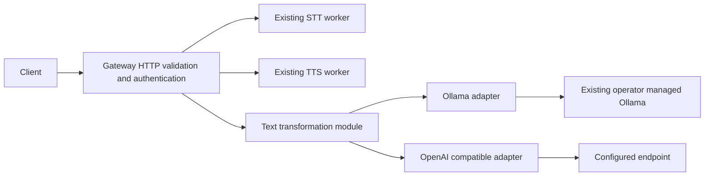

# M05B — Configurable text transformation and translation

Status: **M05B IN PROGRESS; Stage 1 — Offline Implementation PASS and operator-accepted (2026-10-22). Stage 2 is pending and not authorized. Deployment, live inference and closeout are not authorized.**

## Scope, prior decision and gates

The operator reviewed M05A outputs and formally closed that milestone in
commit `a5d22ab2ce7e52b2dc15380b5391832d0523ab8e` (2026-10-22). The accepted
retention remains all three candidates: local Qwen3.5 9B Q4_K_M, Groq Qwen3.8 27B and
Groq GPT-OSS 120B. Their quality limitations are accepted for an initial service
whose generated text is reviewed by the user. In particular, local Qwen may
switch to English without a translation request. This is operator-reported
planning input, not a new quality measurement or a correctness guarantee.

M05A's committed [result](../M05A/result.md) and [validation](../M05A/user-validation.md)
record PASS/COMPLETE and explicit operator approval. Its bounded quality evidence
and limitations remain unchanged: generated text requires user review, and
completion does not establish production readiness, account cost suitability,
independent linguistic validation or safe LLM/TTS concurrency. M05B Stage 1
offline implementation is explicitly authorized. No deployment, live
inference, Stage 2 or M05B closeout is authorized. Stage 1 commit authorization
is provided by the current operator request and is limited to intended Stage 1
implementation and documentation files.

Include direct text rewriting/translation through Gateway, validated provider
and model configuration, explicit selection, stable ordering, bounded fallback,
cloud permission and transparent result metadata. Preserve STT/TTS contracts.
Exclude clients, speech pipeline orchestration, streaming, semantic checking
agents, model discovery/registration, provider SDK frameworks, GPU scheduling,
additional inference services, automatic downloads and changes to shared Ollama.

Design decision: [ADR 0021](../../adr/0021-configurable-text-transformation.md), accepted for Stage 1 implementation only.
Acceptance procedure: [user-validation.md](user-validation.md).

Review provenance: no Astra M05B review text was found in project records.
This revision uses only findings A–I supplied in the current task. Section 12
maps each finding to its correction; it does not invent further review findings.

## 1. Current architecture assessment

**OBSERVED by source inspection, not runtime verification:**

| Existing component | Relevant behavior and reuse |
| --- | --- |
| `internal/config/config.go`, `configs/gateway.yaml` | Go YAML v3, known-field validation, exactly one document, duration/URL validation and environment overrides. Extend this loader; no second configuration framework. |
| `cmd/gateway/main.go` | Constructs dependencies explicitly and owns HTTP server timeouts and shutdown. Inject the new module here. Current write timeout is 610s. |
| `internal/gateway/handler.go` | Standard `net/http` routing, optional bearer token, bounded bodies, context-bound worker calls, strict TTS JSON decoding, four shared STT/TTS admission slots and sanitized errors. Reuse conventions without importing evaluation runners. |
| `internal/transport/http.go`, `api/openapi/public-v1.yaml` | Existing JSON helper and closed `{code,message}` error schema; OpenAPI 3.0.3, versioned resource paths and stable model aliases. Add one operation without changing existing schemas. |
| STT and TTS workers | Independently own native inference, artifacts and lifecycle. TTS handles minimal SSML. Neither should depend on the text module or call an LLM. |
| Root `compose.yaml` | Canonical three-service product deployment per ADR 0018; private worker networks, non-root/read-only Gateway, existing health checks and model mounts. The Gateway publish bridge disables masquerading. Egress and host Ollama reachability are not established. |
| `deployments/compose/` | Historical/foundation and build profiles remain supported within their recorded scope. Do not replace them or adopt their older health-only workers as the product baseline. |
| M00–M04 operations and records | Reuse scoped Compose deployment, known-good image/config rollback, bounded private evidence, strict model provisioning and operator acceptance. Earlier incomplete historical M02 scopes remain as recorded in PLANS.md. |
| `scripts/m05a_eval.py` | Synthetic corpus, prompt versions and preservation cases are reusable test/review inputs. Its Ollama `/api/generate` payload establishes a useful adapter baseline; CLI/container controls and telemetry are evaluation-only. |
| `scripts/m05a_groq_eval.py` | Chat Completions payload and secret-safe classification inform production design. Exact model maps, run files, evaluation retry loops and Python `requests` are not production dependencies. |

M05A records local `think=false`, 4K context and finite keep-alive, explicitly
unloading after runs. True first use was approximately 166s for local Qwen;
warm timings are not a cold-start promise. Simultaneous LLM/TTS use was not
established. Groq's initial urllib transport was rejected with Cloudflare 1010;
the requests transport completed both evaluations, including four recovered
Qwen 429s. A Go client must be qualified live; changing clients alone does not
prove the underlying edge rule or justify disabling TLS checks.

The older [M05 umbrella](../M05/plan.md) named different provisional modes and
local-only inference. This proposal replaces those future assumptions for the
M05B slice with the operator's present requirements; no installed contract is
being removed. `formatting` and nullable language in the evaluation corpus are
internal fixture fields; the new public proposal uses `format` and `none`.

## 2. Responsibilities and dependency direction



Gateway HTTP code owns authentication, media type, request/response mapping and
input validation. `internal/texttransform` owns validated options, passthrough,
prompt construction, selection, deadlines and fallback. Its provider boundary
is one small interface, conceptually
`Generate(context.Context, GenerationRequest) (GenerationResult, error)`.
The request contains the selected configured model and trusted system/user
messages; the result contains final text and optional bounded upstream model
metadata. A typed failure carries a safe category and scope, never an upstream body. Adapters own serialization,
authentication headers, bounded HTTP I/O and response validation. Inject the
adapter registry, HTTP clients and the text service-lifetime context.
Use concrete types internally where substitution adds no value.

Ollama sends `model`, separate `system`/`prompt`, `stream: false`, optional
`think`, finite `keep_alive` and its typed `options` object; accept only a
completed nonempty `response` with `done: true` and a normal stop reason.
Chat Completions sends `model`, two `messages`, `stream: false` and only the
configured optional fields; require exactly one final assistant choice with
string content and `finish_reason: stop`. Provider aliases may resolve to
canonical/versioned names: do not require byte-for-byte equality with the
configured upstream name. Tool calls are invalid output; structured refusal
has its own terminal classification in section 5. Do not expose upstream response
IDs or reasoning fields. Both adapters send JSON and optional Bearer credentials only
to the configured endpoint; no arbitrary additional request headers.

Ollama remains responsible for loading and unloading its models. The Gateway
never runs a CLI, downloads artifacts, edits Ollama configuration or exposes
engine settings to callers. This is an in-process HTTP integration, not native
LLM inference inside Gateway. Add no worker process or inter-worker dependency.

One operation performs mode, formatting and translation in one invocation per
attempt. Fallback can add attempts; it never chains rewrites of generated text.
Every attempt receives the original text and identical requested options.

## 3. Declarative configuration proposal

Add an optional `text_transform` block to the existing Gateway YAML. Absence
means the feature is disabled, preserving old configurations. Its route returns
503 `text_transform_unavailable` when disabled. If present, require `enabled`;
with `enabled: false` no credentials are resolved and no provider is contacted.
Reject malformed supplied fields even in disabled entries. No hot reload:
validated configuration and credential availability form an immutable startup
snapshot. Missing credential values are availability failures, not malformed
configuration; see section 3.1. Authenticate before disabled/unavailable checks.

Complete proposed Gateway example (documentation only; no production config
is changed). It deliberately permits only local inference until the operator
sets `allow_cloud: true` and supplies credentials. All three models remain
configured and enabled for controlled qualification; this is not a production
enablement recommendation. Keep local-qwen disabled in production until section
8.1 passes or a restrictive operational policy is approved. Policy filtering
is distinct from model enablement.

```yaml
listen_host: 0.0.0.0
listen_port: 8080
stt_url: http://stt:8081
stt_timeout: 180s
tts_url: http://tts:8082
tts_timeout: 600s
max_header_bytes: 1048576
max_request_bytes: 26214400
read_timeout: 30s
write_timeout: 610s
idle_timeout: 60s
shutdown_timeout: 10s
text_transform:
  enabled: true
  request_timeout: 240s
  max_request_bytes: 65536
  max_input_bytes: 10000
  max_output_characters: 20000
  max_response_bytes: 262144
  max_concurrent_requests: 1
  selection:
    policy: ordered
    allow_cloud: false
  transport:
    connect_timeout: 3s
    tls_handshake_timeout: 5s
    max_idle_connections: 2
  providers:
    - id: host-ollama
      type: ollama
      locality: local
      endpoint: http://host.docker.internal:11434/api/generate
      timeout: 180s
    - id: groq
      type: openai_compatible
      locality: cloud
      endpoint: https://api.groq.com/openai/v1/chat/completions
      api_key_env: GROQ_API_KEY
      timeout: 30s
  models:
    - id: local-qwen
      provider: host-ollama
      model: qwen3.5:9b-q4_K_M
      enabled: true
      context_limit_tokens: 4096
      prompt_overhead_tokens: 512
      parameters:
        ollama:
          think: false
          keep_alive: 0s
          num_predict: 1024
          num_batch: 128
          num_thread: 8
          temperature: 0
          top_p: 1
          seed: 20261022
    - id: groq-qwen
      provider: groq
      model: qwen/qwen3.8-27b
      enabled: true
      context_limit_tokens: 8192
      prompt_overhead_tokens: 512
      parameters:
        openai_compatible:
          max_completion_tokens: 1024
          temperature: 0
          top_p: 1
          seed: 20261022
          reasoning_effort: none
          include_reasoning: false
    - id: groq-gpt-oss
      provider: groq
      model: openai/gpt-oss-120b
      enabled: true
      context_limit_tokens: 8192
      prompt_overhead_tokens: 512
      parameters:
        openai_compatible:
          max_completion_tokens: 1024
          temperature: 0
          top_p: 1
          seed: 20261022
          reasoning_effort: low
          include_reasoning: false
```

Schema and validation rules:

| Area | Required semantics |
| --- | --- |
| Shape | Strict typed decoding, unknown/duplicate mapping keys rejected at every level, exactly one document, no implicit environment substitution across YAML. Providers and models are sequences, never maps sorted by ID. |
| IDs/references | Unique IDs within each sequence, pattern `[a-z][a-z0-9-]{0,63}`; every model references an existing provider, even when disabled. Actual model names are nonempty bounded strings. No special cases for initial aliases or model names. |
| Locality | Required `local|cloud` on the provider, independent of protocol. An OpenAI-compatible local server is possible. All models inherit it. This is trusted operator classification, not guessed from DNS or model name. |
| Endpoint | Full POST URL, including API path; no appended/version-guessed suffix. Only HTTP(S); forbid userinfo, query, fragment and missing host. Cloud requires HTTPS and an explicitly configured credential environment name if authentication is needed. Local HTTP is permitted for trusted networking. |
| Credentials | Optional environment variable name, syntactically valid and bounded; no literal key field. Resolve once for every provider referenced by an enabled, policy-permitted model. A named variable missing/empty marks only that provider unavailable, emits a sanitized diagnostic and does not fail startup/check-config; section 3.1 is authoritative. Cloud-forbidden and unused providers need no credential value. Authentication-free providers may omit the name. |
| Settings | Require exactly the parameter block matching the provider type. Optional settings are pointers/explicit presence values: omit unset parameters on the wire, retaining explicit `false` and `0`. No arbitrary map of request extensions, HTTP headers, tools, URLs or code. |
| Ollama | Typed boolean `think`; finite `keep_alive` from 0s to 5s, default 0s, reject negative/infinite residency. Derive wire `num_ctx` from `context_limit_tokens` (no duplicate YAML setting); require `num_predict < context_limit_tokens`; positive bounded batch/thread values. |
| Chat Completions | Exactly one positive bounded output budget, `max_completion_tokens` or `max_tokens`, sent under that exact name. Optional finite temperature 0..2, top_p >0..1, signed 32-bit seed, reasoning effort and boolean include_reasoning. Do not send unsupported optional fields by default. |
| Reasoning | Optional `reasoning_effort` is a nonempty string of at most 64 ASCII letters, digits, underscores or hyphens, sent unchanged. No duplicate capability list. Operators own truthful capability declarations; offline validation cannot prove remote support. Do not hardcode model-name capability tables or retry a 400 with altered options. |
| Limits | Require positive durations and bounded integers; proposed ceilings: request/provider timeout 10m, connect/TLS 30s, idle connections 1..16, concurrent requests exactly 1 for initial M05B qualification, JSON body <=64KiB, decoded input <=10000 UTF-8 bytes, output <=20000 code points, provider body <=1MiB, token budgets <=32768, context <=32768, batch <=context, threads <=64. Request size remains subject to Gateway's smaller global bound. Reject nonfinite floats. |
| Cross-field | Shared connect/TLS limits <=each provider timeout <=total request timeout; provider timeout also bounds response headers/body (no duplicate header-timeout declaration); total request timeout plus a 5s response margin <=server write timeout. Require prompt overhead plus output reservation <model context limit and a fitting fixed prompt (section 3.2). Empty policy-permitted/available model sets are valid: raw still works. Malformed supplied model/provider declarations remain errors. |
| Attempts | Zero same-model retries, no retry/backoff configuration and no implicit SDK or transport POST replay. Automatic selection always uses ordered fallback; explicit selection is a singleton. |

If a compatible endpoint does not support reasoning, omit all reasoning fields.
If it supports only `max_tokens`, choose that field. New compatible endpoints
need configuration only within this allowlist; a genuinely different protocol
or parameter requires a reviewed adapter/schema extension. Do not silently
drop rejected options to simulate compatibility.

The example's context/overhead values are proposed conservative operating
budgets, not measured provider maxima or proven template bounds. Stage 1 tests
the enforcement arithmetic; Stage 2 must qualify the tokenizer/template and
model identity assumptions before enabling each model for live service. Record this evidence in the
qualification record/runbook; no new configuration capability registry is needed.

`keep_alive: 0s` is serialized in Ollama's supported zero representation and
requests immediate unload after completion. Cold starts will cost more than
M05A's warm runs; no permanent residency or explicit extra unload call is
planned. On cancellation the remote engine may finish later. Lifecycle and
resource release must be checked live, without altering shared server policy.

### 3.1 Credential and startup failure isolation

Structural errors (unknown/duplicate fields, invalid endpoint/duration, missing
required schema values or invalid model references) fail configuration loading
and `--check-config`, including in supplied disabled entries. Do not silently
repair malformed configuration. This preserves existing fail-fast behavior.

A valid `api_key_env` naming an absent, empty or whitespace-only variable marks
that optional provider unavailable for this process snapshot. Startup and
`--check-config` succeed with a safe provider-ID/reason diagnostic, without
printing its value. Never attempt anonymous access when a key was configured.
Authentication-free endpoints explicitly omit `api_key_env`. Disabled,
unreferenced and globally prohibited providers need no environment lookup.
No startup inference/network probes are required. Key rotation/recovery takes
effect on restart; runtime provider failures never alter the startup snapshot.

When text is enabled, valid raw/no-translation requests succeed even if every
provider lacks credentials or is down, including a valid explicit alias whose
provider is unavailable. Validate alias/permission first but do not require
provider availability for passthrough. With the feature absent/disabled,
authenticated requests (including raw) return 503 `text_transform_unavailable`.
Missing/invalid caller authentication takes precedence in both cases.
Inference requests follow section 5; automatic selection skips unavailable
providers, explicit selection never substitutes. STT/TTS routes and speech
readiness remain independent of all text-provider availability failures.

### 3.2 Context-limit enforcement (authoritative)

Enforce two limits before network I/O: the bounded JSON request body and
`max_input_bytes` on the complete decoded UTF-8 text. Raw passthrough needs only
these limits. No character-to-token ratio or average-language estimate proves
fit. For inference build the exact fixed system prompt and serialized user
message (including options, delimiters and JSON escaping) once from the full
original input. For each candidate require:

`UTF8_bytes(system) + UTF8_bytes(user_message) + prompt_overhead_tokens + output_reservation <= context_limit_tokens`.

This intentionally conservative one-token-per-byte bound is usable only for
qualified byte-fallback/byte-level tokenizers whose normalization cannot exceed
it. Qualification must document the tokenizer revision and bound, including
special-token handling, plus an upper bound for provider-added chat/model
template tokens in `prompt_overhead_tokens`. Count the entire serialized data,
not just source characters. Reject zero/negative overhead, impossible fixed
prompt budgets and overflow in checked integer arithmetic. Regenerate boundary
fixtures when the fixed prompt changes. Keep the bound logic common to adapters.
With the illustrative local budgets, system plus user-message bytes must fit
within `4096 - 512 framing - 512 template overhead - 1024 output = 2048`.
After the compact 1,069-byte system prompt and 112-byte empty serialized user
wrapper/options, 867 bytes remain for unescaped ASCII input. This remains below
the 10,000-byte API ceiling. Stage 1 uses prompt compaction to improve this
budget without changing context or output reservations. The byte preflight
remains a valid context bound only after tokenizer/template qualification;
Stage 2 must still establish that assumption. Do not increase local context
without renewed GPU qualification.

- **Ollama:** send `num_ctx = context_limit_tokens`; reserve `num_predict`.
  Qualify the configured model digest/tokenizer and its actual Ollama template;
  overhead covers template/BOS/EOS additions outside system/user text. Do not
  depend on Ollama's implicit input truncation or `prompt_eval_count` to detect
  loss after dispatch. Never send an over-budget request.
- **OpenAI-compatible:** reserve the configured `max_completion_tokens` or
  `max_tokens`, including any reasoning tokens charged against that budget.
  Qualify the endpoint/model's tokenizer and message framing; use a conservative
  operating context cap no greater than its verified capacity. No tokenizer or
  remote token-count API is assumed to exist. A tokenizer/framing assumption
  that cannot be justified leaves that model disabled until a measured,
  documented bound or a reviewed accurate counter is available. Do not add a
  tokenizer framework speculatively. Requalify on upstream alias/template changes.

An explicit model that cannot fit returns 413 `context_limit_exceeded`, with
zero provider calls. Automatic selection skips non-fitting candidates in the
same stable order; if none of the enabled, permitted models fit, return that
413 without calls. If a fitting candidate exists but is unavailable, apply the
availability result in section 5. Skips alone do not set `fallback_occurred`.
Every dispatched attempt must independently pass this check. Providers rejecting
context despite preflight are adapter/configuration failures, not permission to
truncate, split, summarize, or silently alter input. A normal finish reason is
only a completion check; it never proves that the full input was processed.

## 4. Selection, cloud permission and explicit override

1. Authenticate first, then reject service shutdown/disabled state; validate the
   full request, including an optional model ID and input byte limits.
2. Compute effective cloud permission as configured `allow_cloud` AND NOT
   request `local_only` (default false). Requests can only tighten permission.
3. For explicit `model`, reject unknown or disabled aliases with HTTP 400
   (`unknown_model`, `model_disabled`), and prohibited cloud selection with
   HTTP 403 `cloud_not_allowed`. Never substitute another alias.
4. With `mode=raw`, `format=normal`, `target_language=none`, return the exact
   decoded input string without admission to inference or provider calls.
   Validate model selection first, but report no model/provider used even if a
   valid model was supplied. No trim, Unicode normalization or line-ending edit.
5. Otherwise build the effective enabled/locality-permitted list from the
   model sequence. `ordered` retains it exactly; `local_first` stably partitions
   local then cloud; `cloud_first` stably partitions cloud then local.
6. Explicit selection makes a singleton attempt list; automatic selection keeps
   the whole resolved list. Apply section 3.2 context checks, then availability
   and request-local suppression. Empty enabled/permitted lists return 503
   `no_eligible_model`. All fitting providers unavailable returns 503
   `text_transform_unavailable`. Neither case performs network I/O.
7. Run sequentially until a complete valid success, terminal failure, caller
   cancellation or total deadline. No parallel or hedged requests.

For the example with cloud permitted: `ordered` and `local_first` resolve to
`local-qwen, groq-qwen, groq-gpt-oss`; `cloud_first` resolves to
`groq-qwen, groq-gpt-oss, local-qwen`. With cloud prohibited all resolve to
`local-qwen`. Disabling an entry removes it without changing its neighbors.
List position is the only priority; a numeric priority field would duplicate
and potentially contradict it, with no demonstrated need.

`fallback_occurred` is true on success only if an earlier distinct model was
actually invoked and failed. Filtering disabled/prohibited, non-fitting or
credential-unavailable candidates does not alone count as fallback. Use one
stable-ordering function: retain list order or concatenate stable local/cloud
partitions. No numeric priority, scoring, global circuit breaker or extra policy
switch is needed.

## 5. Authoritative fallback classification and lifecycle

This table is the single failure-policy specification. Every failed dispatched
attempt ends immediately; no same-model retry or parameter mutation is allowed.
“Next” applies only to automatic selection, with time remaining and no caller or
service cancellation. Explicit selection always stops at its selected alias.
Suppression lasts only for this request. Terminal outcomes override exhaustion.

| Condition | End attempt / request | Suppress provider? | Next eligible model? | Public outcome if no success |
| --- | --- | --- | --- | --- |
| Missing/invalid caller bearer token when configured | Reject before decoding/feature checks | No | No | 401 `unauthorized`; zero calls |
| Caller JSON/options/model validation, media type or cloud permission error | Reject before invocation | No | No | 400 validation code, 415 `unsupported_media_type`, or 403 `cloud_not_allowed` |
| Input/body too large; no candidate context fit | Reject before invocation | No | No | 413 `request_too_large` or `context_limit_exceeded` |
| Structural configuration error | Reject startup/check-config | N/A | No | Process configuration error; no serving |
| Text disabled / no enabled permitted candidates | No attempt | N/A | No | 503 `text_transform_unavailable` / `no_eligible_model` |
| Missing optional provider credential | Skip; explicit selection ends | Yes | Yes | 503 `text_transform_unavailable` if no calls occurred; otherwise exhaustion rule |
| Provider HTTP 401/403 | End attempt | Yes | Yes, other provider | 503 `text_transform_failed` |
| Transient connection/DNS/reset or incomplete transport read | End attempt | No | Yes | 503 `text_transform_failed` |
| Provider attempt timeout, total time remains | End attempt | No | Yes | 503 `text_transform_failed` |
| HTTP 429, provider/organization scope or unknown scope | End attempt | Yes | Yes, other provider | 503 `text_transform_failed` |
| HTTP 429, established model-only scope | End attempt | No | Yes, including another model on same provider | 503 `text_transform_failed` |
| Provider HTTP 5xx | End attempt | No | Yes | 503 `text_transform_failed` |
| Confirmed model missing/unavailable | End attempt | No | Yes, including same provider | 503 `text_transform_failed` |
| Provider HTTP 400/422, rejected settings or unexpected context overflow | End attempt | Yes | Yes, other provider; never edit settings | 502 `provider_request_rejected` |
| Unrecognized 404, redirect, TLS certificate error or unexpected HTTP status | End attempt | Yes | Yes, other provider | 502 `provider_protocol_error` |
| Invalid JSON/UTF-8, empty/non-string text, incomplete completion, token-limit finish, tool call, output/body over limit | End attempt | No | Yes | 502 `invalid_provider_response` |
| Structured refusal/content-filter signal | End entire request | No | No | 422 `transformation_refused` |
| Valid final text with unsatisfactory wording/language/meaning | Successful request ends | No | No | 200; generated text for user review |
| Total deadline | End entire request; cancel I/O | No | No | 504 `deadline_exceeded` if writable |
| Caller cancellation/disconnection | End entire request; cancel I/O | No | No | No response to disconnected caller |
| Service shutdown | Stop admission; end active text requests | No | No | 503 `text_transform_unavailable` if writable |
| Text admission full | Reject before inference | No | No | 429 `overloaded` |

If mixed attempts exhaust, choose a deterministic public error: any invalid
response => 502 `invalid_provider_response`; else any rejected provider request
=> 502 `provider_request_rejected`; else any protocol/configuration failure
=> 502 `provider_protocol_error`; else 503 `text_transform_failed`. No calls
because all fitting candidates lack credentials uses the table's unavailable
outcome. Terminal caller/refusal/deadline/shutdown conditions end immediately;
when cancellation causes coincide, disconnect prevents writing, then service
shutdown takes precedence over the total deadline. Never return partial output
or silently replace failed generated text with original text.

Recognize rate-limit scope, model unavailability and structured refusal only
from bounded, tested provider-specific structured codes/headers. Unknown 429
scope is provider-wide; `Retry-After` alone does not prove model-only scope.
Conflicting scope signals use the broader provider scope. One configured
provider represents the credential/organization rate-limit boundary; the two
Groq models must share it. Do not split the same account into provider aliases
to evade suppression. An explicit model-only signal may allow the next model
immediately; no retry of the throttled model occurs. M05B has no backoff waits
or retry configuration. Do not inherit M05A's evaluation retries. Hard maximum
calls = number of eligible distinct models, reduced by skips and suppression.

A refusal represented only as ordinary valid text is returned for review; no
heuristic refusal/quality detector is added. Bound error-body reads, classify,
and discard. Diagnostics include logical provider/model, safe category,
attempt index, suppression scope and elapsed time, never secrets, user text or
upstream error bodies. Keep the public closed `{code,message}` error schema.

### 5.1 Deadlines, shutdown and remote cancellation

Create one total deadline at authenticated handler entry; body processing,
admission and every attempt consume it. Bound uploads by the existing server
read timeout. Each provider call uses the smaller of remaining total time and
its provider timeout; shared connect/TLS settings constrain I/O further. Do not
reset the total clock for fallback. Text admission is nonblocking, with one
slot and no queue; it never consumes STT/TTS slots.

Inject a text-specific service-lifetime context from `cmd/gateway/main.go`.
Link each text operation to both this context and its HTTP request context,
with removable cancellation callbacks and deferred cleanup. On SIGTERM/SIGINT
or server exit, atomically close text admission and cancel the text lifetime
before the existing bounded `http.Server.Shutdown`. Requests racing admission
must check the stopped state; recheck cancellation before each dispatch and
before success delivery. No fallback is dispatched after stopping. Interrupt
any pending I/O/timer wait through context cancellation; there are no retry
waits in M05B, and future waits must use this same context. Close response bodies,
cancel child contexts, release slots and wait for text handlers within the
existing shutdown budget. Close idle text transports. Do not replace the whole
server BaseContext or change existing STT/TTS shutdown/drain behavior merely
to cancel text work.

HTTP cancellation stops local I/O and result delivery, not necessarily remote
inference. In particular, Ollama may continue computation and retain VRAM after
its connection closes; a freed Gateway slot does not prove the GPU is free.
`keep_alive: 0` requests unloading but is not evidence of actual unloading.
Stage 2 must measure termination/unload/recovery after success, disconnect,
timeout and shutdown, including a subsequent local request. Failed remote
termination qualification restricts local production enablement under section
8.1. Do not kill shared Ollama or issue an unscoped unload against other users.
Cloud timeout/fallback may duplicate work and billing; no exactly-once claim
or unsupported idempotency header. Zero retries reduces, but does not remove,
that risk.

## 6. Gateway API proposal

Add only `POST /v1/text/transformations`, operation ID `transformText`, JSON
request/response, existing optional bearer policy. Direct text works without
STT or TTS. Do not add a combined speech route or a model-list endpoint in this
slice; operators/clients use configured logical IDs.

| Request field | Schema / deterministic default |
| --- | --- |
| `text` | Required nonempty UTF-8 string; reject whitespace-only; preserve original bytes of the decoded string; configured UTF-8 byte/body limits and per-model context preflight |
| `mode` | `raw|written|polite|diplomatic`; default `raw` |
| `format` | `normal|concise|structured`; default `normal` |
| `target_language` | `none|en|sv|ru`; default `none`; explicit null invalid |
| `model` | Optional logical ID; omission selects policy; empty/null invalid |
| `local_only` | Boolean, default false; can only restrict cloud use |

Reject unknown fields, wrong types, duplicate keys and trailing JSON values.
Modes and formats are single enums, not flags or arrays. `raw` requires
`normal`, including when translating. `raw` translation preserves wording as
far as translation permits; an explicit language always invokes the model,
even if it appears to match the source. No language detector is added.

```json
{
  "text": "Your team ignored my request.",
  "mode": "diplomatic",
  "format": "normal",
  "target_language": "sv",
  "model": "local-qwen",
  "local_only": true
}
```

Proposed successful response (illustrative generated text, not measured output):

```json
{
  "original_text": "Your team ignored my request.",
  "transformed_text": "Ert team har inte tagit hänsyn till min begäran.",
  "options": {
    "mode": "diplomatic",
    "format": "normal",
    "target_language": "sv",
    "model": "local-qwen",
    "local_only": true
  },
  "model": "local-qwen",
  "provider": "host-ollama",
  "fallback_occurred": false,
  "generated": true
}
```

`options` always contains normalized requested defaults and the requested
model (null when omitted). Top-level `model` and `provider` are actual logical
IDs, never engine tags, endpoints or credentials. Both are null for raw
passthrough; `generated` and `fallback_occurred` are then
false. Equal generated and source strings still have `generated: true` when
a model was invoked. Metadata identifies provenance, not semantic accuracy. `model` always uses the
configured logical ID, regardless of upstream alias canonicalization. Optional
upstream model metadata is bounded/sanitized internal diagnostic data only,
never a metric label or public identity. All generated text already requires
user review; no redundant `review_required` field is needed.

OpenAPI implementation work must add closed request/options/response schemas,
nullable fields and the raw/normal conditional constraint using OpenAPI 3.0.3
composition plus handler validation. Define all errors: existing 400/401/403,
413/415/422/429/500/503/504 plus new 502 descriptions; use `transport.Error`.
Add route limits to the Gateway's per-path body limiter. Keep STT/TTS schemas,
aliases, health checks and catalog behavior unchanged. Text providers are not
polled by `/healthz`, `/readyz` or metrics scraping; their outage does not turn
working speech services unready or create billable readiness calls.

## 7. Prompt, security and reliability

Reuse M05A prompt v2's one-call preservation rules as a versioned, production
owned prompt, with explicit `none` and the public `format` mapping. Do not read
an evaluation file at runtime. `polite` includes written-language improvement;
`diplomatic` additionally includes courteous and tactful expression, retaining
material meaning, facts, criticism, urgency, negation, uncertainty, speaker
attribution, commitments and technical identifiers as faithfully as possible.
`concise` must preserve material facts; `structured` must not add content.

System instructions are fixed trusted code/assets; serialize user text and
validated options as a separate JSON data message. Never interpolate text into
system instructions, roles, URLs, model IDs or transport options. Ollama uses
separate `system` and `prompt`; Chat Completions uses system/user messages.
Disable tools and conversation history; no browsing, commands, retrieval or
follow-up model calls. This reduces prompt-injection authority but cannot prove
instruction compliance or semantic fidelity. User review remains required.

Reject invalid UTF-8 and lone surrogate JSON escapes instead of silently
replacing them. Apply section 3.2 before every inference call; never truncate input. Reject invalid final bodies, refusal,
tool calls and length-limited output; do not regex-strip reasoning or invent
missing text. Extract only the documented final text field; separate reasoning
fields are discarded, never returned or logged. No semantic verifier or
automatic language-based retry is added.

Configuration is an operator trust boundary: a provider labeled local must
actually be local. `allow_cloud: false` prevents all attempts to configured
cloud providers, including credential resolution and startup probes; it is
not an OS firewall and cannot detect a dishonest locality declaration. Public
callers cannot register providers or override policy. Recheck eligibility at
dispatch, not just while sorting. Disable HTTP redirects, environment-proxy
inheritance and TLS-insecure settings. The initial transport needs no arbitrary
proxy, header, CA bypass or remote-fetch controls; standard verified TLS and
the configured endpoint are sufficient.

Read keys from named process variables populated by the operator's existing
private secret mechanism. Keep secret files under ignored root `private/`,
restrict file/parent permissions, never source untrusted files as shell code,
and never print env/Compose expansion with live keys. Environment variables
are visible to privileged container inspection; they are not a secret vault.
Rotation requires restart with a new environment snapshot. Keep the current
Gateway token behavior; do not add literal provider keys or a second auth model.

No text persistence, prompt/completion logging, transcript hashes or temporary
files by default. Bounded in-memory buffers live for the request and become
collectable after cleanup; do not promise secure RAM erasure. Structured events
contain logical provider/model, safe category, attempt index, fallback flag and
duration. Metrics use configured bounded labels and count attempts, errors,
latency and overload, without user text, error bodies, arbitrary request IDs or
upstream IDs as labels. Treat returned text as untrusted plain text in clients.
Cloud processing/retention is governed by the operator's provider agreement;
this platform cannot enforce remote deletion.

## 8. Deployment and rollback proposal

Extend root Compose only as needed for the existing Gateway. Preserve STT/TTS
definitions, model stores, private networks, working health checks, resource
limits and default loopback publication. Add no GPU service or runtime mount.
Before deployment, use read-only scoped inspection to establish the actual
baseline: M04's technical test restored earlier image IDs, so accepted source
does not alone establish currently deployed behavior.

The example endpoint is provisional container-to-host routing, not a claim
that host DNS/firewall reachability is working. Prefer a configurable
`extra_hosts` mapping for `host.docker.internal` to `host-gateway` and the
existing published Ollama port, provided an in-container probe validates it.
Do not use container `localhost`, join/reconfigure Ollama or Dify networks,
publish new worker ports, or change the shared Ollama listen address. If the
existing port cannot be reached safely, stop that deployment step for a scoped
network decision; no shared-service change is implied.

Cloud use also needs a reviewed Gateway-only outbound bridge because current
publish masquerading is disabled. Prefer a minimal optional Compose overlay
adding that bridge to Gateway, preserving the publish and worker networks.
Use it only for an authorized cloud deployment; no change to worker egress.
It provides connectivity, not destination-level filtering. Application cloud
permission remains authoritative. Render/check network topology with synthetic
environment values; verify DNS and TLS from the Gateway runtime during live
acceptance. The current distroless image's CA trust is to be verified, not
assumed from host curl success. No insecure workaround for edge/TLS failure.

Compose passes only the required named credential variable(s) to Gateway;
for the initial example that is `GROQ_API_KEY`, absent/empty by default. An
operator adding another provider explicitly adds its named environment entry
through a small reviewed overlay/env-file mapping. YAML environment-name
references do not automatically import host secrets. Keep provider config
read-only, no secret mount into STT/TTS, and no dependency on private deployment
snapshots. Validate successful startup and speech availability with a missing
Groq key even when cloud is enabled, using section 3.1.

Later deployment must first capture immutable known-good Gateway image,
configuration, effective overlays and non-secret network/health metadata in a
private record. Build the candidate Gateway, validate configuration/Compose,
then recreate only Gateway with `--no-deps --no-build --wait`. Rollback uses
the captured image/config/overlays and the same scoped Gateway-only operation;
if the outbound overlay is removed, prove the extra Gateway attachment is gone.
Verify STT/TTS container IDs, start times, restart counts and health unchanged.
Keep shared Ollama/Dify/M00 resources untouched; no prune or model deletion.

### 8.1 Shared GPU qualification and production restriction

**OBSERVED (historical/source evidence):** M05A's
[local v2 measurements](../M05A/prompt-refinement.md) reported a minimum
6,400 MiB free during local Qwen inference with baseline STT residency.
`configs/tts.yaml` requires 8,000 MiB free before loading; the TTS factory in
`services/tts/lifecycle.py` enforces that threshold. **INTERPRETATION:** that
observed state is 1,600 MiB below the TTS load requirement. Sequential LLM then
TTS smoke tests cannot establish coexistence. STT residency also does not prove
active STT performance during inference. **NOT ESTABLISHED:** current combined
workload capacity or reliable Ollama unloading on cancellation.

Retain one concurrent local transformation, bounded 4096-token local context,
and zero keep-alive (at most 5s only after qualification). This bounds Gateway
submissions, not other Ollama clients or residual remote work. Do not lower TTS
memory guards or add a GPU scheduler to make tests pass.

Stage 2 must record an authorized test envelope (input/context/output sizes,
repetitions, deadlines, GPU sample interval, baseline tolerance and bounded
unload observation window) before execution. Use the existing GPU telemetry
approach and read-only Ollama residency observations. Measure baseline, peaks,
errors, durations, actual overlap and return to baseline for:

1. Active STT while local Qwen is generating, with both producing valid results
   within their configured deadlines and no worker restart/OOM.
2. Cold TTS load/synthesis started during active Qwen generation. Record the
   memory-guard rejection if it occurs; a clean rejection establishes recovery
   safety, not successful speech coexistence.
3. Qwen cold start while TTS is resident, then TTS synthesis during generation;
   measure capacity and latency in this reverse allocation order.
4. Caller cancellation, socket disconnection, provider/total timeout and Gateway
   shutdown during local work. Distinguish local handler cleanup from remote
   stop/unload; verify subsequent STT/TTS and local requests recover without
   accumulating overlapping orphan inference or retained model allocations.
5. Actual Ollama model unloading after successful and failed/cancelled requests:
   residency disappears and GPU memory returns within the approved baseline
   tolerance/window. A zero keep-alive payload or closed socket alone fails to
   establish this. If observations cannot distinguish other clients, isolate an
   approved test window or report the result NOT ESTABLISHED.

No unrestricted local-model production enablement until this matrix passes.
On failure or inconclusive evidence, leave local models `enabled: false` in
production; cloud-permitted deployments can use qualified cloud models and
raw remains available. Any narrower local use (for example a dedicated operator
window excluding concurrent TTS) requires an approved, enforceable operational
policy and recovery evidence. Record that as restricted acceptance, never a
coexistence pass. A scheduler or shared-service change needs demonstrated need
and separate approval. Free-tier Groq limits are not guaranteed production
capacity; capacity/cost and cloud permission remain deployment decisions.

## 9. Implementation stages and expected files

Keep **one M05B milestone with two acceptance stages**. Stage 1 offline
implementation is authorized by the operator; Stage 2 is not. No automatic
deployment, closeout or commit.

| Stage | Work / expected files | Exit evidence |
| --- | --- | --- |
| Stage 1 — Offline implementation | Extend `internal/config/config.go` and tests; add cohesive `internal/texttransform/` options, service, selection, prompt, errors and two adapters with standard Go HTTP and existing YAML. Add non-secret example. Update `api/openapi/public-v1.yaml` before the handler; wire service lifetime in `cmd/gateway/main.go`, additive handler/route limits in `internal/gateway/`, and contract/auth tests. Prepare minimal Compose/env overlay, config checks and runbook artifacts offline as needed for Stage 2. | Strict config, context arithmetic, fake-server adapters, table-driven fallback, auth, shutdown/cancellation, privacy and regression evidence. Full `make verify` **plus dedicated TTS/SSML suite**. No live providers or deployment. Stop for review before Stage 2. |
| Stage 2 — Live qualification | Review concrete Gateway-only rollout/rollback, then separately authorized controlled deployment; qualify local Ollama and both Groq models, tokenizer/template bounds, both fallback directions, permissions, resource coexistence, remote cancellation/shutdown and speech regression. Maintain `docs/operations/text-transformation.md` and architecture overview alongside actual changes. | All bounded live cases in user-validation.md; operator text review; production restrictions/policy if GPU coexistence fails; rollback verification; explicit operator acceptance. A Stage 1 pass alone is not M05B completion. |

Maintain these milestone records and ADR 0021 alongside actual changes. Do not
modify M05A runners/prompts/results or old deployment profiles merely to share
code. No dependency change is expected; any new dependency requires a concrete
need. Stage 1 updates the public OpenAPI and adds a non-secret config example;
production Compose, `.env.example` and `configs/gateway.yaml` remain deferred
to a separately reviewed Stage 2 deployment plan.

## 10. Verification and acceptance mapping

| Risk / requirement | Planned automated verification |
| --- | --- |
| Strict config and compatibility | Old config unchanged; unknown/duplicate fields/documents, missing schema values, durations/URLs/ranges/IDs/references/options rejected. Missing/empty optional keys do not fail startup/check-config, including cloud enabled/all providers unavailable; fake speech remains available. |
| Stable ordering and suppression | Exact calls for all policies, reordered YAML, disabled/non-fitting models, mixed locality/protocol, explicit singleton and no eligible model. Unknown/provider-wide 429 skips both Groq models; established model-only 429 permits the next Groq model. Auth failures suppress provider; later requests start with fresh suppression state. |
| Cloud boundary | Zero cloud-listener calls with global false under every policy or local_only true; explicit cloud prohibited; local-only success/outage, redirects blocked and proxies ignored. |
| Endpoint authentication | With bearer configured, missing and invalid tokens each yield 401 for generated requests, raw passthrough, disabled transformation and unavailable providers; zero adapter calls in every unauthorized case. Correct token follows normal policy. No-token deployment preserves existing optional-auth contract. |
| Adapter portability | `httptest` servers inspect exact JSON/headers, endpoints, false/zero, omitted optional settings, both output-budget names and reasoning effort. Alias/canonical upstream names succeed with logical public metadata. No credential on wrong destination. |
| Context limits | Byte/body boundaries, multibyte Swedish/Russian/emoji, escaped JSON, fixed prompt/options/template overhead and output/reasoning reservation; equality fits, one over rejects/skips before calls. Explicit overflow and automatic all-overflow return 413; mixed context capacities keep order. No input slicing; every fake receives original full text. Unexpected upstream overflow is classified per section 5, regardless of normal finish elsewhere. |
| Failure policy and attempt bound | Table-driven tests for every section 5 row and mixed exhaustion precedence; structured refusal terminal, ordinary unsatisfactory wording returned. At most one call per model, no same-model retries or backoff, both provider/model 429 scope and conflicting/absent scope. |
| Cancellation, timeout and shutdown | Controlled slow headers/body, transport disconnect, provider vs total timeout; fake remote observes request cancellation. Inject service cancellation with active handlers and an admission race; no new dispatch/fallback after stop, all slots/bodies/callbacks released, no goroutine leaks. Test request cancellation independent of service cancellation; simulated noncooperative remote proves local cancellation is not remote-stop evidence. Existing speech shutdown behavior retained. |
| Passthrough and modes | Exact whitespace/newline/Unicode identity with zero calls; all 4x3x4 combinations (raw/non-normal rejected), defaults/null/duplicate/unknown JSON. Raw works when all credentials missing or providers down; feature-disabled raw is 503 after authentication. One invocation per attempt from original input. |
| Unsafe provider output | Invalid UTF-8/JSON, empty/null/list text, absent choices, done=false, token-limit finish, refusal/tool call and oversized bodies. No partial success or original-text substitution. |
| Metadata/privacy | Logical IDs, requested defaults, passthrough nulls and flags, generated=true even when unchanged, internal-only bounded upstream model. Capture logs for sentinel secrets/source/provider-body leakage; safe missing-key/attempt/suppression diagnostics only. |
| Speech regression | Text has separate admission and lifetime; outage/missing keys never change speech readiness. Run existing Go, STT, dedicated TTS/SSML, OpenAPI, configuration and Compose checks. |

Required commands for Stage 1 (actual executions and limits are recorded in
verification.md):

```sh
go test -race ./internal/config ./internal/texttransform ./internal/gateway
go run ./cmd/gateway --config configs/gateway-text.example.yaml --check-config
docker compose --env-file .env.example -f compose.yaml config --quiet
make verify PYTHON=.venv/bin/python
.venv/bin/python -m unittest discover -s services/tts/tests -p 'test_*.py' -v
git diff --check
```

The current `make verify` discovers scripts and STT tests but not the dedicated
TTS suite; the explicit command above is mandatory until that suite is included
in the target. Use existing Go `testing`, `httptest`, race detection and Python
unittest infrastructure; no new test framework.

For cloud-enabled example/config tests, provide fake values in a test subprocess
environment; never resolve a real secret for offline tests or render it to
stdout. Extend Compose checks to render the proposed overlay with sentinel
values. Full verification includes the existing OpenAPI validator; passing a
schema validator alone does not establish handler conformance or model quality.

Live acceptance uses the [operator procedure](user-validation.md), covering
all three exact configured models, both fallback directions, complete outage,
raw behavior, cloud restriction and existing speech health. Synthetic text
only for any request which may reach Groq, including local-to-cloud fallback.
Use mock failures/configured unreachable test endpoints in a private Gateway
configuration; never shut down production providers to simulate outage.

M05A's 39 original and seven unseen cases remain review inputs for facts,
identifiers, language, criticism, uncertainty, negation and commitments. Adapt
fixture field names in tests; preserve original evidence. Do not require exact
live LLM wording or automatically fail over on semantic flags. Record observed
quality issues and the operator's acceptance limits without implying the
initial service guarantees meaning preservation.

## 11. Acceptance criteria and operator decisions

M05B can be proposed for closeout only when configuration and selection are
strict/deterministic; privacy restrictions are demonstrated with zero forbidden
calls; explicit selection never changes model; attempt/deadline/error behavior
matches the table; raw passthrough is exact; one-call transformation/translation
and provenance work; all required offline checks pass; authorized live checks
and rollback evidence are recorded; and the operator reviews generated output
and explicitly approves completion. GPU failures require an approved restricted
local policy (or local production disablement) recorded in that acceptance;
never report unrestricted coexistence without evidence. No stage result alone
closes the milestone.

Only these decisions require operator input before their dependent action:

1. **M05A formal disposition:** **COMPLETE** in commit
   `a5d22ab2ce7e52b2dc15380b5391832d0523ab8e`; the accepted three-model decision
   and documented quality limitations remain unchanged.
2. **Implementation authorization:** **Stage 1 authorized, implemented and
   operator-accepted PASS (2026-10-22).** The current operator request
   separately authorizes the scoped Stage 1 commit. This does not authorize
   deployment, Stage 2 or closeout.
3. **Deployment privacy choice:** select production `allow_cloud` and initial
   policy. Recommended shipped default is `allow_cloud: false`, `ordered`,
   automatic fallback. The example uses those defaults.
   Enabling cloud authorizes possible external processing during fallback and
   requires operator acceptance of provider terms, quota and duplicate billing
   risk. Synthetic live cloud validation needs its own operational authorization.
4. **Local production policy:** after section 8.1 measurements, approve normal
   enablement or an enforceable restricted policy; otherwise leave local disabled.

Routine design choices (list priority, zero same-model retries, upstream-auth
fallback to another permitted provider, raw defaults, zero keep-alive and
request-local restriction) have explicit proposals above and need no additional
question unless the operator wants changes. Actual host reachability, Go/Groq
compatibility, cold latency, capacity, account cost and remote retention remain
verification prerequisites, not facts to invent or additional features to add.

## 12. Astra response and remaining decisions

| Supplied finding | Plan correction / acceptance reference |
| --- | --- |
| A — Optional credential isolation | Section 3.1 separates structural errors, unavailable keys and runtime failure; authenticated enabled raw remains deterministic without inference; section 10 tests speech isolation. |
| B — Shared GPU safety | Section 8.1 names the 6,400/8,000 MiB conflict and mandatory overlap/recovery/unload matrix; local production restricted pending evidence/policy. |
| C — Context fit | Section 3.2 bounds full prompt, framing and output before dispatch per model; oversized requests reject/skip without truncation. Tokenizer/template qualification is explicit. |
| D — Provider-wide 429 | Section 5 uses request-local provider suppression for broad/unknown scope; same-provider continuation requires established model-only scope; zero retries. |
| E — Consistent fallback | Section 5 is the sole decision table, with termination, suppression, continuation and deterministic exhaustion precedence; refusals and valid wording are distinct. |
| F — Shutdown | Section 5.1 links text requests to service lifetime, stops admission/cancels I/O and prevents fallback; remote termination is a separate live check. |
| G — Regression coverage | Section 10 explicitly adds dedicated TTS/SSML, endpoint bearer matrix, context, 429, cloud, local-only, timeout, remote cancellation and shutdown tests. |
| H — Configuration simplicity | Shared transport, provider-specific timeouts, YAML order with one stable partition function; no allowed_reasoning_efforts, numeric priorities, retry settings or fallback toggle. Configurable reasoning_effort retained. |
| I — Model identity/metadata | Sections 2/6 accept upstream canonical names, expose configured logical IDs and retain safe internal model metadata; redundant review_required removed. |

All nine findings are addressed in the proposed design; none is claimed runtime
verified. No remaining architecture choice blocks offline implementation after
operator approval. Stage 2 must establish tokenizer/framing bounds (example
numbers are provisional), actual Ollama unload/coexistence, Go/Groq compatibility,
network reachability, timing/resource envelope and rollback. If those cannot be
established, keep affected models disabled and report the limitation. Production
cloud permission/policy, any restricted local operating policy and later
deployment authorization remain explicit operator decisions. M05A closeout is
complete. Stage 1 implementation and offline verification are operator-accepted
PASS; do not deploy or start Stage 2 without separate authorization.
