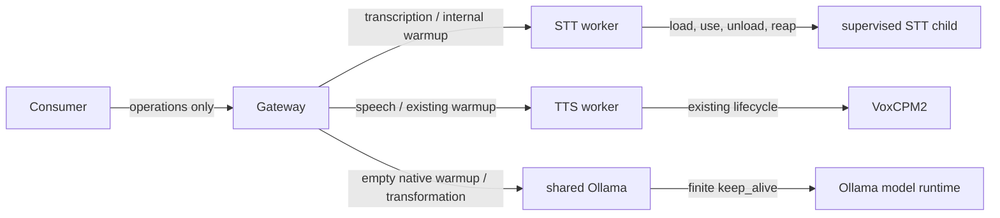

# M06 — Model Lifecycle, Predictive Warmup and Readiness-Aware Routing

Status: **IN PROGRESS; M06A finalized; M06B offline implementation and verification ACCEPTED 2026-10-23. M06C is the next planned development stage. M06D and M06E remain pending.**

## Objective

Allow the STT worker to load Faster-Whisper on first use, safely unload it after a configured idle interval, and reload it on demand. Add one bounded public operation warmup request that can prepare STT, existing TTS, and the configured eligible local text model. Preserve normal inference behavior without warmup and preserve M05B model selection, privacy and fallback semantics.

## Scope and boundaries

M06 changes STT model lifecycle and readiness semantics, adds a public Gateway warmup contract, and adds Gateway-to-Ollama warmup. TTS lifecycle remains as implemented. Gateway owns public authentication, request validation and bounded orchestration; STT and TTS own their model lifecycle; Ollama owns local LLM residency. Application recording and hotkey behavior stays in consumers.

M06 excludes consumer clients, model downloads, new inference engines, persistent lifecycle/job databases, job polling, a generic model manager, distributed locks, cross-host scheduling, a general GPU scheduler, forced model eviction, cloud warmup, changing shared Ollama/Dify configuration, and production deployment without a separate authorization. Existing M05B evidence is preserved unchanged.

M05B is closed with accepted limitations. Its 6,270 MiB Qwen minimum-free sample was observed with STT resident in one bounded workload and is not a capacity guarantee. Qwen inference plus TTS cold-loading remains unqualified. The tracked example's `keep_alive: 0s` differs from the finite `5s` used in accepted production evidence; M06 warmup must use finite nonzero keep-alive and must never send zero to the shared service.

## Existing implementation and planned changes

| Area | Current implementation (OBSERVED) | M06 requirement |
|---|---|---|
| Gateway | Public `/v1/stt/transcriptions`, `/v1/tts/speech`, and `/v1/text/transformations`; optional configured bearer authentication; bounded requests; readiness proxies for workers; no public warmup route. | Add one strict public warmup route; preserve current inference endpoints and auth convention. Gateway readiness continues to reflect required worker service availability, not optional model residency. |
| STT | M06A baseline was eager loading and loaded-model readiness. M06B now starts bounded admission without a child, lazily starts one supervised child for inference/internal warmup, unloads after idle, and reports readiness while unloaded/loading/ready/unloading. | M06D verifies integration/regression; M06E separately qualifies target GPU behavior. |
| TTS | `ModelLifecycle` lazy-loads, serializes native use, has internal `/internal/v1/warmup` and `/internal/v1/state`, a configurable 60-second idle default, active-use protection and an 8,000 MiB free-VRAM load guard. | Reuse existing behavior/endpoints. Preserve its HTTP inference slot; competing warmup may receive 429. No TTS lifecycle rewrite. |
| Ollama | Gateway adapter uses `/api/generate`, configured options, top-level `think`, and configured `keep_alive`. No warmup operation. Tracked example is 0s; accepted production setting was finite 5s. | Use native empty `/api/generate` request, no user content, top-level `think:false`, and finite configured keep-alive. Never explicitly unload or change shared service settings. Runtime compatibility remains for M06E. |
| Text selection | `ordered`, `local_first`, `cloud_first`, explicit model, `local_only`, `allow_cloud`, and typed failure fallback exist. Text request concurrency is limited to one. | Preserve all behavior. Cold/warming local models remain eligible; warmup state does not cause automatic cloud fallback. |

## Ownership and data flow



- The Gateway receives operation identifiers only; it never receives microphone content for warmup.
- STT owns child creation, model state, use accounting, idle timer and cleanup confirmation.
- TTS retains its lifecycle implementation and admission.
- Ollama controls residency on the existing shared service. Gateway does not own global model state.
- A process-local cold-load semaphore is optional only if M06 implementation demonstrates a concrete overlapping-load race. It is not a VRAM reservation and must not block unrelated active inference indefinitely.

## STT lifecycle requirements for M06B

Worker process state remains separate from model state. Model states and transitions:

| State | Required behavior and transitions |
|---|---|
| `unloaded` | Worker is operational and ready. First inference or internal warmup transitions to `loading`. |
| `loading` | Exactly one supervised child initialization is in flight. Concurrent requests join that initialization within their own deadlines. Success transitions to `ready`; a recoverable failure with confirmed cleanup returns to `unloaded`; fatal or uncertain cleanup transitions to `faulted` or `cleanup_unconfirmed`. |
| `ready` | Model can serve bounded admitted requests. Completed model use resets the 60-second idle timer. Idle expiry transitions to `unloading` only if no active or admitted pending/queued request needs the model. |
| `unloading` | No new child use starts before unload/exit resolves. Confirmed child exit/reap transitions to `unloaded`; a waiting request may then trigger one reload. Unconfirmed termination transitions to `cleanup_unconfirmed`. |
| `faulted` | Worker cannot safely start/process work; `/readyz` returns 503. Preserve current fault-latch and manual recovery behavior for fatal native failures. |
| `cleanup_unconfirmed` | Child termination/resource release is unknown; `/readyz` returns 503 and another load is prohibited until safely recovered. |

Idle-timeout invariant: after a successful load, set last-use time when a model operation (inference or warmup) completes; only unload when elapsed idle time is at least the configured interval and active count is zero and no accepted pending/queued job can use the child. A rejected request does not refresh use time. An admitted queued request prevents unload until it completes or is removed. `model_idle_unload_seconds` is strict validated configuration in `0..86400`, with 60 seconds as the initial default; zero means unload at the first safe point, never interrupt active/admitted work. Tests use controllable clocks/waits rather than GPU experiments.

Internal `POST /internal/v1/warmup` invokes the same load path as first inference, accepts an empty body only, and uses the configured default model. It is idempotent and singleflight with inference. Success returns a safe ready state; failures use the existing sanitized worker error envelope and bounded status codes. Keep `GET /internal/v1/state` private; it may report worker/model state and numeric active/admitted counts, but no audio, transcript, prompt, credential or private path. No public unload route is added.

### Readiness contract

- `/healthz`: process liveness only.
- `/readyz`: worker is serving and can accept bounded on-demand inference/warmup. `unloaded`, `loading`, and safe `unloading` are not by themselves unready; requests may wait/queue within configured bounds.
- `faulted`, `cleanup_unconfirmed`, draining/stopped, or inability to accept work means not ready.
- Gateway `/readyz` remains based on required worker availability; ordinary STT idle unload must not flap Gateway readiness.
- This changes STT `/readyz` semantics from loaded-model readiness to on-demand worker readiness. Gateway compatibility was checked offline; deployment/target probe behavior remains for separately authorized qualification. Public inference response schema and normal successful behavior remain compatible.

## Public warmup API proposal for M06C

`POST /v1/models/warmup`, `Content-Type: application/json`, same optional bearer authentication behavior as existing inference routes. The strict request has no unknown fields and is at most 4 KiB. `operations` is required, length 1–3, unique, and contains only the stable names below. Validate the entire request before making any worker/provider call; preserve requested operation order.

```json
{"operations":["stt","tts","text_transform"]}
```

The route is synchronous and bounded by validated Gateway `warmup_timeout` (initial proposal: 180 seconds; validate `1s..10m` and ensure it fits Gateway write/shutdown limits). Consumers can call it asynchronously while recording. No client-supplied model, provider, endpoint, content, timeout, or cancellation token is accepted.

```json
{
  "results": [
    {"operation":"stt","status":"ready"},
    {"operation":"tts","status":"overloaded","code":"overloaded"},
    {"operation":"text_transform","status":"resource_unavailable","code":"resource_unavailable"}
  ],
  "complete": false
}
```

`complete` is true exactly when every result is `ready`. Per-operation statuses: `ready`, `warming`, `unavailable`, `resource_unavailable`, `overloaded`, `timed_out`, `not_attempted`. A status may contain a stable optional `code`, never raw provider/worker text. `warming` is allowed only when Gateway/worker can confirm an in-flight load at the caller deadline. `timed_out` means the operation deadline expired and outcome may be unknown; it does not claim cancellation or release. If the total deadline expires before a later requested operation starts, return `not_attempted` with `code: deadline_exceeded`. Continue to later operations after a per-operation failure while total time remains. Repeating the same request is safe and joins the same load where possible.

HTTP semantics: 200 if the valid operation set was accepted/attempted, even when results are partial; 400 for invalid JSON, unknown fields/operations, empty list or duplicate operations; 401 for failed configured bearer auth; 405 for wrong method; 413 over 4 KiB; 415 for non-JSON; 503 when Gateway is draining or cannot attempt the operation set. Per-operation failure codes are sanitized and results do not disclose provider names/models, endpoints, paths or credentials. If the client disconnects, cancel its wait where supported; underlying model load may continue. Do not claim worker/Ollama cancellation unless confirmed by that owner.

Operation mapping:

- `stt`: private STT internal warmup.
- `tts`: existing TTS private warmup and state endpoints; preserve the current TTS admission slot and VRAM guard. A competing request may return 429.
- `text_transform`: first enabled local candidate in the existing resolved order, considering only local candidates and never changing inference selection order. If no eligible local candidate exists, return `unavailable`. Use Ollama's documented empty `/api/generate` request with configured model, `stream:false`, top-level `think:false`, and finite nonzero `keep_alive`. Send no prompt/system/user data and never select cloud. Discard the response body content. Confirm empty-request preload behavior against the installed Ollama version under separately approved M06E; API documentation is not runtime verification.

Warmup never synthesizes audio or returns transformation text. Existing inference routes remain valid and cause on-demand loading without warmup.

## Configuration and resource policy

- STT adds `model_idle_unload_seconds` under strict lifecycle configuration, validated in `0..86400` seconds with 60 seconds as the initial default. Zero means unload at the first safe point; it never interrupts active or admitted work.
- TTS keeps existing `idle_unload_seconds: 60` and `min_free_vram_mib: 8000` configuration.
- Ollama uses existing typed `keep_alive`. Warmup requires a finite nonzero value, initially proposed as 60 seconds, validated in `1s..24h`. The current tracked example's 0 seconds is an unload-after-generation setting and must not be reused for warmup; M06C must update that example to a finite value. The accepted production smoke previously used finite 5 seconds; this is historical evidence, not a universal default or a changed live configuration.
- Preserve current worker admission and per-load VRAM guards. A Gateway-local semaphore may be added only if offline tests/code demonstrate value for avoiding overlapping cold-load starts. It cannot reserve GPU memory or coordinate external clients.
- On resource failure, return bounded operation error, preserve other active work, and allow retry only when the owner confirms safe cleanup. Never evict/preempt an active model to make room. Do not claim STT, TTS and Qwen can coexist.

## M05B routing compatibility

M06 does not add routing behavior. Keep `ordered`, `local_first`, `cloud_first`, explicit model selection, `local_only`, global `allow_cloud`, and the existing typed failure table unchanged. A local candidate that is cold or warming remains eligible under the existing policy and normal request deadline. Do not fall through to cloud because the local model needs to load. Existing fallback may occur only under existing failure classification and authorization rules. Raw passthrough does not warm or call any LLM. `on_local_warming` and `next_eligible` are deferred future enhancements, not M06 acceptance requirements.

## Failure, concurrency and shutdown invariants

- Per-worker loading is singleflight; one successful child/model instance serves joined waiters.
- Admission bounds work. Active and admitted queued STT requests protect the model; TTS keeps its current one-slot protection; text transformation remains bounded by existing request admission.
- Warmup operations in one public request are sequential to avoid avoidable overlapping cold-load initiation. Concurrent distinct public requests may wait within bounds; the Gateway need not become a general GPU scheduler.
- Load, operation and overall warmup waits obey the minimum of configured limits and caller deadline. Timeout/disconnect stops waiting where possible but does not imply backend work was canceled.
- A partial warmup does not make another worker or overall Gateway unready. Worker fatal errors and uncertain cleanup affect only that worker's readiness.
- Shutdown rejects new warmup, drains within current configured bounds and preserves existing supervised-child cleanup behavior. No explicit Ollama unload is issued.

## Stage decomposition, dependencies and acceptance

| Stage | Scope and dependency | Acceptance evidence / gate |
|---|---|---|
| **M06A — Architecture and contract finalization** | This documentation-only stage; based on M05B closeout and current implementation. | Operator-approved ADR and plan; aligned lifecycle/readiness/API/routing/resource requirements; no implementation. This document stage is finalized; no milestone closeout is implied. |
| **M06B — STT lazy loading, idle unloading, reload and readiness** | M06A approved; implementation authorized by the M06B request. | **ACCEPTED 2026-10-23** for implementation and offline verification, including the documented limitation for non-cooperative native calls. This does not claim live GPU behavior or complete M06. |
| **M06C — Gateway warmup API, TTS reuse and Ollama warmup** | **Next development stage; requires separate M06C implementation authorization.** | Contract-first OpenAPI update and handler/config tests prove strict request validation, auth, multiple/partial outcomes, repeat/concurrency safety, per-operation deadlines, no content generation/transmission, no cloud warmup, TTS endpoint reuse, finite Ollama keep-alive and unchanged M05B routing/fallback. |
| **M06D — Offline integration and regression verification** | Depends on M06C implementation in addition to accepted M06B. | Run scoped STT/TTS/Gateway/config/API/full repository verification; record exact commands/results and limitations; verify inference from unloaded state and compatibility; prepare reviewed qualification/rollback procedure. No live service action. |
| **M06E — Operator-authorized live qualification and deployment** | Depends on accepted M06D evidence and separate explicit authorization for live GPU qualification; deployment separately requires its own explicit authorization. | Operator selects target and shared-Ollama ownership acceptance, approves run envelope, monitoring, resource sequence, recovery and rollback. Sequential qualification records load/warm/idle/reload, GPU samples, health, Ollama state and unrelated-workload observations. M06A–D do not authorize live qualification or deployment. |

## Acceptance criteria for M06 implementation

1. STT process starts without loading the model; `/healthz` reports liveness and `/readyz` is ready while operational and unloaded.
2. First ordinary STT inference and internal warmup share one bounded load; concurrent calls do not create duplicate children.
3. STT idle unload occurs only after configured idle timeout with no active or admitted queued use; confirmed child exit precedes `unloaded`; next work reloads successfully.
4. Fatal native failure and uncertain cleanup remain unready and cannot trigger unsafe retry; recoverable confirmed failures return a bounded safe outcome and later recovery is possible.
5. TTS lifecycle, idle setting, admission, active-use protection and guard are reused unchanged; competing warmup may return 429.
6. Public warmup request/response conforms to the schema and errors above, validates all operations before side effects, supports partial success, and contains no provider internals or user content.
7. Ollama warmup uses empty native request, no generated user-facing content, `think:false`, finite nonzero keep-alive and no unload action; target-version compatibility is only claimed after separately authorized M06E evidence.
8. Inference works normally without prior warmup. Existing M05B route ordering, explicit selection, `local_only`, `allow_cloud`, and typed fallback behavior remain unchanged. Cold/warming local state alone never triggers cloud fallback.

9. Resource exhaustion, timeout, disconnect and shutdown do not evict/preempt active models or falsely claim cancellation/release. Partial operation failure leaves successful operations intact.
10. Offline verification is recorded separately from live GPU qualification. No simultaneous residency or production-readiness claim exceeds evidence.

## M06B implementation evidence

Implemented behavior and offline evidence are recorded in [implementation.md](implementation.md) and [verification.md](verification.md). The operator accepted M06B implementation and offline verification on 2026-10-23. Remaining M06D integration qualification is still required. In particular, live GPU memory/recovery, production health-probe behavior, and load-timeout behavior on the target are not established.

## Risks and unresolved matters

- **M06A baseline observed:** STT `/readyz` required a loaded model; M06B changes this to worker availability. Gateway readiness consumes worker `/readyz`; Gateway code was not changed. Target health-probe behavior remains for operator review/qualification.
- **Observed:** TTS load guard is 8,000 MiB free; Qwen historical sample had 6,270 MiB free. Do not expect Qwen-resident TTS cold load to pass that preflight.
- **Not established:** model-pair capacity, exact VRAM recovery after object deletion, concurrent external Ollama impact, and installed target support/behavior for empty request with the selected finite keep-alive.
- **Proposal requiring strict config confirmation:** STT idle timeout 60 seconds (allowed `0..86400`, where zero means unload as soon as safe); Gateway total warmup timeout 180 seconds (`1s..10m`); Ollama keep-alive 60 seconds (finite positive, maximum 24 hours). Historical production `5s` remains recorded and unchanged until authorized configuration work.
- **Deferred:** whether `next_eligible` could be useful later. It is not required to satisfy warmup and would require a separate privacy/fallback decision.

## Verification and operator-validation gates

Offline M06D verification must cover lifecycle races, queue/active use, load/reload/failure, worker readiness, public authentication and request schema, partial results, deadlines, caller disconnect semantics, no content generation, no cloud warmup, strict config, TTS regression, M05B selection policies, OpenAPI and shutdown. Use fake worker/Ollama boundaries; no GPU inference is needed.

Live M06E qualification is not authorized by M06A. If separately authorized, use an operator-reviewed target and run envelope; record per-workload state, finite keep-alive, natural expiry, sampled GPU use/free memory, service health/restarts and recovery. Do not stop or reconfigure shared Ollama, force unload, deploy, or infer unrelated-client safety without the explicit approved scope.

M06C is the next planned development stage and requires separate authorization. M06D integration verification and M06E live GPU qualification/deployment are not accepted by the M06B decision. Deployment and overall M06 closeout remain separate decisions.

## References

- [Architecture principles](../../architecture/principles.md)
- [ADR 0022](../../adr/0022-model-lifecycle-predictive-warmup.md)
- [ADR 0007 — STT execution lifecycle](../../adr/0007-stt-execution-lifecycle.md)
- [ADR 0019 — STT active cancellation](../../adr/0019-stt-active-cancellation.md)
- [ADR 0020 — TTS lifecycle](../../adr/0020-voxcpm2-tts-integration.md)
- [ADR 0021 — M05B provider selection](../../adr/0021-configurable-text-transformation.md)
- [M05B result](../M05B/result.md), [M05B Stage 2A evidence](../M05B/stage-2a-qualification.md), [M05B verification](../M05B/verification.md)
- [TTS operations](../../operations/tts.md)
- [Public API OpenAPI](../../../api/openapi/public-v1.yaml)
- [Ollama Generate API](https://docs.ollama.com/api/generate), [Ollama FAQ](https://docs.ollama.com/faq), [running models API](https://docs.ollama.com/api/ps)
