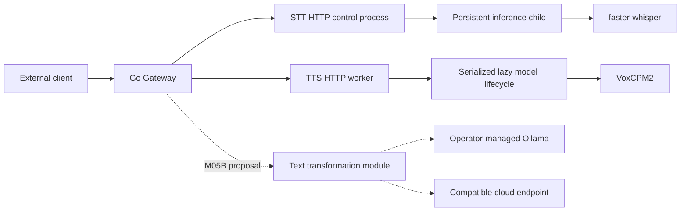

# Part 1 — Executive assessment

**SpeechPlatform has a sound architectural foundation and can continue incrementally. It is not yet ready for unrestricted shared-GPU operation or broader production deployment.**

The component boundaries fit the project: a small Go Gateway, independent Python speech workers, and model lifecycle ownership within each worker. The proposed M05B text module also belongs in Gateway while it performs outbound HTTP integration. Another service or generalized workflow engine would add little value.

The strongest aspects are:

- Provider details stay behind public contracts.
- STT has explicit admission, memory accounting, model identity, and failure handling.
- Speech workers have separate private networks and independently pinned dependencies.
- Models are provisioned separately from runtime.
- SSML support is deliberately narrow and bounded.
- Milestone records often distinguish technical success from production qualification.

The principal weaknesses are **incomplete execution-lifecycle guarantees, insufficiently established resource coexistence, and divergence between the current product and its verification/operational tooling**.

The largest unnecessary complexity is in the historical deployment machinery. ADR 0018 correctly removed generations and restoration snapshots from ordinary installation, but the repository still maintains overlapping build, publication, configuration, and operational paths.

**No Critical finding was established.** The findings below contain four High, seven Medium, and one Low issue. Some are confirmed defects; others are explicitly unverified assumptions rather than claims of observed production failure.

### Review evidence and limits

Reviewed state: commit `a5d22ab`, including the existing modified/untracked M05/M05B planning documents. No files were edited, no commits created, and no running services changed.

**OBSERVED — verification performed:**

| Command/check | Result |
|---|---|
| `go test -race ./...` | Passed; Go reported cached package results |
| `PYTHONDONTWRITEBYTECODE=1 .venv/bin/python -m unittest discover -s services/stt/tests -p 'test_*.py' -q` | 64 tests passed |
| `PYTHONDONTWRITEBYTECODE=1 .venv/bin/python -m unittest services.tts.tests.test_tts -q` | 22 tests passed |
| Selected product deployment, Compose, and acceptance suites | 18 tests passed |
| Selected publication, release, artifacts, and M05A evaluation suites | 63 tests passed with `PYTHONPATH=scripts:.` |
| OpenAPI validation using `openapi_spec_validator` | All three documents passed |
| `git diff --check` | Passed |
| Synthetic lifecycle, HTTP timeout, and deployment-guard probes | Reproduced findings described below |

The first invocation of the publication tests failed with `ModuleNotFoundError: publish_images`; the corrected import-path invocation passed. Publication/provider calls in those tests were mocked.

Environment: Go 1.24.0 and Python 3.12.3. These results do not qualify the different toolchain versions named in CI.

**NOT ESTABLISHED:** full `make verify`, container builds, deployment/rollback execution, current live topology, native CUDA failure behavior, sustained capacity, cloud-provider compatibility, or independent linguistic validation. Historical live results are attributed to repository records, not presented as new measurements.

# Part 2 — Architecture reconstruction

### Implemented system

| Component | Actual responsibility |
|---|---|
| Gateway | Optional bearer authentication, public validation, body limits, four shared speech request slots, worker HTTP calls, response forwarding |
| STT control process | Multipart parsing, upload accounting, FIFO admission, lifecycle/readiness, metrics |
| STT inference child | Audio decoding, resident model, native inference, cooperative cancellation checkpoints |
| TTS worker | JSON validation, one inference slot, lazy loading, idle unloading, SSML processing and WAV composition |
| Deployment tools | Model verification/provisioning, Compose operations, image builds and historical publication/recovery workflows |
| M05A scripts | Evaluation tools; not production adapters |
| M05B | Proposed configuration, API, provider adapters and acceptance procedure; **not implemented** |

The actual Go application is small: configuration, Gateway handlers, a transport helper, and process composition. There is no substantial business-logic layer or speculative framework. See `cmd/gateway/main.go` and `internal/gateway/handler.go`.

### Audio → STT → text

1. Gateway authenticates, acquires a shared request slot, and buffers the bounded multipart request.
2. It forwards the body and timeout header to STT.
3. STT validates multipart fields and obtains an upload lease.
4. The application resolves the configured alias and submits work to bounded admission.
5. The supervisor sends the audio to its persistent child.
6. The adapter decodes into bounded audio storage and transcribes.
7. STT validates the result and returns raw transcription plus output-language metadata.

References: `services/stt/http_server.py`, `services/stt/application.py`, `services/stt/supervisor.py`, `services/stt/backends/faster_whisper.py`.

Translation exists as an optional second native Whisper operation for a translation-enabled model. **The canonical large-v3-turbo configuration disables it.** An unsupported translation request returns an error; the response is not a successful partial result containing the transcription.

There is no implemented STT-to-LLM pipeline.

### Text → TTS → audio

1. Gateway validates text, voice, language hint, mode, and input format.
2. TTS validates the request again and acquires its single inference slot.
3. The lifecycle loads VoxCPM2 if necessary.
4. Plain text produces one generation call.
5. SSML produces ordered speech/silence segments; the worker composes one WAV only after all segments succeed.
6. Idle unloading releases the model after the configured interval.

References: `services/tts/server.py`, `services/tts/lifecycle.py`, `services/tts/ssml.py`.

There is no implemented transformation-before-TTS stage. Clients must currently compose operations themselves.

### Proposed text transformation

M05B proposes one direct text operation, one small generation interface, and two protocol adapters. A single attempt combines style, formatting, and translation. Fallback always starts from the original input, rather than repeatedly rewriting generated output.

The proposal correctly includes:

- Exact raw passthrough.
- Explicit model selection without substitution.
- Ordered, bounded automatic fallback.
- Cloud permission that requests can tighten.
- Provider-scoped suppression for unknown/provider-wide rate limits.
- Separate text admission and shutdown cancellation.
- No silent truncation or successful raw-text replacement after generation failure.

This abstraction is sufficiently generic for the two proposed protocols. Provider-specific settings belong in adapter configuration; their presence there is appropriate. Additional protocols will require explicit extensions rather than an unrestricted parameter map.

### Meaning preservation

**Meaning preservation is not established.** M05A records material semantic failures for all three retained candidates, including altered commitments, invented actions, language changes, and identifier concerns.

M05B’s response metadata identifies generation and fallback provenance. It cannot distinguish semantically correct output from plausible but incorrect output. HTTP 200 will mean a structurally valid completion, including outputs with unsatisfactory meaning under the proposed policy.

That is acceptable only within the explicitly accepted user-review scope. It does not justify an unattended transformation-to-TTS or automatic-send workflow. A semantic checking agent would not provide a correctness guarantee and is not warranted here.

# Part 3 — Findings

## ARCH-001 — STT explicit shutdown can wait indefinitely behind active inference

**High · Confirmed defect · STT supervisor and shutdown**

**Evidence:** `InferenceSupervisor.transcribe()` holds `_lock` throughout its response-polling loop. `shutdown()` must acquire the same lock before reaching its bounded termination logic. See `services/stt/supervisor.py` around `transcribe()` and `shutdown()`.

Admission shutdown waits twice for the drain interval before calling supervisor shutdown through the application. See `services/stt/admission.py` and `services/stt/application.py`.

**OBSERVED:** With the existing fake backend configured to ignore cancellation for 0.8 seconds, `shutdown(0.03)` took approximately **0.739 seconds**, despite a 0.03-second process-exit setting.

**Consequence:** A genuinely stuck native call prevents explicit shutdown from reaching terminate/kill/reap. Container shutdown may eventually force termination, but that does not establish the application’s advertised bounded cleanup. ADR 0019 explicitly retains bounded cleanup for explicit shutdown.

**Minimal correction:** Preserve single-flight IPC ownership, but make explicit shutdown signaling and bounded process termination reachable without waiting for the inference-held lock. Add a regression using an active uncooperative child.

**Timing:** Before M05B live cancellation/coexistence qualification and before production. Offline text implementation need not wait.

## ARCH-002 — Speech deadlines do not have consistent end-to-end behavior

**High · Confirmed defect · Gateway, STT admission, TTS**

**Evidence:**

- Gateway gives upstream clients `timeout + 5s` and maps transport errors to 503, including timeout errors.
- TTS never reads the required `X-Request-Timeout-Ms` header.
- STT admission keeps waiting for active completion after cancellation.
- Public documentation promises 504 on deadline exhaustion.

**OBSERVED:** A synthetic TTS request with a **1 ms** timeout returned **200 after approximately 146 ms**.

**Consequence:** Clients receive different outcomes depending on where time expires. TTS can continue generating subsequent SSML segments after the caller has gone away, retaining scarce capacity for work that can no longer be delivered.

**Minimal correction:** Establish one request deadline, distinguish timeout from worker unavailability, and consume the remaining budget at worker boundaries. Preserve the deliberate prohibition on interrupting native TTS mid-call, but check cancellation/deadline before loading and between segments. Separate STT caller completion from continued ownership of active cleanup.

**Timing:** Before broader deployment; resolve before claiming M05B end-to-end cancellation guarantees.

## ARCH-003 — GPU installation guard counts devices instead of processes

**High · Confirmed defect · Product deployment**

**Evidence:** The process query returns `gpu_uuid,pid`, but `checks()` retains only UUIDs in a set and compares that set’s size with an allowed process count. Existing project ownership permits one entry when STT and TTS share a GPU.

**OBSERVED:** A mocked query containing three distinct PIDs on one selected GPU passed `require_idle_gpu=True` and reported a count of one.

**Consequence:** Reinstallation can pass the “only existing canonical STT” safeguard while Ollama or other workloads occupy the same GPU. The guard also never establishes that the permitted process actually belongs to STT.

**Minimal correction:** Retain `(GPU UUID, PID)` records and verify any exemption against the actual canonical STT container/process. Reject unidentified occupants. Test multiple PIDs on one GPU and a foreign singleton.

**Timing:** Before the next shared-host installation using this guard, including applicable M05B deployment work.

## ARCH-004 — Local LLM and speech coexistence remains unqualified

**High · Unverified assumption · STT, TTS, Ollama integration**

**Evidence:** M05B records **6,400 MiB free** during local Qwen work, while TTS requires **8,000 MiB before loading**. The factory enforces that threshold.

A single Gateway text slot bounds submissions, not inference continuing remotely after cancellation or requests from other Ollama clients.

**Consequence:** Depending on allocation order, TTS may reject loading, local generation may fail, or speech latency may deteriorate. Sequential smoke tests cannot establish coexistence.

Also, `STT_GPU_MEMORY_LIMIT` and `TTS_GPU_MEMORY_LIMIT` configure Compose `mem_limit`: these are container memory limits, not VRAM reservations. See Docker resource documentation: https://docs.docker.com/engine/containers/resource_constraints/.

**Minimal correction:** Preserve M05B’s existing qualification matrix and default-disabled local production policy. Measure both allocation orders, actual overlap, post-cancellation residency, and subsequent recovery. Rename misleading memory settings when compatibility permits.

**Timing:** Before local M05B production enablement. This is not a reason to block offline implementation or qualified cloud-only operation.

## ARCH-005 — TTS readiness remains successful after permanent load failure

**Medium · Confirmed defect · TTS health and recovery**

**Evidence:** `ready()` checks only `_stopping`. Model-load failures return to `unloaded`; they do not affect readiness.

**OBSERVED:** An injected missing-artifact failure produced `model_load_failed`, followed by `ready=True`.

**Consequence:** A worker with missing or invalid artifacts can remain ready indefinitely while every synthesis fails. Lazy loading explains readiness before first use; it does not justify continuing to advertise readiness after a known permanent failure.

**Minimal correction:** Distinguish normal unloaded state, transient resource rejection, and known configuration/artifact failure. Perform inexpensive artifact-availability checks without loading the model. Keep retries possible for genuinely transient shortages.

**Timing:** Before broader deployment. Retain lazy loading.

## ARCH-006 — Startup dependencies couple otherwise independent capabilities

**Medium · Architectural risk · Compose and Gateway readiness**

**Evidence:** Gateway startup requires both speech services to become healthy. Its readiness aggregates both workers. M05B says direct text works without STT or TTS.

**Consequence:** A failed STT startup can prevent Gateway from starting, making healthy TTS—and future cloud text transformation—unreachable. At runtime, an aggregate 503 can also cause a reverse proxy to withdraw otherwise functioning routes.

Docker explicitly waits for dependencies declared `service_healthy`: https://docs.docker.com/compose/how-tos/startup-order/.

**Minimal correction:** Allow Gateway to start and report per-route worker failures. Preserve aggregate readiness if useful, but document its meaning and provide capability-specific availability without requiring every capability for every route.

**Timing:** Resolve the intended behavior before M05B deployment; no service decomposition is needed.

## ARCH-007 — Normal verification excludes TTS behavioral tests

**Medium · Confirmed defect · Make and CI**

**Evidence:** `make test` discovers script tests and STT tests, but never `services/tts/tests`. CI runs `make verify`, which inherits that omission.

The omitted suite covers SSML parsing/composition, lifecycle, admission, and disconnect behavior. It passed separately in this review.

**Consequence:** TTS regressions can pass the normal verification gate. M05B’s manual instruction to run the suite separately acknowledges the gap but leaves it in place.

**Minimal correction:** Include the existing TTS suite in the canonical test target. Add focused regressions for ARCH-001/002/003/005; avoid duplicating implementation details in tests.

**Timing:** Before M05B implementation verification is accepted.

## ARCH-008 — TTS build and publication use different product identities

**Medium · Confirmed defect · Release tooling**

**Evidence:**

- `make image SERVICE=tts` builds the root Compose VoxCPM2 image.
- The publisher still declares TTS as `voiceservice-tts-health-only`, role `tts-health-only`, variant `health-only`.
- Publication resolves image references from the historical Compose definition.

**Consequence:** On a clean environment, publication can build the new TTS image and then inspect a different, absent historical image. If an old image exists, revision validation should reject it. The path does not publish the newly built inference image coherently.

Passing mocked publication tests does not establish this cross-file integration.

**Minimal correction:** Align the build source, resolved image reference, role, variant, and package for current TTS. Keep historical release records immutable. Add a test comparing the selected build and publication definitions.

**Timing:** Before the next TTS/all-service image publication. It need not block Gateway-only M05B development.

## ARCH-009 — Operational diagnostics are materially weaker than failure handling

**Medium · Architectural risk · Gateway, TTS, STT startup, operator commands**

**Evidence:**

- Gateway exposes only aggregate readiness metrics.
- TTS suppresses HTTP logging and has no request metrics route.
- Deferred STT startup catches exceptions and only changes lifecycle state.
- `status` and `logs` call `checks()`, which still runs application configuration commands.

**Consequence:** Operators cannot readily distinguish cold loading, overload, inference failure, and transport failure. A broken current configuration or missing development tool can obstruct the convenience command intended to inspect logs.

**Minimal correction:** Add bounded outcome/duration/inflight metrics and sanitized lifecycle failure categories. Let status/log retrieval operate without validating a proposed application configuration. STT’s existing metrics provide a usable pattern.

**Timing:** Before broader deployment. No observability platform is required.

## ARCH-010 — Gateway admission is not reconciled with its memory limit

**Medium · Architectural risk · Gateway buffering and Compose**

**Evidence:** Gateway permits four shared speech requests and buffers full STT requests and full TTS responses. TTS responses may each reach 64 MiB; the container limit is 256 MiB.

**Consequence:** Four slow clients retaining maximum-sized TTS response buffers account for the entire container limit before runtime overhead and allocation growth. The single TTS inference slot does not prevent completed responses from accumulating in Gateway.

**NOT ESTABLISHED:** An actual OOM under production audio sizes; no memory-load experiment was run.

**Minimal correction:** Qualify the maximum admitted workload against the container budget. Initially reduce/configure response concurrency or introduce a small byte budget. Keep whole-response buffering if needed to preserve all-or-nothing response semantics.

**Timing:** Before broader deployment or increased request limits.

## ARCH-011 — Proposed local context admission has a very small usable input envelope

**Medium · Unverified assumption · M05B prompt and model configuration**

**Evidence:** The proposal reserves 512 tokens for overhead and 1,024 for output in a 4,096-token context, using complete UTF-8 byte length as a conservative token bound. It proposes reusing M05A v2’s preservation rules.

**OBSERVED:** Extracting the existing v2 system prompt yields 2,209 bytes. With a 71-byte empty mapped user message, the example leaves approximately **280 bytes for ordinary input**, before escaping expansion. Under this calculation, 38 of the 39 original synthetic cases fit.

**Consequence:** Short benchmark cases can pass while ordinary paragraphs fail, particularly Cyrillic text. A 10,000-byte API ceiling can obscure the much smaller local generation envelope. Separately, the tokenizer/template assumptions remain unqualified.

**Minimal correction:** Calculate and publish usable input limits with the actual production prompt before freezing the API examples. Shorten the prompt carefully or use a justified model-specific counter if necessary. Do not increase GPU context merely to avoid rejection.

**Timing:** Practical budget decision during M05B Stage 1; tokenizer/template qualification before enabling each model live.

## ARCH-012 — Current documentation has conflicting operational status

**Low · Documentation inconsistency · README, runbook, contracts, plans**

**Evidence:**

- README still says fast TTS is unavailable and M03B acceptance is in progress, while the current handler accepts `fast` and `high_quality`.
- The general runbook still describes foundation-only behavior and deferred authentication.
- M05B says M05A closeout remains pending, while M05A’s result says complete.
- Internal TTS readiness documentation says the model is loaded, contrary to accepted lazy readiness.

**Consequence:** A maintainer must reconstruct current behavior from milestone history and implementation. Documentation-based validation can approve obsolete assumptions.

**Minimal correction:** Update current entry-point documentation and cross-reference superseding decisions. Preserve historical evidence as historical.

**Timing:** Reconcile M05B’s gate status before its next authorization decision; remaining updates can accompany the relevant fixes.

# Part 4 — Simplicity assessment

**The runtime architecture is appropriately small. The supporting repository is more complicated than its current operating needs.**

| Area | Recommendation |
|---|---|
| Historical deployment generations/snapshots | Freeze their scope and keep them clearly optional. Do not extend them for M05B. ADR 0018 already supplies the right direction. |
| Multiple build/publication definitions | Align current product identities and isolate historical definitions; ARCH-008 shows a concrete consequence of divergence. |
| Gateway handlers | Separate STT, TTS, and future text handlers into cohesive files/modules. Share only demonstrated mechanics such as authentication and bounded upstream error handling. |
| Worker lifecycle abstractions | Preserve different STT and TTS strategies. Their native execution characteristics justify differences; a common lifecycle framework would conceal them. |
| Configuration | Distinguish fixed public contract ceilings from configurable operating limits. Avoid duplicating operational values in Gateway, worker configuration, and deployment scripts. |
| M05B selection policy | Ordered lists and a small provider interface are sufficient. The additional stable locality policies are manageable, but further scoring or retry-policy layers have no demonstrated need. |
| Shared Python utilities | Extract neutral configuration/artifact utilities only when current cross-package imports obstruct maintenance. Do not create a general platform framework. |
| Dependencies | No unjustified runtime framework was found. Keep evaluation dependencies out of production. Preserve separate inference dependency locks. |

The old deployment machinery represents thousands of lines across deployment profiles, state, adoption, snapshots, and recovery. That is a maintenance burden, but wholesale deletion is unnecessary and would discard accepted historical work. Clear isolation is the smaller correction.

Preserve private networks, immutable artifacts, bounded admission, explicit dependencies, original-text retention, the narrow SSML subset, and Git + Compose operations.

# Part 5 — Architectural contradictions

| Intended/documented property | Actual evidence | Assessment |
|---|---|---|
| Explicit STT shutdown remains bounded | Shutdown waits for the inference-held lock | Confirmed mismatch; ARCH-001 |
| Deadlines produce consistent 504 behavior | TTS ignores its timeout header; Gateway maps transport timeout to 503 | Confirmed mismatch; ARCH-002 |
| Installation allows only the existing STT GPU occupant | Guard counts UUIDs and does not verify process ownership | Confirmed mismatch; ARCH-003 |
| Independent service availability | Gateway startup waits for both workers | Deployment coupling; ARCH-006 |
| Canonical verification protects current behavior | TTS behavioral tests are omitted | Verification gap; ARCH-007 |
| Current TTS image can follow the release path | Builder selects inference TTS; publisher selects health-only TTS | Release integration mismatch; ARCH-008 |
| M05A closeout status is settled | M05A and M05B current records disagree | Documentation drift; ARCH-012 |

Several apparent contradictions are **intentional and should remain**:

- STT native translation and future LLM translation can coexist. They have different capability scopes; preserve the existing STT contract.
- TTS can be ready while unloaded. The defect is readiness after a known permanent failure.
- M05A completion does not imply semantic correctness or production readiness.
- Historical milestone completion does not establish that the current running deployment contains those changes.
- Public and internal OpenAPI documents need not be identical, but each must accurately describe its own boundary.

# Part 6 — Prioritized remediation roadmap

### 1. Must address before continuing M05B through its relevant gates

For **offline implementation and acceptance**:

1. Reconcile M05A/M05B status without changing historical decisions.
2. Establish the practical input envelope using the intended production prompt.
3. Include the existing TTS suite in normal verification.
4. Decide how direct text availability interacts with Gateway startup and aggregate readiness.
5. Preserve the proposal’s separate text cancellation lifetime. Existing Gateway shutdown alone does not supply that cancellation; Go’s shutdown waits for active connections to become idle. See https://pkg.go.dev/net/http#Server.Shutdown.

For **live qualification and local enablement**:

1. Correct the GPU occupant guard wherever the deployment path uses it.
2. Resolve STT bounded shutdown and speech deadline handling.
3. Execute the existing coexistence and remote-unload matrix.
4. Qualify actual container-to-Ollama connectivity and cloud DNS/TLS using the production Go transport.
5. Qualify tokenizer/template bounds and provider options.
6. Keep unqualified local models disabled or adopt an explicit restricted operating policy.

These are stage-specific gates. Unresolved GPU qualification does not require stopping all offline M05B development.

### 2. Should address before broader deployment

- Correct TTS permanent-failure readiness.
- Remove unnecessary startup availability coupling.
- Establish Gateway memory headroom under maximum admitted requests.
- Add minimal request/lifecycle diagnostics and make logs accessible during configuration failure.
- Repair TTS publication before using that release path.
- Qualify actual non-loopback authentication and TLS exposure.

The default loopback/private-network posture is reasonable. However, non-loopback policy is enforced in the installation helper, while Gateway accepts an empty token. Direct Compose operation must not be assumed to reproduce that helper’s checks. See `scripts/product_deployment.py` and `internal/config/config.go`.

### 3. Can be deferred

- Reorganizing historical deployment tooling.
- Further Gateway file decomposition.
- Extracting shared neutral Python utilities.
- Adding another speech backend or provider protocol until one is actually selected.
- Streaming, richer SSML, combined speech/text routes, and dynamic model catalogs.
- Stronger reproducible-build guarantees beyond the current pinned inputs; retain known-good image identities for dependable rollback.

### 4. No action recommended

- No Kubernetes, broker, cache service, service mesh, or workflow engine.
- No additional text worker for simple HTTP provider integration.
- No generic provider SDK framework.
- No automatic model eviction across shared services.
- No automatic semantic retries or checking-agent pipeline.
- No replacement of stable public aliases with engine-native identifiers.
- No broad rewrite of STT admission or worker boundaries.

# Part 7 — Final verdict

1. **Is the current architecture fundamentally sound?**
   **Yes.** The boundaries and deployment model fit a self-hosted platform maintained by one developer. Several reliability guarantees need correction.

2. **Can development continue incrementally?**
   **Yes.** The findings support small, independently verifiable changes. A rewrite would increase risk.

3. **What are the three most important weaknesses?**
   - Cancellation, deadlines, and explicit shutdown do not consistently bound work and recovery.
   - Shared-GPU coexistence remains unqualified, and one deployment safeguard is defective.
   - Verification and operational tooling have diverged from the current product, especially TTS.

4. **What should deliberately remain unchanged?**
   Independent speech workers, Gateway-owned public contracts, worker-owned native lifecycle, private networking, bounded execution, immutable model provisioning, original-text preservation, the narrow SSML subset, and Git + Compose operations.

5. **Is it unnecessarily complicated for its purpose?**
   **The runtime is not. The accumulated deployment and documentation machinery is.** Keep M05B small, consolidate current operational paths, and avoid extending historical machinery into new features.
